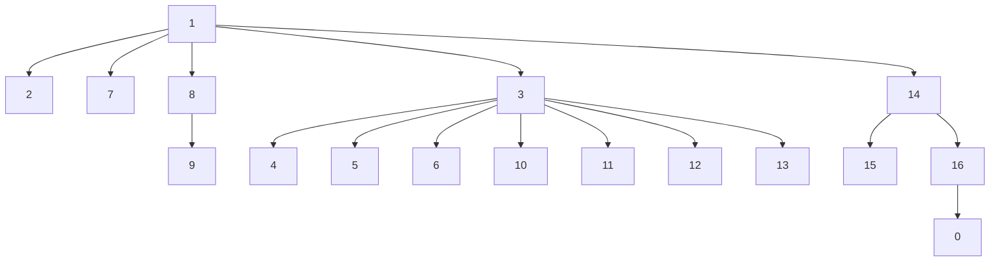
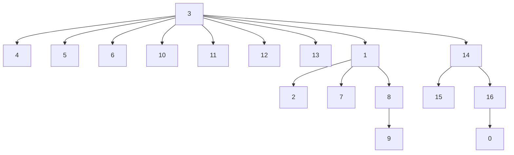
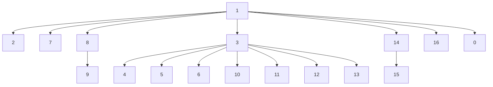
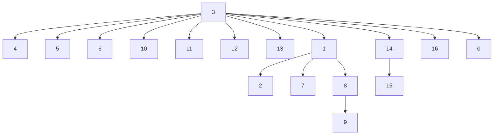

# 数据结构第七次作业

## 题目概要

Textbook exercises 8.1, 8.2

## Exercise 8.1

Show the result of the following sequence of instructions: union(1,2), union(3,4), union(3,5), union(1,7), union(3,6), union(8,9), union(1,8), union(3,10), union(3,11), union(3,12), union(3,13), union(14,15), union(16,0), union(14,16), union(1,3), union(1,14) when the unions are

a. performed arbitrarily

b. performed by height

c. performed by size

### Answer

初始时，0 到 16 各自构成一个集合。每次 `union(x, y)` 先找到两个元素所在集合的根，再合并这两个根，8.1 中不进行路径压缩

a 中统一把第二个集合的根挂到第一个集合的根下面；b、c 中如果高度或大小相同，也保留第一个集合的根

下面的 $u\to v$ 表示把根 $u$ 挂到根 $v$ 下面，也就是令 `parent[u] = v`

| 操作 | a. arbitrarily | b. by height | c. by size |
| --- | --- | --- | --- |
| union(1,2) | $2\to1$ | $2\to1$ | $2\to1$ |
| union(3,4) | $4\to3$ | $4\to3$ | $4\to3$ |
| union(3,5) | $5\to3$ | $5\to3$ | $5\to3$ |
| union(1,7) | $7\to1$ | $7\to1$ | $7\to1$ |
| union(3,6) | $6\to3$ | $6\to3$ | $6\to3$ |
| union(8,9) | $9\to8$ | $9\to8$ | $9\to8$ |
| union(1,8) | $8\to1$ | $8\to1$ | $8\to1$ |
| union(3,10) | $10\to3$ | $10\to3$ | $10\to3$ |
| union(3,11) | $11\to3$ | $11\to3$ | $11\to3$ |
| union(3,12) | $12\to3$ | $12\to3$ | $12\to3$ |
| union(3,13) | $13\to3$ | $13\to3$ | $13\to3$ |
| union(14,15) | $15\to14$ | $15\to14$ | $15\to14$ |
| union(16,0) | $0\to16$ | $0\to16$ | $0\to16$ |
| union(14,16) | $16\to14$ | $16\to14$ | $16\to14$ |
| union(1,3) | $3\to1$ | $3\to1$ | $1\to3$ |
| union(1,14) | $14\to1$ | $14\to1$ | $14\to3$ |

### Answer a. performed arbitrarily

每次把第二个集合的根挂到第一个集合的根下面，最终根为 1，树高为 3

图中的连线从父结点指向子结点



### Answer b. performed by height

把高度较小的树挂到高度较大的树下面，高度相同时保留第一个根，并使树高增加 1

执行 `union(1,3)` 前，以 1 为根的树高为 2，以 3 为根的树高为 1，所以把 3 挂到 1 下面，树高仍为 2

执行 `union(1,14)` 时，两棵树的高度都是 2，所以把 14 挂到 1 下面，树高增加到 3

最终结构与 a 相同：


### Answer c. performed by size

把结点较少的树挂到结点较多的树下面，大小相同时保留第一个根

执行 `union(1,3)` 前，以 1 为根的集合有 5 个元素，以 3 为根的集合有 8 个元素，所以把 1 挂到 3 下面，合并后的集合大小为 13

最后执行 `union(1,14)` 时，1 所在集合的根已经是 3，而以 14 为根的集合大小为 4，所以把 14 挂到 3 下面

最终根为 3，集合大小为 17，树高为 3：



## Exercise 8.2

For each of the trees in the previous exercise, perform a find with path compression on the deepest node.

### Answer a. performed arbitrarily

最深结点是 0，深度为 3，执行 `find(0)` 时经过的路径为：

```text
0 → 16 → 14 → 1
```

找到根 1 后，把路径上的结点直接挂到 1 下面，也就是把 0 和 16 的父结点改为 1，14 原本就直接连接根

路径压缩后的树为：



`find(0)` 返回 1，压缩后 0 的深度为 1，整棵树的高度为 2

### Answer b. performed by height

b 的树与 a 相同，最深结点也是 0，所以同样执行 `find(0)`：

```text
0 → 16 → 14 → 1
```

把 0 和 16 的父结点改为 1，路径压缩后的树为：


`find(0)` 返回 1，整棵树的实际高度变为 2。按教材的实现，路径压缩不更新根的 rank，因此根 1 保存的 rank 仍为 3，对应数组值 `s[1] = -4`

### Answer c. performed by size

c 中最深的结点有 0 和 9，深度都是 3。这里选择 0，执行一次 `find(0)`，经过的路径为：

```text
0 → 16 → 14 → 3
```

找到根 3 后，把 0 和 16 的父结点改为 3，14 原本就直接连接根

路径压缩后的树为：



`find(0)` 返回 3，压缩后 0 的深度变为 1，但 9 的路径仍为 `9 → 8 → 1 → 3`，所以整棵树的高度仍为 3

路径压缩不改变集合大小，根 3 保存的大小仍为 17，对应数组值 `s[3] = -17`
