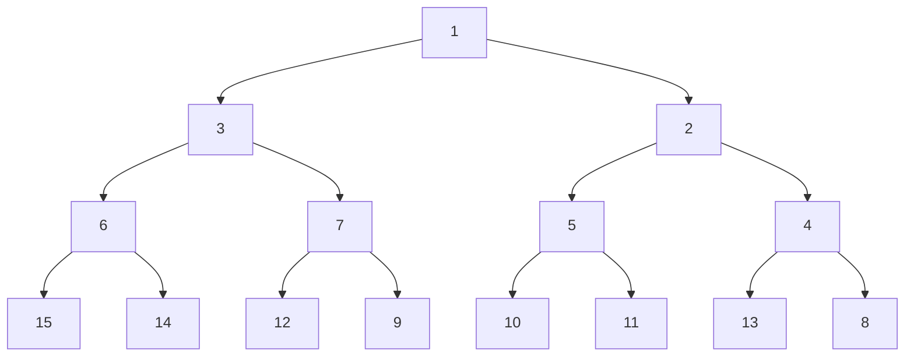
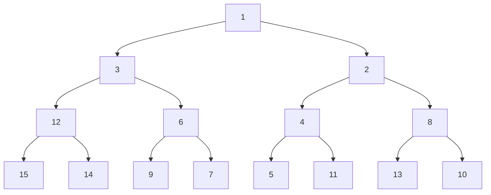
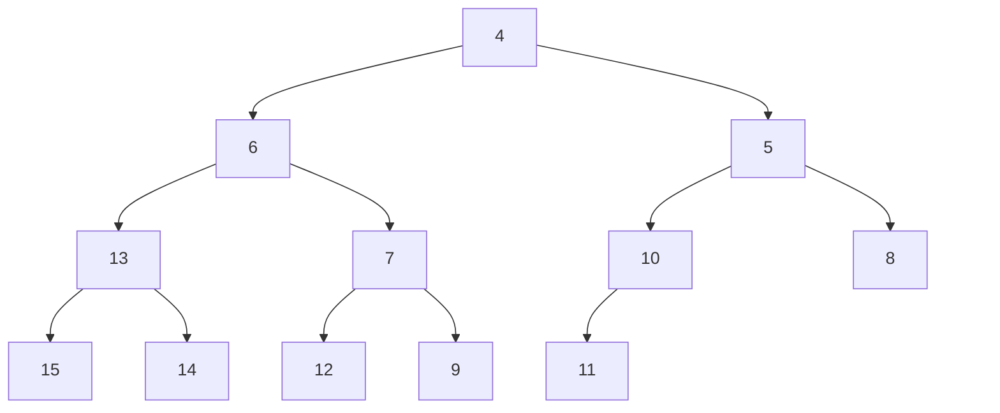
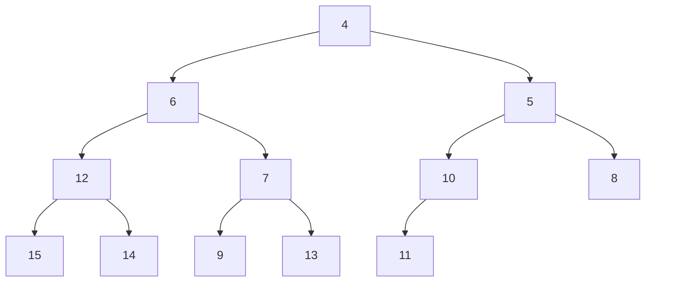

# 数据结构第五次作业

## 题目概要

哈希表作业：Exercise 5.1, 5.8

堆作业：Exercise 6.2, 6.3, 6.4

# 哈希表作业

## Exercise 5.1

Given input {4371, 1323, 6173, 4199, 4344, 9679, 1989} and a hash function

h(x) = x (mod () 10), show the resulting

a. separate chaining hash table

b. hash table using linear probing

c. hash table using quadratic probing

d. hash table with second hash function h2(x) = 7 − (x mod 7)

### Answer a. Chaining hash table

这个哈希函数是 $h(x) = x \mod 10$ 所以只看个位数就行了

| 槽位 | 链表 |
| --- | --- |
| 0 | 空 |
| 1 | 4371 |
| 2 | 空 |
| 3 | 1323 -> 6173 |
| 4 | 4344 |
| 5 | 空 |
| 6 | 空 |
| 7 | 空 |
| 8 | 空 |
| 9 | 4199 -> 9679 -> 1989 |

### Answer b. linear probing

| 槽位 | 元素 |
| --- | --- |
| 0 | 9679 |
| 1 | 4371 |
| 2 | 1989 |
| 3 | 1323 |
| 4 | 6173 |
| 5 | 4344 |
| 6 | 空 |
| 7 | 空 |
| 8 | 空 |
| 9 | 4199 |

### Answer c. quadratic probing

| 槽位 | 元素 |
| --- | --- |
| 0 | 9679 |
| 1 | 4371 |
| 2 | 空 |
| 3 | 1323 |
| 4 | 6173 |
| 5 | 4344 |
| 6 | 空 |
| 7 | 空 |
| 8 | 1989 |
| 9 | 4199 |

### Answer d. double hashing

第二哈希函数 $h_2(x) = 7-(x\mod 7)$

探测公式就是 $(h(x) + ih_2(x))\mod10$

这个 $1989$ 的 $h = 9$ , $h_2 = 6$，探测序列应当是 9， 5， 1， 7， 3， 9... 但是都满了所以无法插入

| 槽位 | 元素 |
| --- | --- |
| 0 | 空 |
| 1 | 4371 |
| 2 | 空 |
| 3 | 1323 |
| 4 | 6173 |
| 5 | 9679 |
| 6 | 空 |
| 7 | 4344 |
| 8 | 空 |
| 9 | 4199 |

## Exercise 5.8

Suppose instead of quadratic probing, we use “cubic probing”; here the ith probe is at hash(x)+i^3. Does cubic probing improve on quadratic probing?

### Answer

没啥用，$h(x) + i^3$ 只是对于 $m = p$ 是素数且 $\gcd(3,p-1)=1$ 也就是 $p≡2( \mod 3)$ 的时候，三次探测可以遍历整个表

但是在其他条件下，效果反而会差一点，例如取 $m = 7$，$i^3\mod 7=\{0,1,6\}$ 而 $i^2\mod 7 = \{0,1,2,4\}$

# 堆作业

## Exercise 6.2

a. Show the result of inserting 10, 12, 1, 14, 6, 5, 8, 15, 3, 9, 7, 4, 11, 13, and 2,one at a time, into an initially empty binary heap.

b. Show the result of using the linear-time algorithm to build a binary heap using the same input.

### Answer a

### Answer b

## Exercise 6.3

Show the result of performing three deleteMin operations in the heap of the previous exercise.

### Answer prev a

### Answer prev b

## Exercise 6.4

AcompletebinarytreeofN elements uses array positions 1 to N. Suppose we try to use an array representation of a binary tree that is not complete. Determine how large the array must be for the following:

a. a binary tree that has two extra levels (that is, it is very slightly unbalanced)

b. a binary tree that has a deepest node at depth 2logN

c. a binary tree that has a deepest node at depth 4.1logN

d. the worst-case binary tree

### Answer a. 2 ex level

设 $k=\lfloor \log N\rfloor$。完全二叉树有 $N$ 个结点时，最深深度约为 $k$。多两层后：

$$
d=k+2
$$

所需数组大小为：

$$
M=2^{d+1}-1=2^{k+3}-1
$$

所以大约在：

$$
4N < M < 8N
$$

### Answer b. depth 2logN

最大下标为：

$$
M=2^{2\log N+1}-1
$$

因为 $2^{2\log N}=N^2$，所以：

$$
M=2N^2-1
$$

### Answer c. depth 4.1logN

最大下标为：

$$
M=2^{4.1\log N+1}-1
$$

即：

$$
M=2N^{4.1}-1
$$

### Answer d. worst case

这个就是链表了，数组下标依次为：

$$
1,\ 3,\ 7,\ 15,\ \dots,\ 2^N-1
$$

因此需要数组大小为：

$$
M=2^N-1
$$
