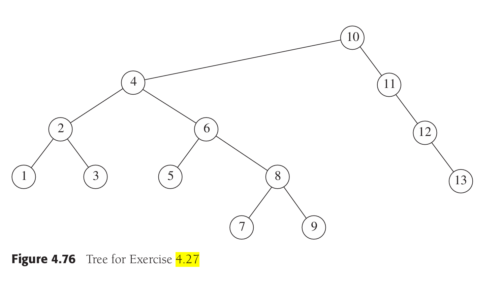
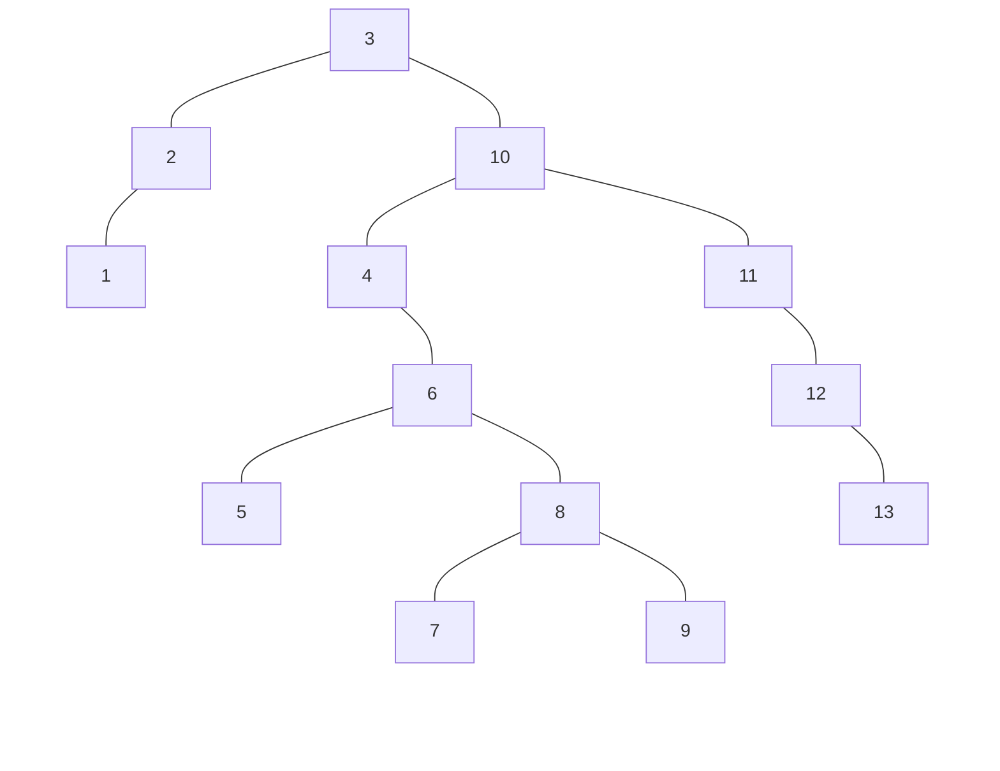
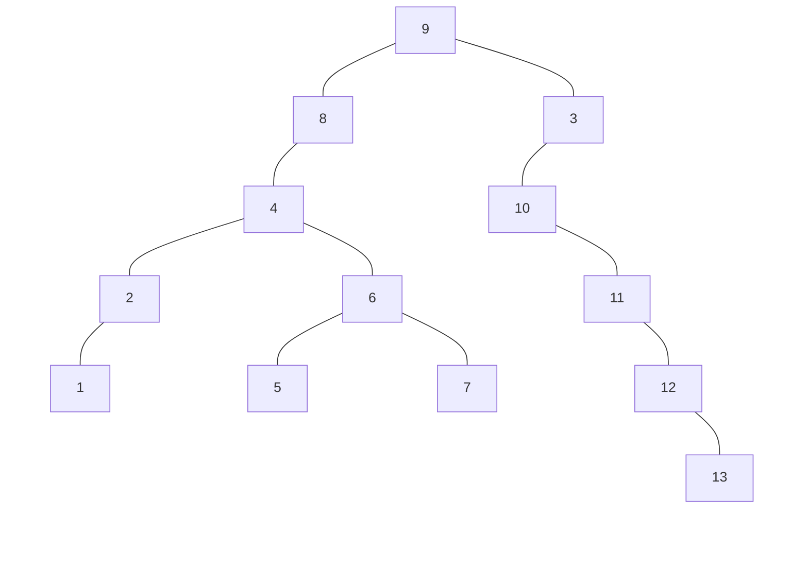
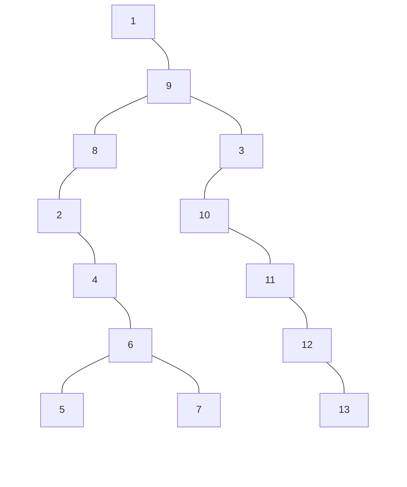
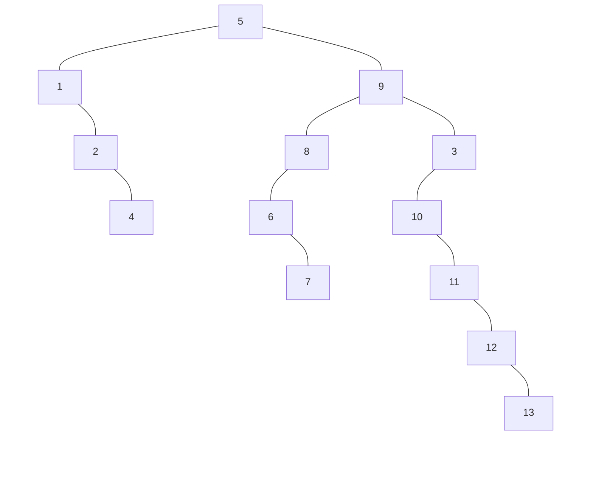
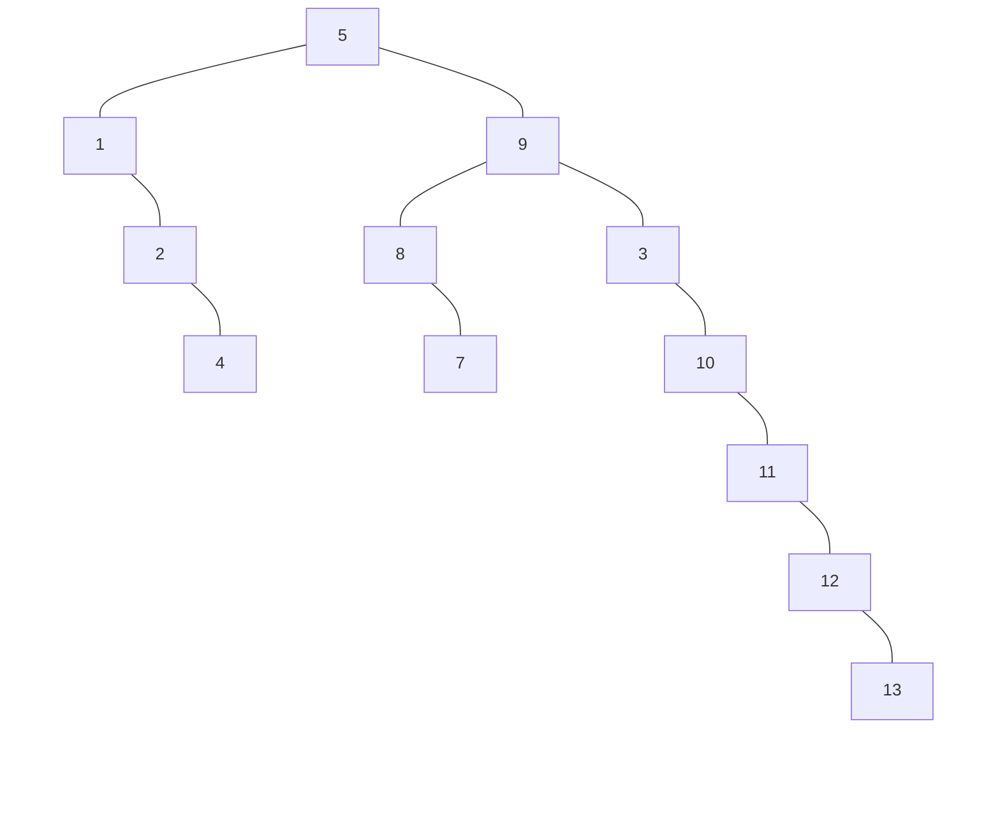
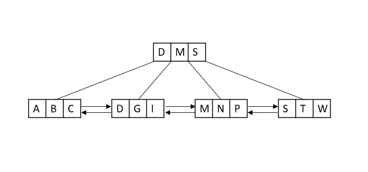
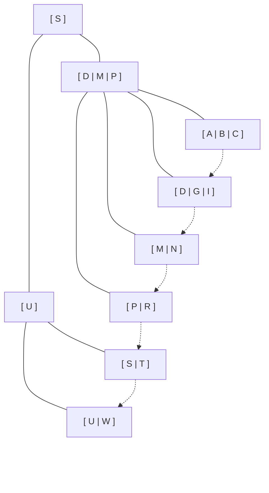

# 数据结构第四次作业

## 题目概要

(1)Textbook exercises 4.27, 4.28

(2)Show the updated B+-Tree with order 4 that results from inserting the records U and R in order.

Assume that the leaf nodes are capable of storing up to 3 records (PPT 最后一页)

## 一、Exercise 4.27

Show the result of accessing the keys 3, 9, 1, 5 in order in the splay tree in Figure 4.76.

### Step 1. accessing key 3

### Step 2. accessing key 9

这个 9 在深层的右侧，先zigzig 6-8-9 再 zigzag 10-8-9 再 zig 3-9 才能把 9 挪到 root

### Step 3. accessing key 1

这个 1 在最左边，zigzig 4-2-1 后 zigzig 8-1-9 即可

### Step 4. accessing key 5

## 二、Exercise 4.28

Show the result of deleting the element with key 6 in the resulting splay tree for the previous exercise.

* 6 的路径为 `右左左` ， 所以应当先zigzig 6-8-9 再 zig 5-6 把 6 旋转到 root
* 随后删除 6 得到两颗子树 $T_L$ $T_R$
* $T_L$ 中最大节点 5 即是 root，将 $T_R$ 连接到新 root 的右侧

## 三、B+ Tree

(2)Show the updated B+-Tree with order 4 that results from inserting the records U and R in order.

Assume that the leaf nodes are capable of storing up to 3 records (PPT 最后一页)

### ANswer

插入 U ：

> U>S ， 进入右侧节点 `[S|T|W]`， 溢出分裂变为 `[S|T] + [U|W]` ， U 被提升为父节点
> 父节点溢出分裂变为 `[D|M] + [U]` ， S 被提升

插入 R ：

> R<S ，R>M ， 进入节点 `[M|N|P]` ，溢出分裂为 `[M|N] + [P|R]`， P 被提升

