# 数据结构

> 先看每章的概念与算法，再动手画过程，最后用文末清单自测；考试前重点看文末的“考试题型（很重要！）”

## 目录

- [0. 课程知识地图](#0-课程知识地图)
- [1. 抽象数据类型与算法分析](#1-抽象数据类型与算法分析)
- [2. 线性表、栈与队列](#2-线性表栈与队列)
- [3. 树与二叉搜索树](#3-树与二叉搜索树)
- [4. AVL 树、伸展树与 B 树](#4-avl-树伸展树与-b-树)
- [5. 查找与哈希表](#5-查找与哈希表)
- [6. 堆与优先队列](#6-堆与优先队列)
- [7. 内部排序与排序下界](#7-内部排序与排序下界)
- [8. 外部排序](#8-外部排序)
- [9. 并查集](#9-并查集)
- [10. 图的表示与遍历](#10-图的表示与遍历)
- [11. 拓扑排序与最短路径](#11-拓扑排序与最短路径)
- [12. 最小生成树](#12-最小生成树)
- [13. 综合速查与复习清单](#13-综合速查与复习清单)
- [考试题型（很重要！）](#考试题型很重要)
- [关键词中英对照表](#关键词中英对照表)

## 0. 课程知识地图

这门课反复解决同一个问题：**为了让某些操作更快，应该怎样组织数据，要付出哪些空间或维护成本？**

| 模块 | 核心内容 | 需要回答的问题 |
| --- | --- | --- |
| 算法分析 | ADT、递归、渐近记号、时间与空间成本 | 操作次数怎样随输入规模增长？ |
| 线性结构 | 顺序表、链表、栈、队列 | 存取位置与插删规则怎样影响效率？ |
| 树 | 遍历、BST、AVL、Splay、B/B+ 树 | 怎样维护有序性与树高？ |
| 查找与哈希 | 二分、哈希函数、冲突处理、重哈希 | 怎样定位关键字，冲突后怎样继续查找？ |
| 堆与优先队列 | 堆序、上滤、下滤、建堆 | 怎样快速取得当前极值？ |
| 排序 | 内部排序、外部排序、稳定性、排序下界 | 怎样兼顾时间、空间与稳定性？ |
| 并查集 | 按大小/秩合并、路径压缩 | 怎样管理动态等价类？ |
| 图 | 存储、遍历、拓扑排序、最短路、最小生成树 | 怎样处理连接、依赖、路径和总成本？ |

**符号约定：** 一般用 $n$ 表示元素数，$h$ 表示树高；图中 $V$ 是顶点集合、$E$ 是边集合，复杂度里的 $V,E$ 简写分别指 $|V|,|E|$。对数未注明时取底数 2；复杂度里固定底数不影响阶。代码片段用于说明核心步骤，不是完整程序

## 1. 抽象数据类型与算法分析

### 1.1 ADT、数据结构、算法的区别

- **ADT（Abstract Data Type）**：规定数据及允许的操作，描述“能做什么”。例如栈提供 `push`、`pop`、`top`
- **数据结构（Data Structure）**：ADT 的具体存储与实现方式，描述“怎么存、怎么做”。同一个栈可以用数组或链表实现
- **算法（Algorithm）**：完成任务的有限步骤。分析算法时关心正确性、时间和空间成本

不能只看结构名字判断快慢，必须明确操作。例如数组随机访问快，链表在已知前驱时插入快；这两句话并不冲突

### 1.2 渐近记号

对最终非负的运行时间函数：

| 记号 | 含义 | 定义要点 |
| --- | --- | --- |
| $T(n)=O(f(n))$ | 渐近上界 | 存在 $c>0,n_0$，当 $n\ge n_0$ 时 $T(n)\le cf(n)$ |
| $T(n)=\Omega(f(n))$ | 渐近下界 | 存在 $c>0,n_0$，当 $n\ge n_0$ 时 $T(n)\ge cf(n)$ |
| $T(n)=\Theta(f(n))$ | 紧确界 | 同时满足上界和下界 |
| $T(n)=o(f(n))$ | 严格更低阶 | 对任意 $c>0$，充分大的 $n$ 都有 $T(n)<cf(n)$ |

例如 $4n^2+3n+6=\Theta(n^2)$，写成 $O(n^3)$ 也成立

常见增长顺序：

$$
1 \prec \log n \prec n \prec n\log n \prec n^2 \prec n^3 \prec 2^n \prec n!
$$

**最佳／平均／最坏情况与上界／下界是两套概念。**前者区分输入，后者描述函数增长。可以说“最坏情况是 $\Theta(n)$”，不能直接把 $O$ 当作最坏情况、把 $\Omega$ 当作最佳情况

### 1.3 复杂度计算方法

1. 确定输入规模与基本操作
2. 写出执行次数的求和式或递推式
3. 化简，保留主导项
4. 标明分析的是哪种情况，以及需要的假设

| 程序结构 | 次数／递推式 | 结果 |
| --- | --- | --- |
| 单循环遍历 $n$ 个元素 | $n$ | $\Theta(n)$ |
| 两层各执行 $n$ 次 | $n^2$ | $\Theta(n^2)$ |
| 内层从 1 到 $i$ | $1+2+\cdots+n$ | $\Theta(n^2)$ |
| 每次把规模减半 | $T(n)=T(n/2)+\Theta(1)$ | $\Theta(\log n)$ |
| 两个半规模子问题，线性合并 | $T(n)=2T(n/2)+\Theta(n)$ | $\Theta(n\log n)$ |
| 每次减 1，当前工作量线性 | $T(n)=T(n-1)+\Theta(n)$ | $\Theta(n^2)$ |

例子：

```text
for k = 1, 2, 4, ..., <= n:
    for j = 1 to n:    // 总次数 Θ(n log n)

for k = 1, 2, 4, ..., <= n:
    for j = 1 to k:    // 总次数 1+2+4+...，为 Θ(n)
```

不能机械地用“两层循环就是平方”，毕竟也会有循环只循环 $\log n$ 的情况。多参数也不能随意合并：统计 $P$ 个像素的 $C$ 种颜色，再对颜色计数排序，成本为 $\Theta(P+C\log C)$

### 1.4 平均分析与摊还分析

- 平均分析：依赖输入概率分布。例如线性查找成功位置等概率，平均比较次数为 $(n+1)/2$
- 摊还分析：研究一整串操作的总成本，不需要假设输入随机。个别操作可以昂贵，但总成本仍有保证

例：动态数组倍增时，某一次扩容需要复制 $\Theta(n)$ 个元素；连续追加的均摊成本可以是 $O(1)$。不能因此说每一次追加的最坏成本都是 $O(1)$

### 1.5 最大连续子序列和

这里的 subsequence 指**连续的一段**

输入 `-2, 11, -4, 13, -5, -2`，最大和为 `20`，对应 `11, -4, 13`

| 解法 | 核心思路 | 时间 |
| --- | --- | --- |
| 三重循环 | 枚举左右端点，每次重新求和 | $O(n^3)$ |
| 二重循环 | 固定左端点，右端点扩展时累计和 | $O(n^2)$ |
| 分治 | 左侧最优、右侧最优、跨中点最优三者取最大 | $O(n\log n)$ |
| 在线扫描 | 维护以当前位置结尾的最优和 | $O(n)$ |

允许空子序列时，全负输入的答案为 0：

```cpp
int best = 0, ending = 0;
for (int x : a) {
    ending = max(0, ending + x);
    best = max(best, ending);
}
```

如果题目要求非空，则应以首元素初始化，使用 `ending=max(x, ending+x)`，全负时返回最大的负数

## 2. 线性表、栈与队列

### 2.1 线性表（List）

线性表是有限、有顺序的元素序列；“有顺序”指位置关系，不表示关键字已经排好序

| 操作／性质 | 顺序表（数组） | 单链表 |
| --- | --- | --- |
| 按下标访问 | $\Theta(1)$ | $\Theta(n)$ |
| 按值查找，无额外索引 | $O(n)$ | $O(n)$ |
| 在指定位置插删 | 最坏 $\Theta(n)$，需要移动元素 | **已知前驱**时 $\Theta(1)$ |
| 查找第 $i$ 个位置后再插删 | 最坏 $\Theta(n)$ | 最坏 $\Theta(n)$ |
| 尾部追加 | 有空位时 $\Theta(1)$ | 有尾指针时 $\Theta(1)$ |
| 前移到前驱 | $\Theta(1)$ | 通常 $\Theta(n)$ |
| 空间特点 | 可能预留未使用容量 | 每个结点有指针开销 |

下面的单链表实现维护 `head`、`tail`、`curr`、`cnt`，其中 **`curr` 指向当前元素的前驱，当前元素是 `curr->next`**，因此插删不必再找前驱

插入核心步骤：

```cpp
curr->next = new Node(x, curr->next);
if (tail == curr) tail = curr->next;
++cnt;
```

删除核心步骤（先保证 `curr->next` 存在）：

```cpp
Node* p = curr->next;
if (tail == p) tail = curr;
curr->next = p->next;
delete p;
--cnt;
```

**易错点：** 改指针之前保留后继；删除尾结点后更新 `tail`；空表和只有一个元素时仍应满足约定；结点删除后不能继续访问

### 2.2 空间比较题

设数组容量为 $D$，实际元素数为 $n$，每个元素大小为 $s$，每个指针大小为 $p$。忽略固定管理字段、内存对齐和分配器开销：

$$
S_{array}=Ds,\qquad S_{linked}=n(s+p)
$$

当 $n<Ds/(s+p)$ 时，单链表更省空间。例如：$D=30,s=2,p=4$，分界为 $n=10$；小于 10 时链表更省，等于 10 时两者相同

### 2.3 栈（Stack）

**LIFO：后进先出** ——插入、删除只发生在栈顶

- `push`：入栈；`pop`：出栈；`top`：读取栈顶
- 数组实现让数组尾部成为栈顶，避免搬移元素
- 链式实现让链表头部成为栈顶，入栈和出栈都为 $\Theta(1)$
- 固定容量数组在不扩容时，基本操作为 $\Theta(1)$；需检查栈空和栈满

常见应用：括号匹配、表达式求值、函数调用与递归。做括号题时，左括号入栈；右括号必须匹配当前栈顶；最后栈应为空

### 2.4 队列（Queue）与循环队列

**FIFO：先进先出** ——队尾入队，队首出队。普通数组若每次出队都整体左移，会付出 $\Theta(n)$；循环数组通过下标取模复用空间

**循环队列实现：`front` 指向首元素，`rear` 指向末元素**

- 实际数组长度为 $M=\text{size}+1$，最多存 $M-1$ 个元素
- `front` 指向首元素，`rear` 指向末元素
- 初始 `front=1, rear=0`

$$
\begin{aligned}
\text{length}&=(rear+M-front+1)\bmod M\\
\text{empty}&:\quad (rear+1)\bmod M=front\\
\text{full}&:\quad (rear+2)\bmod M=front
\end{aligned}
$$

入队：先 `rear=(rear+1)%M`，再写入。出队：先取 `A[front]`，再 `front=(front+1)%M`

**不要直接套另一套常见公式。** 若使用 `front` 指首元素、`rear` 指下一个待插位置，则空为 `front==rear`，满为 `(rear+1)%M==front`，长度为 `(rear-front+M)%M`。两种实现都可行，必须从头到尾一致

链式队列用头尾指针可实现 $\Theta(1)$ 入队、出队；删除最后一个元素时要同步处理尾指针

> 做题时先看清 `front` 和 `rear` 的含义，空、满、长度公式必须与同一套下标定义配套使用

## 3. 树与二叉搜索树

### 3.1 基本术语与性质

- 根（root）、父结点、子结点、兄弟、叶结点、内部结点、子树
- 路径长度按**边数**计算；根的深度为 0，叶的高度为 0
- 结点深度：根到它的路径长度；结点高度：它到最远叶子的路径长度
- 非空树有 $n$ 个结点时，有 $n-1$ 条边；无环，任意两结点之间恰有一条简单路径
- 一般树可采用“第一个孩子＋下一个兄弟”表示，避免为每个结点预留大量孩子指针

二叉树每个结点至多两个孩子，左右位置有区别。高度为 $h$ 时：

$$
n\le 2^{h+1}-1,\qquad h\ge\lceil\log_2(n+1)\rceil-1
$$

给定 $n$，最高可退化为链，高度 $n-1$；完全二叉树高度为 $\lfloor\log_2n\rfloor$

下面用图区分深度和高度，B 只有右孩子 D，左侧用透明结点和透明连接线保留空位；后面的二叉树图也按同一约定，实线上的“左／右”表示孩子的位置

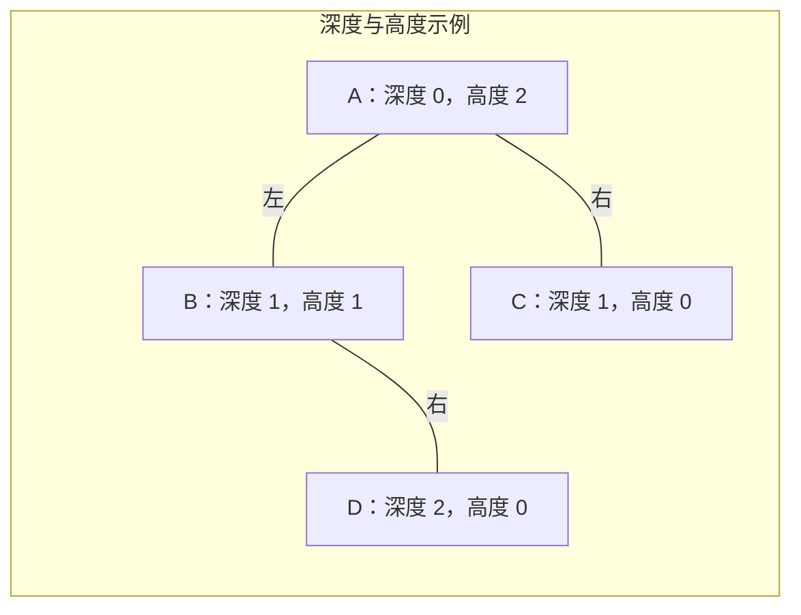

**术语注意：** Full Binary Tree 指每个结点要么有两个孩子，要么没有孩子，常称“严格／正则二叉树”；不意味着每层都满。Complete Binary Tree 是完全二叉树，最后一层从左到右填充。Perfect Binary Tree 才是所有层都填满的情形

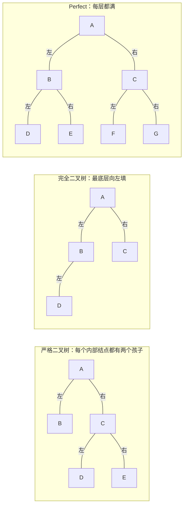

### 3.2 遍历与重建

| 遍历 | 访问顺序 | 常见用途 |
| --- | --- | --- |
| 前序 Preorder | 根、左、右 | 先处理父结点、复制结构 |
| 中序 Inorder | 左、根、右 | 得到 BST 的有序序列 |
| 后序 Postorder | 左、右、根 | 删除树、先算子问题 |
| 层序 Level-order | 按层从左到右 | 用队列实现 |

三种深度优先遍历均为 $\Theta(n)$ 时间，递归辅助空间为 $O(h)$

当结点标识唯一时：

- 前序＋中序，或后序＋中序，可以唯一重建
- 前序＋后序，一般不能唯一重建，例如一个孩子在左或在右
- 重建步骤：确定根，在中序中划分左右子树，再递归处理

例如：前序 `G H I J`，中序 `I H G J`。根是 `G`，左子树中序为 `I H`，右子树为 `J`；所以 `G` 左孩子为 `H`，`H` 左孩子为 `I`，`G` 右孩子为 `J`

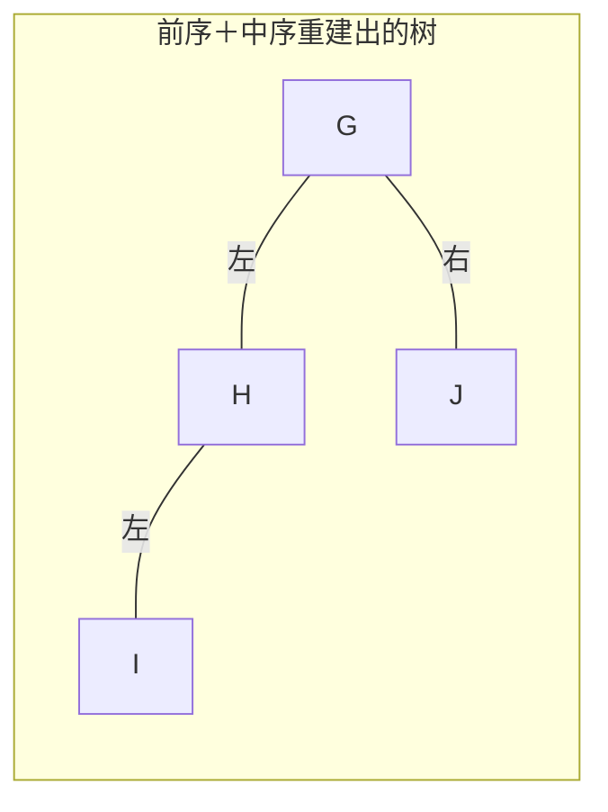

这棵树的后序为 `I H J G`，层序为 `G H J I`；H 的右侧空位没有画成真实结点

### 3.3 二叉搜索树（BST）

对每个结点，左子树关键字小于它，右子树关键字大于它。若允许重复，必须明确策略：拒绝重复、保存频次，或规定相等值放在哪侧

**性质针对整棵子树，不能只检查左右孩子。** 中序遍历给出递增序列；允许重复时是非递减序列

- `find`：比较后选择左子树或右子树
- `findMin`：一直沿左孩子走；`findMax`：一直沿右孩子走
- `insert`：按查找路径到空位置后插入
- `remove`：分三种情况

| 删除对象 | 处理方式 |
| --- | --- |
| 叶结点 | 直接删除并断开父指针 |
| 只有一个孩子 | 让父结点直接连接这个孩子 |
| 有两个孩子 | 用右子树最小值（中序后继）替换，再在右子树删除该值；或对称地用前驱 |

单次查找、插入、删除为 $O(h)$；平衡时为 $O(\log n)$，最坏为 $O(n)$。**插入顺序决定形状**，升序插入普通 BST 会退化

**删除两个孩子结点的例子：** 8 的中序后继是右子树最小值 9，先用 9 替换根的值，再删除原来的叶结点 9

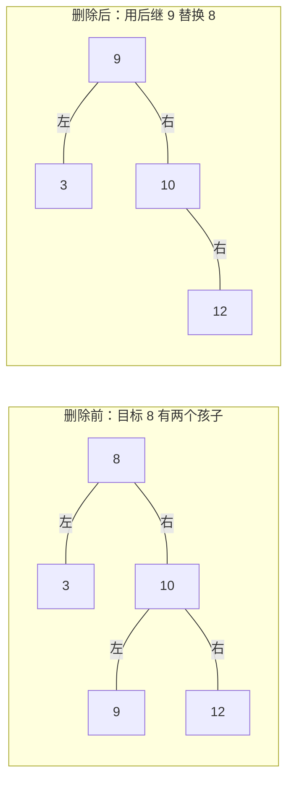

删除后，10 的左孩子为空、右孩子仍为 12；图中的透明占位用于保留这个左右关系

## 4. AVL 树、伸展树与 B 树

### 4.1 AVL 树

AVL 是满足高度平衡条件的 BST。约定：

$$
BF(v)=h(v.left)-h(v.right),\qquad BF(v)\in\{-1,0,1\}
$$

实现中常设空树高为 $-1$，叶高为 0。插入后沿路径向上更新高度，找到失衡结点 $\alpha$，按插入路径决定旋转

| 类型 | 从 $\alpha$ 出发的路径 | 修复动作 | 最小例子（依次插入） |
| --- | --- | --- | --- |
| LL | 左、左 | 对 $\alpha$ 右旋 | `3,2,1` |
| RR | 右、右 | 对 $\alpha$ 左旋 | `1,2,3` |
| LR | 左、右 | 先左旋左孩子，再右旋 $\alpha$ | `3,1,2` |
| RL | 右、左 | 先右旋右孩子，再左旋 $\alpha$ | `1,3,2` |

四个例子修复后都得到根 2、左孩子 1、右孩子 3。**LL 是失衡路径名，不是“向左旋”的意思**

**四种失衡的图解：** 以下每组按标题序号阅读，透明空位可以看出插入路径是在左侧还是右侧

**LL：右旋 3**

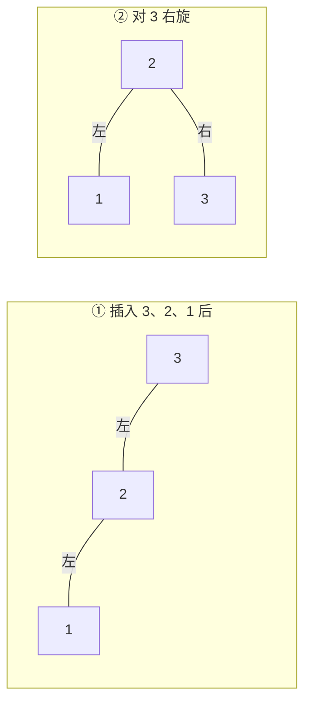

**RR：左旋 1**

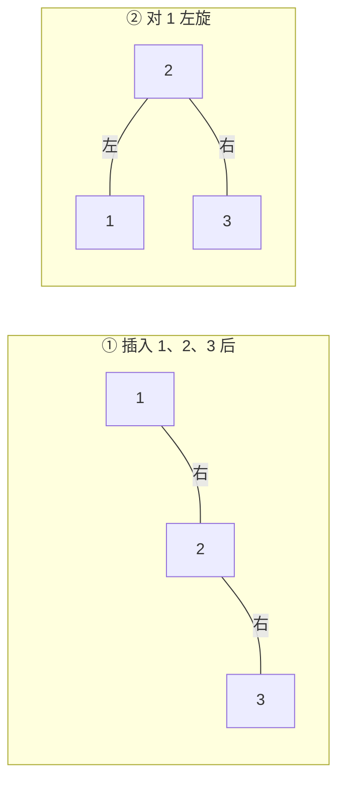

**LR：先左旋 1，再右旋 3**

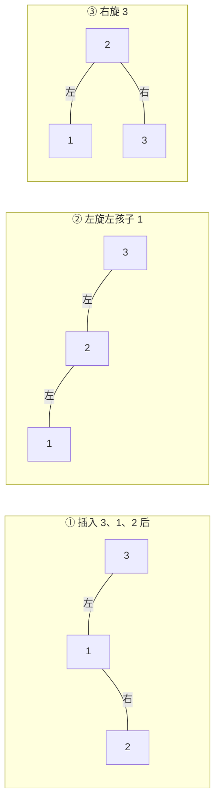

**RL：先右旋 3，再左旋 1**

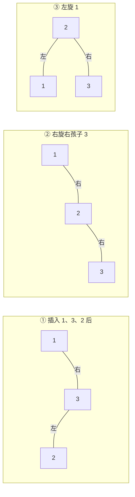

右旋的核心连接关系（`a` 原来是子树根）：

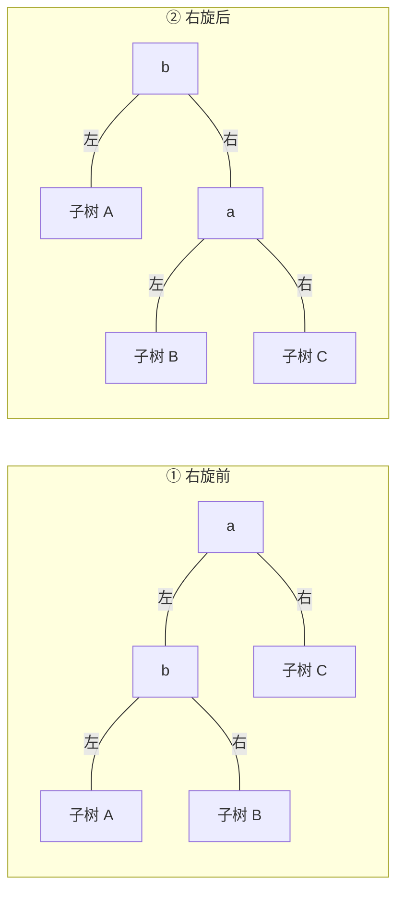

注意原来 b 的右子树 B 会接到 a 的左侧，不能在旋转时丢失；A、B、C 表示整棵子树，可以为空

```cpp
Node* b = a->left;
a->left = b->right;
b->right = a;
updateHeight(a);   // 先更新下降的结点
updateHeight(b);
return b;          // 父结点要接住新的子树根
```

旋转保持中序顺序，因此保持 BST 性质。高度界来自最少结点数递推：

$$
S(0)=1,\quad S(1)=2,\quad S(h)=1+S(h-1)+S(h-2)
$$

其增长类似 Fibonacci，推出 $h=O(\log n)$，所以 AVL 查找、插入、删除最坏都为 $O(\log n)$

插入在最低失衡处修复后，该子树高度恢复到插入前，可停止继续旋转；删除可能让高度继续下降，需要一路向上修复。删除时还可能出现重侧孩子 `BF=0` 的情况，不能只按插入路径套四类

### 4.2 伸展树（Splay Tree）

核心思想：每次访问结点 $x$ 后，通过旋转把它移到根附近，最终移到根，以利用访问的局部性。不要求每次操作后严格平衡，也不需要像 AVL 那样维护高度平衡条件

设父亲为 $p$，祖父为 $g$：

- **Zig**：$p$ 就是根，对 $p$ 做一次旋转
- **Zig-Zig**：$x,p$ 相对各自父结点同向。先旋转 $g,p$，再旋转 $p,x$
- **Zig-Zag**：两者异向。先旋转 $p,x$，再旋转 $g,x$

不能把 Zig-Zig 简化成“对 $x$ 连续做两次普通上提”，旋转次序不同，结构也不同

**Zig-Zig 例子：访问 10，把它伸展到根**

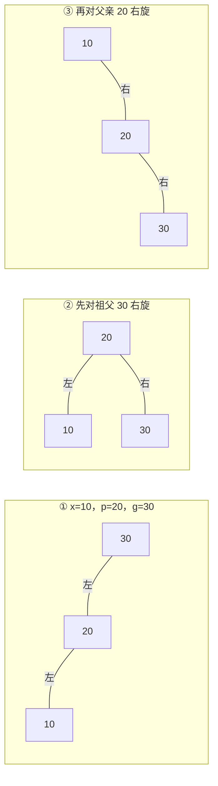

**Zig-Zag 例子：访问 20，把它伸展到根**

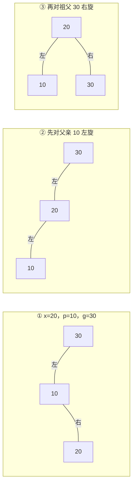

上图只展示三个结点的最小例子；实际存在其他子树时，也要像 AVL 旋转那样接回对应位置，保持中序顺序

插入：按 BST 插入，再把新结点伸展到根。删除：先把目标伸展到根，删除根；将左子树最大结点伸展成左子树的新根，再接上原右子树。左子树为空时直接返回右子树

**单次最坏 $O(n)$，长期操作序列的摊还成本 $O(\log n)$。** 不能说每次查找都有对数最坏保证，也不能说任意时刻都平衡

### 4.3 B 树与 B+ 树：先看定义

**记录全在叶子、内部结点只作导航**的多路搜索树通常称为 **B+ 树**；B 树通常允许内部结点也保存数据记录。下面先说明 B+ 树的操作，画图和计算时要先确认题目采用哪一种定义

设阶为 $M$，叶容量为 $L$：

1. 根是叶子，或有 $2$ 到 $M$ 个孩子
2. 非根内部结点有 $\lceil M/2\rceil$ 到 $M$ 个孩子，孩子数比导航键数多 1
3. 所有叶子深度相同
4. 非根叶结点存 $\lceil L/2\rceil$ 到 $L$ 条记录；根为叶时允许少于此下限
5. 导航键表示右侧相应子树的最小关键字；叶间可用顺序链连接

**查找：** 在内部结点确定区间，一路走到叶子。即使某个内部导航键等于目标，也要继续到叶子找记录

**插入：** 先找到叶子；有空位直接插；溢出则分裂，将新导航信息加入父结点；父结点也可能分裂，直到根；根分裂才会增加树高。叶分裂时导航键会被复制到上层，记录仍保存在叶子

**叶分裂示例，取 $M=L=3$：** 右叶插入 9 后暂有 4 条记录，分成 `[6,7]` 与 `[8,9]`，把新右叶的最小键 8 复制到父结点

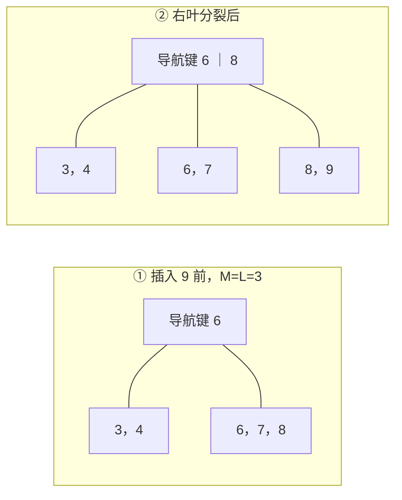

父结点现在有 3 个孩子、2 个导航键，仍未溢出；导航键 6 和 8 对应的数据记录都还在叶子里

**删除：** 删叶中记录；不足下限时，优先向有余量的相邻兄弟借；无法借则合并，并删除父结点中对应的导航信息；可能向上传播。子树最小关键字改变时要维护导航键，根只剩一个孩子时可缩减一层

**借位示例，取 $M=L=3$：** 删除 4 后，左叶只剩 `[3]`，不足 2 条；右叶有 3 条，可以把最小记录 6 借给左叶，父导航键随右叶最小值更新为 7

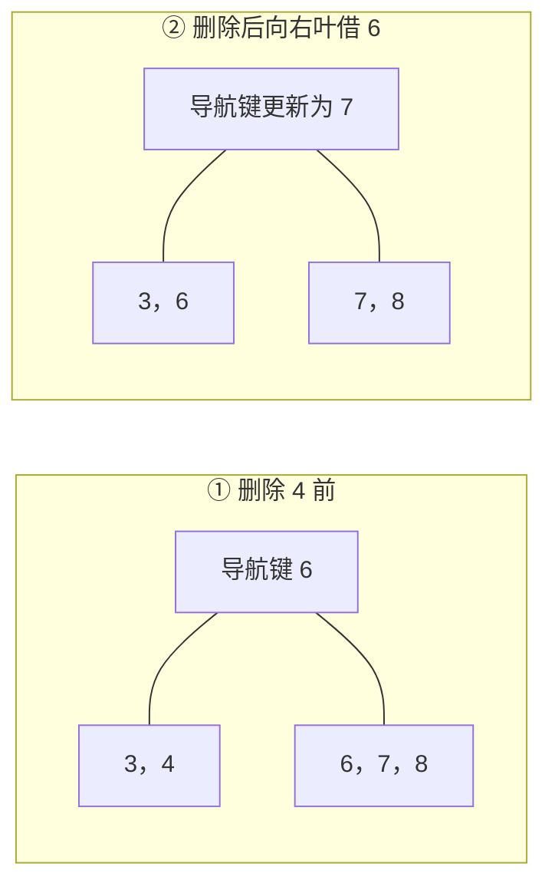

**合并示例，仍取 $M=L=3$：** 如果右叶原来只有 `[6,7]`，它也在下限，不能借出记录；删除左叶的 4 后，把两叶合并为 `[3,6,7]`，根只剩一个孩子，于是缩根

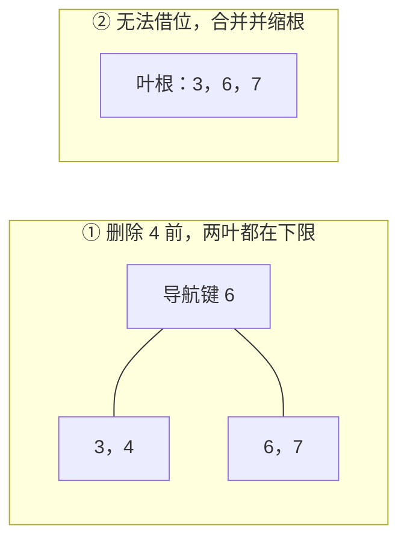

目的在于减少外存访问：一个结点尽量放入一个磁盘块，分支多、树更矮。固定合理阶数时查找 CPU 成本为 $O(\log n)$，外存访问次数由树高决定

## 5. 查找与哈希表

### 5.1 线性查找、有序查找、自组织表

- 无序表顺序查找：最坏 $\Theta(n)$；成功位置等概率时平均比较 $(n+1)/2$ 次；失败需检查 $n$ 个元素
- 有序数组二分查找：最坏 $O(\log n)$；需要有序且能高效随机访问
- 跳跃查找：每隔 $j$ 个元素检查一次，找到区间后顺序扫描，成本约 $n/j+j$，取 $j\approx\sqrt n$ 得 $\Theta(\sqrt n)$
- 自组织表：让常访问的记录更靠前，常见启发式有计数排序、移至表头（move-to-front）、与前驱交换（transpose）

若第 $i$ 个位置的访问概率为 $p_i$（下标从 0），成功查找期望比较次数为 $\sum_{i=0}^{n-1}(i+1)p_i$。按访问概率从大到小排列有利于减小该期望

### 5.2 哈希思想

哈希函数将关键字映射为槽位：$h(k)\in\{0,\ldots,M-1\}$。不同关键字映射到同槽称为**冲突**。哈希结构主要支持精确匹配的 `find/insert/delete`，不天然支持有序遍历、范围查询或快速找最小值

好函数应计算便宜、分布均匀，并尽量利用完整关键字及其位置信息

- 整数常用 `k % M`，表长选择还应考虑关键字模式
- 字符串简单 ASCII 求和会让 `abc/bca/cab` 冲突；Horner 形式能利用顺序：`r=(base*r+c)%M`
- 字符串长为 $\ell$ 时，完整计算哈希一般需要 $O(\ell)$；“哈希操作期望常数时间”通常还假设关键字处理成本为常数

装填因子：$\lambda=n/M$。哈希的快依赖散列质量与装填率，**不是无条件最坏 $O(1)$**

### 5.3 冲突处理

| 方法 | 探测／存储规则 | 主要特点 |
| --- | --- | --- |
| 分离链接 Separate Chaining | 每个槽位挂一条链等容器 | 允许 $\lambda>1$；期望查找 $O(1+\lambda)$ |
| 线性探测 Linear Probing | $(h(k)+i)\bmod M$ | 实现简单，有主聚集 |
| 固定步长探测 | $(h(k)+ci)\bmod M$ | 遍历全表要求 $\gcd(c,M)=1$；仍有聚集 |
| 二次探测 Quadratic Probing | $(h(k)+i^2)\bmod M$ | 缓解主聚集，仍有次聚集 |
| 双重散列 Double Hashing | $(h_1(k)+i h_2(k))\bmod M$ | 步长依赖关键字，减少共同探测路径 |

从 $i=0$ 开始探测。查找必须沿插入时同样的序列进行

- **主聚集：**连续占用区域越来越大，吸引更多冲突
- **次聚集：**初始地址相同的关键字沿相同路径探测
- 二次探测不一定覆盖全表；对素数表长和上述平方偏移形式，表至少半空时可以保证新元素找到空槽
- 双重散列应满足 $h_2(k)\not\equiv0\pmod M$ 且 $\gcd(h_2(k),M)=1$。仅仅“步长不是 $M$ 的约数”不足以保证覆盖全表

### 5.4 删除与重哈希

开放寻址需要区分三种状态：从未使用、正在使用、已删除。删除通常做惰性删除（墓碑标记）

**查找遇到“已删除”必须继续，遇到“从未使用”才可停止。** 否则会截断后续冲突元素的查找路径。插入时可记录首个墓碑位置，但若要求关键字唯一，应继续确认后面没有同键

表过满或墓碑过多时进行 rehash：新建表，逐一重新计算有效元素的位置。表长改变后不能只复制原槽位。良好分布和合适容量下，一次重建通常为 $O(n)$，扩容不应在每次插入时发生

例如 `H2(k)=(k+1)%11` 对某些关键字会算出 0，不能直接当作通用的合法步长函数，必须检查其在输入关键字上的值

### 5.5 例题：线性探测

表长 7，$h(k)=k\bmod7$，依次插入 `3,12,9,2,10`：

| 下标 | 0 | 1 | 2 | 3 | 4 | 5 | 6 |
| --- | --- | --- | --- | --- | --- | --- | --- |
| 最终关键字 | 空 | 空 | 9 | 3 | 2 | 12 | 10 |

`2` 的路径为 `2→3→4`；`10` 的路径为 `3→4→5→6`。手算时记录完整路径，不要只写最后落点

## 6. 堆与优先队列

### 6.1 两个性质必须同时满足

以最小二叉堆为例：

1. **结构性质：** 是完全二叉树
2. **堆序性质：** 每个父结点的值不大于孩子

因此最小值在根，但左右子树没有全局大小关系；**堆不是 BST，堆数组不是有序数组**，查找任意值最坏仍为 $O(n)$

| 数组下标 | 根 | 父结点 | 左孩子 | 右孩子 |
| --- | --- | --- | --- | --- |
| 从 1 开始 | 1 | $\lfloor i/2\rfloor$ | $2i$ | $2i+1$ |
| 从 0 开始 | 0 | $\lfloor(i-1)/2\rfloor$，仅非根 | $2i+1$ | $2i+2$ |

### 6.2 基本操作

- `findMin`：返回根，$\Theta(1)$
- `insert`：把新值放数组末尾，再沿父链**上滤**，最坏 $O(\log n)$
- `deleteMin`：移走根，用最后一个元素填根，再**下滤**，最坏 $O(\log n)$
- 下滤时选两个孩子中**较小的一个**，否则可能破坏堆序；注意只有左孩子的边界

上述插入时间先假定堆数组容量充足。动态数组实现还可能触发扩容，该次复制会额外花费 $O(n)$；把扩容成本摊还到操作序列后，再结合上滤成本分析

例：最小堆 `[2,4,6,7,5]`（按层序、0 下标）。插入 `1`，末尾下标为 5，先与父值 6 比，再与根值 2 比，最终为 `[1,4,2,7,5,6]`

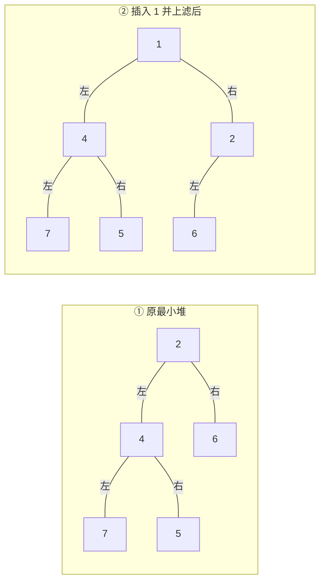

右侧结点 2 的左孩子是 6，右孩子为空；按层读取即可得到上面的数组

### 6.3 建堆为什么是线性？

逐个插入：最坏 $O(n\log n)$。更好的 `buildHeap`：从最后一个非叶结点开始，逆序下滤

```text
// 1 下标
for i = floor(n/2) down to 1:
    percolateDown(i)
```

不能把所有结点都按树高收费。约一半是叶子不用下滤，约四分之一至多下一层，约八分之一至多下两层：

$$
T(n)=O\left(n\sum_{k\ge0}\frac{k}{2^{k+1}}\right)=O(n)
$$

优先队列是 ADT，堆是其实现之一。应用包括任务调度、事件模拟，以及后面的多路归并、Dijkstra、Prim

## 7. 内部排序与排序下界

### 7.1 先明确评价标准

- 时间：最佳、平均、最坏是否不同？
- 空间：是否需要辅助数组？递归栈是否计入？
- 稳定性：关键字相等的记录，排序后是否保持原相对顺序？

例如 `7a,5,7b` 排成 `5,7a,7b` 才保持两个 7 的顺序。“稳定”与重复值能否相邻没有关系

### 7.2 排序对照表

以下针对常规实现；辅助空间包含递归栈

| 算法 | 最佳 | 平均 | 最坏 | 辅助空间 | 稳定 |
| --- | --- | --- | --- | --- | --- |
| 冒泡（无提前退出版） | $\Theta(n^2)$ | $\Theta(n^2)$ | $\Theta(n^2)$ | $O(1)$ | 是 |
| 简单选择 | $\Theta(n^2)$ | $\Theta(n^2)$ | $\Theta(n^2)$ | $O(1)$ | 否 |
| 直接插入 | $\Theta(n)$ | $\Theta(n^2)$ | $\Theta(n^2)$ | $O(1)$ | 是 |
| 希尔 | 依增量序列而定 | 依增量序列而定 | 依增量序列而定 | $O(1)$ | 否 |
| 堆排序 | 不统一列紧确最佳界 | $O(n\log n)$ | $\Theta(n\log n)$ | $O(1)$ | 否 |
| 二路归并（普通数组版） | $\Theta(n\log n)$ | $\Theta(n\log n)$ | $\Theta(n\log n)$ | $O(n)$ | 是，需相等时先取左边 |
| 快排（常规二路版） | $\Theta(n\log n)$ | $\Theta(n\log n)$ | $\Theta(n^2)$ | 平均 $O(\log n)$，最坏 $O(n)$ | 否 |
| 计数式桶排序 | $\Theta(n+b)$ | $\Theta(n+b)$ | $\Theta(n+b)$ | $O(b)$；稳定记录输出另需 $O(n)$ | 依实现 |
| LSD 基数排序 | $\Theta(r(n+b))$ | $\Theta(r(n+b))$ | $\Theta(r(n+b))$ | $O(n+b)$ | 是，需每一趟稳定 |

这里 $b$ 是桶数，$r$ 是位数／趟数。冒泡若加“本趟无交换则退出”，最佳可降为 $\Theta(n)$，固定双循环版本即使输入有序仍需完成全部比较。堆排序最佳情况与实现、是否允许大量重复值有关，复习时重点掌握最坏保证

### 7.3 冒泡、选择、插入

**冒泡：** 比较相邻元素，逆序就交换。一趟固定一个极值；从右向左扫描时，把当前最小值放到未排序区首端。也可从左向右把最大值放末端，过程题要跟题目方向一致。比较次数为 $n(n-1)/2$

**选择：** 每趟扫描未排序区找最小值，与未排序区首元素交换。比较总数仍是 $n(n-1)/2$，交换次数为 $O(n)$，适合交换成本昂贵的情况。远距离交换会破坏稳定性，例如 `2a,2b,1` 第一趟后变为 `1,2b,2a`

**插入：** 维护有序前缀，把下一个元素插入正确位置。已排序输入只需线性比较，逆序输入需要平方级移动，适合基本有序或很小的数据

进一步解释：对相邻交换版插入排序，交换次数恰好等于逆序对数。逆序对定义为 $i<j$ 且 $A[i]>A[j]$。不同元素随机排列的期望逆序对数是 $n(n-1)/4$，所以只靠相邻交换的算法平均需要 $\Omega(n^2)$ 次交换。**选择排序使用远距离交换，不能纳入这个论证**

### 7.4 希尔排序（Shellsort）

按步长 $h$ 将数组分成若干间隔子序列，对每个子序列做插入排序；逐步缩小 $h$，最后必须有 $h=1$

- 一趟 $h$ 排序后，满足所有有效位置的 $A[i]\le A[i+h]$
- 最后一趟虽是插入排序，但输入已被前几趟预处理，不能据此断言总成本一定平方级
- 时间强烈依赖增量序列；Shell 原始减半序列最坏为 $\Theta(n^2)$
- 使用 Hibbard 序列 `1,3,7,...,2^k-1` 时，最坏时间为 $\Theta(n^{3/2})$
- 平均复杂度估计应连同其假设／猜想性质一起记，不要记成所有希尔排序的统一结论

### 7.5 堆排序（Heapsort）

升序排列通常用**最大堆**：先线性建堆；把根与末元素交换；缩小堆范围；对新根下滤；重复

$$
O(n)+\sum_{k=2}^{n}O(\log k)=O(n\log n)
$$

已经放到右端的元素不再参加下滤。堆排原地、不稳定，提供最坏 $\Theta(n\log n)$ 的保证

### 7.6 归并排序（Mergesort）

把左右两半分别排好，再用双指针合并到辅助数组。一次合并为 $\Theta(n)$：每次取当前较小者，某侧耗尽后复制另一侧剩余元素

$$
T(n)=2T(n/2)+\Theta(n)=\Theta(n\log n)
$$

相等时取左侧，才能稳定。数组常规实现需要 $O(n)$ 辅助空间。**合并时必须统一边界与比较条件**；若区间两端都包含，应使用 `i<=mid`、`j<=right`，相等取左边

### 7.7 快速排序（Quicksort）

选枢轴 pivot，分区，使小值到一侧、大值到另一侧，再递归。采用二路分区时，先把 pivot 换到右端，分区完成后再放回最终位置

$$
T(n)=T(i)+T(n-i-1)+\Theta(n)
$$

- 近似均分：$\Theta(n\log n)$
- 总分成 0 和 $n-1$：$\Theta(n^2)$
- 随机选 pivot 时有期望 $\Theta(n\log n)$，但仍可能出现平方级的一次运行
- 三数取中取左、中央、右三个值的中位值，不是求整个区间的真正中位数，也不是自动消除最坏情况
- 小区间可改用插入排序，减少递归开销

实现时必须保证双指针推进，尤其遇到等于 pivot 的元素时，避免死循环；大量重复值也可考虑三路分区。**升序分区时，左指针跳过小于 pivot 的值，右指针跳过大于 pivot 的值，不能把两侧比较方向写成相同**

所谓“原地快排”通常指不另建线性大小数组，递归栈仍占空间；常规实现平均栈深 $O(\log n)$，最坏可达 $O(n)$

### 7.8 桶排序与 LSD 基数排序

小整数的计数式桶排序：值域为 `0..b-1`，统计各值次数，再依次输出，成本 $\Theta(n+b)$。这与“任意分桶后再对桶内排序”的版本不同，不能给所有桶排序都套同一复杂度

LSD 从最低位到最高位做稳定分配、按桶号收集。第 $t$ 趟后，序列按最低 $t$ 位有序

例：`170,45,75,90,802,24,2,66`，不足位补 0：

```text
个位后：170, 90, 802, 2, 24, 45, 75, 66
十位后：802, 2, 24, 45, 66, 170, 75, 90
百位后：2, 24, 45, 66, 75, 90, 170, 802
```

每趟必须稳定，才能保留低位已经排好的相对顺序。计数实现常用“计数→前缀和→倒序放入输出数组”，保持稳定

$$
T=\Theta(r(n+b)),\qquad S=O(n+b)
$$

**“线性”有条件：** 当位数和桶数可视为常数时，时间对 $n$ 是线性的。进一步看：固定基数 $b$，若必须表示 $n$ 个不同关键字，位数至少为 $\log_b n$，按该逐位实现的参数模型会得到相应的 $\Omega(n\log n)$ 成本。这不等于基数排序普遍受比较排序下界约束

### 7.9 比较排序下界

对 $n$ 个互异元素，有 $n!$ 种可能次序。只通过关键字大小比较的算法可建模为二叉决策树；每个叶子对应一种需要区分的排序结果

深度为 $d$ 的二叉树至多有 $2^d$ 个叶子，因此：

$$
2^d\ge n!\quad\Rightarrow\quad d\ge\log_2(n!)=\Omega(n\log n)
$$

这说明：**任何纯比较排序，在最坏情况下都需要 $\Omega(n\log n)$ 次比较。** 计数、基数排序利用了关键字结构，不是纯比较模型，因此不与之矛盾

选择问题不要求排出全部次序，不能套 $n!$ 个排序结果的论证。找最小值至少需要 $n-1$ 次比较：除最小值外，每个元素都必须至少输掉一次比较。第 $k$ 小问题的决策树下界也应针对选择任务推导，不能直接套完整排序下界

## 8. 外部排序

### 8.1 为什么关注 I/O？

数据无法一次装入内存时，需要分批读写外存。此时优化目标主要是**减少全量读写的趟数**，不只是减少 CPU 比较次数

设总记录数为 $N$，内存一次能处理 $M$ 条：

1. 每次读入至多 $M$ 条，内排序后写出，得到初始有序段（run）
2. 初始段数 $R=\lceil N/M\rceil$
3. 通过归并不断减少有序段数，直到剩一段

### 8.2 二路与多路归并

二路归并的归并趟数为 $\lceil\log_2R\rceil$；总趟数还要加初始段生成的 1 趟。推广为 $k$ 路：

$$
P_{merge}=\lceil\log_k R\rceil,\qquad P_{total}=1+\lceil\log_kR\rceil
$$

适用于至少一段输入，并将一次完整读写算一趟的模型。每趟通常读写全部记录；若题目按块计算 I/O，还需除以每块记录数并计入读写两部分

多路归并用最小堆维护各段当前首元素，每输出一条，补入该段下一条。每条记录的堆维护为 $O(\log k)$；增大 $k$ 还受缓冲区和内存约束

### 8.3 置换选择（Replacement Selection）

利用一个可容纳 $M$ 条记录的最小堆，生成可能超过内存容量的初始段：

1. 输出堆中最小值
2. 读入下一条；若不小于刚输出的值，可继续参加当前段
3. 若更小，则冻结，留给下一段
4. 当前活跃堆为空时结束一段，再用冻结记录开始下一段

随机分布输入下，初始段平均长度约为 $2M$；不是对所有输入的保证。已升序的数据可能形成一个很长的段，逆序数据则难以取得该平均收益。还可进一步了解 Polyphase Merge（多阶段归并）

## 9. 并查集

### 9.1 管理动态等价类

等价关系满足自反、对称、传递。并查集维护若干互不相交的集合：

- `find(x)`：返回 $x$ 所在集合的代表根
- `union(a,b)`：合并两个集合
- `find(x)==find(y)`：判断是否属于同一集合

应用：连通性、迷宫生成、Kruskal 判断加边是否成环。它擅长合并和查询，普通版本不支持任意拆分集合

### 9.2 父指针森林与优化

数组 `s[x]` 非负时存父结点下标；根用负值标识。有两种常见负值编码，**不能混用**：

- 按大小合并：根的 `s[root]` 为集合大小的负数
- 按高度／秩合并：可用 `-(height+1)`，单点为 `-1`

朴素合并可能把树连成链，`find` 最坏 $O(n)$

**按大小合并：**把小树挂到大树根上。某结点深度每增加 1，其所在集合大小至少翻倍，故高度最多 $O(\log n)$

**路径压缩：**查找过程中，让经过的结点直接指向根

```cpp
int find(int x) {
    if (s[x] < 0) return x;
    return s[x] = find(s[x]);
}

// 按大小合并版本；先找根，根的负值表示大小
void unite(int a, int b) {
    a = find(a);
    b = find(b);
    if (a == b) return;
    if (s[a] > s[b]) swap(a, b);  // a 集合更大，负值更小
    s[a] += s[b];
    s[b] = a;
}
```

路径压缩后，“秩”一般不再等于实际高度，但仍可作为合并依据

### 9.3 复杂度：根合并与完整合并要区分

| 版本 | `find` 单次最坏 | 合并已知的两个根 |
| --- | --- | --- |
| 朴素父指针 | $O(n)$ | $O(1)$ |
| 按大小／秩合并 | $O(\log n)$ | $O(1)$ |
| 按大小／秩＋路径压缩 | 单次仍可 $O(\log n)$ | $O(1)$，但完整 `unite` 包括两次 `find` |

操作序列可用 $O(m\log^*n)$ 作上界；更紧的界使用反 Ackermann 函数，常简写为总成本 $O(m\alpha(n))$、每次摊还 $O(\alpha(n))$（另计初始化，或令 $m\ge n$）。实际增长极慢，但不能写成每次最坏严格 $O(1)$

## 10. 图的表示与遍历

### 10.1 基本术语

图 $G=(V,E)$ 描述顶点及其关系。区分有向／无向、带权／无权、路径／简单路径、环，以及稀疏／稠密

- 无向图度数和：$\sum_v\deg(v)=2|E|$
- 有向图：$\sum_v\operatorname{indeg}(v)=\sum_v\operatorname{outdeg}(v)=|E|$
- 无向图中任意两点可达称连通；极大连通部分称连通分量
- 有向图“强连通”要求互相可达；忽略方向后连通只是弱连通，不能混为一谈
- 简单无向图至多 $n(n-1)/2$ 条边；简单有向图（不含自环）至多 $n(n-1)$ 条边

### 10.2 邻接矩阵与邻接表

| 项目 | 邻接矩阵 | 邻接表 |
| --- | --- | --- |
| 空间 | $\Theta(V^2)$ | $\Theta(V+E)$ |
| 判断指定边是否存在 | $\Theta(1)$ | 普通无序链表最坏 $O(\deg(u))$ |
| 枚举顶点 $u$ 的邻居 | $\Theta(V)$ | $\Theta(\deg(u))$ |
| 遍历整图 | 通常 $\Theta(V^2)$ | $\Theta(V+E)$ |
| 适用情形 | 稠密图、频繁查指定边 | 稀疏图、频繁遍历邻居 |

无向图邻接表通常把每条边存两次；矩阵关于对角线对称。带权图若允许零权边，不能简单用 0 表示“无边”

接口 `first(v)`／`next(v,w)` 用于枚举邻居。邻接矩阵找下一邻居可能要扫描多个槽位，不能把每次调用都当常数时间

### 10.3 DFS：深度优先

先沿一条路径走到底，再回溯；用递归或显式栈

```text
DFS(v):
    visited[v] = true
    visit(v)
    for each neighbor w of v:
        if not visited[w]: DFS(w)
```

一次从起点出发，只覆盖起点可达部分。遍历非连通图需再加外层循环，对所有未访问顶点启动 DFS，得到生成森林。无向图中，启动次数等于连通分量数

### 10.4 BFS：广度优先

按距离起点的层数扩展，使用队列；**发现时立即标记并入队**，防止一个顶点重复入队

```text
mark s; enqueue(s)
while queue not empty:
    v = dequeue()
    for each neighbor w of v:
        if w is unvisited:
            mark w
            parent[w] = v
            enqueue(w)
```

邻接表下 DFS、BFS 全图遍历为 $\Theta(V+E)$，额外访问标记及栈／队列为 $O(V)$。邻接矩阵通常为 $\Theta(V^2)$

**顺序题提醒：**DFS、BFS 的具体序列依赖起点和邻居扫描顺序。题目若规定按字母或编号扫描，必须遵守；没有规定时可能有多个合法答案

## 11. 拓扑排序与最短路径

### 11.1 拓扑排序

对有向图求一个顶点线性序列，使每条边 $u\to v$ 都满足 $u$ 在 $v$ 之前。**存在拓扑序，当且仅当图为 DAG（有向无环图）。**适用于课程先修、任务依赖

Kahn 算法：

1. 统计入度，将所有入度为 0 的顶点入队
2. 出队一个顶点并输出
3. 将其所有出边终点的入度减 1；减到 0 则入队
4. 最终若输出少于 $V$ 个顶点，说明有环

邻接表＋队列为 $O(V+E)$；每轮重新扫描所有顶点找零入度可能变成 $O(V^2+E)$。拓扑序不一定唯一。另一个方法是对 DAG 做 DFS，取完成顺序的逆序；用于一般有向图时必须额外检测环

### 11.2 无权最短路：BFS

无权图或所有边权相同时，最短路等价于最少边数。令 `dist[s]=0`，其他为未发现；首次发现 $w$ 时：

$$
dist[w]=dist[v]+1,\qquad prev[w]=v
$$

BFS 分层扩展，所以首次发现就得到最短距离。DFS 找到的一条路径不保证最短。保存 `prev` 后，可从终点反向回溯并逆序得到路径

### 11.3 非负权最短路：Dijkstra

前提是**边权非负**。它维护从源点到各点的当前距离估计，每次选未确定顶点中 `dist` 最小者，将其距离确定，再松弛出边

$$
dist[w]\leftarrow\min\{dist[w],dist[v]+weight(v,w)\}
$$

```text
dist[*] = ∞; dist[s] = 0
repeat:
    choose unfinalized v with minimum dist[v]
    if no such v or dist[v] == ∞: stop
    finalize v
    for each unfinalized neighbor w:
        if dist[v] + weight(v,w) < dist[w]:
            update dist[w] and prev[w]
```

正确性的关键：非负边无法让“绕过更远的未确定顶点”的路径反过来改善当前最近点。存在负边时，这个贪心保证失效，即使图没有负环也不能一般性使用 Dijkstra

| 实现 | 时间上界 | 注意 |
| --- | --- | --- |
| 每轮线性找最小顶点 | $O(V^2+E)$，简单图常写 $O(V^2)$ | 适合稠密图 |
| 邻接表＋支持 decrease-key 的二叉堆 | $O((V+E)\log V)$ | 堆按距离排序 |
| 改善距离就压入新记录，旧记录延迟丢弃 | 可写 $O(V+E\log(E+1))$ | 最多线性于边数的记录，需跳过失效项 |

常见简单图模型下，第三种也常概括为 $O((V+E)\log V)$；若按最多与 $E$ 同阶的堆记录数分析，会得到含 $\log E$ 的界。不要把“可能更新”误写成每条边必然导致更新

**初始化易错点：** 源点为 `s` 时应写 `D[s]=0`，不能将源点写死为下标 0。还要初始化访问标记，避免给无穷大加权时溢出，堆实现需跳过旧距离或已确定顶点

### 11.4 全源最短路与阅读边界

全源最短路径可通过对每个源点重复单源算法求解；非负权稀疏图可重复堆版 Dijkstra，也可以使用动态规划方法

Floyd–Warshall 使用

$$
D[i][j]\leftarrow\min(D[i][j],D[i][k]+D[k][j])
$$

最外层枚举允许经过的中间顶点 $k$，时间 $O(V^3)$，空间 $O(V^2)$。可处理负边；若存在影响某对顶点的负环，该对没有有限最短距离

## 12. 最小生成树

### 12.1 定义与最短路径树的区别

对连通无向带权图，生成树包含全部顶点、无环、有 $V-1$ 条边；MST 使**所选边权总和最小**。非连通图只能求最小生成森林

| 比较 | 最短路径树 | 最小生成树 |
| --- | --- | --- |
| 优化目标 | 源点到各顶点的路径分别最短 | 全树边权总和最小 |
| 是否依赖源点 | 是 | 目标本身不指定源点 |
| 代表算法 | BFS／Dijkstra | Prim／Kruskal |

MST 不保证某个源点到所有点都最近。MST 可以有负权边，Prim 和 Kruskal 不要求非负权。相同权值可能带来多个 MST，但总权值相同

### 12.2 Prim：逐点扩展一棵树

维护已选点集合 $S$；每次选一条连接 $S$ 与外部的最小权边，加入新顶点

令 `key[w]` 为当前树到 $w$ 的最便宜连接边：

$$
key[w]\leftarrow\min\{key[w],weight(v,w)\}
$$

注意 **Prim 不加 `key[v]`**；Dijkstra 更新的是源点路径总长，需要加 `dist[v]`

- 线性选最小／矩阵实现：通常 $O(V^2)$
- 邻接表＋二叉堆：$O((V+E)\log V)$
- 除起点外，接受顶点时记录其 `parent` 边
- 若剩余最小 `key` 为无穷，图不连通；不能继续添加无效父边

源点为 `s` 时同样应初始化 `D[s]=0`；更新时应只更新未选顶点，并先检查可达性，再添加连接边

### 12.3 Kruskal：逐边合并森林

1. 每个顶点独立构成一棵树
2. 把所有边按权值从小到大处理，可排序或放进最小堆
3. 对边 $(u,v)$，若 `find(u)!=find(v)`，接受并合并集合；否则丢弃以防成环
4. 接受 $V-1$ 条边后完成；若边耗尽仍不足，则不存在覆盖全图的生成树

初始化还需 $O(V)$，排序边为 $O(E\log E)$，并查集部分近似线性；连通图下通常概括为 $O(E\log E)$。简单图有 $E=O(V^2)$，也常写 $O(E\log V)$

循环除了检查“已选不足 $V-1$ 条”，还要判断候选边容器非空，避免非连通图上从空堆取元素

### 12.4 为什么贪心成立？

**割性质：**把顶点分成两个非空部分，跨越这个割的最轻边，可以属于某棵 MST

交换论证：若某棵 MST 没有这条最轻边，加上它产生一个环；环上必有另一条跨同一割的边，删去那条边仍是生成树，总权重不会增加。若权值相等，可能得到另一棵同样最优的树，不必强求唯一

Prim 每次选当前树与外部之间的最轻边；Kruskal 每次选连接不同分量的最轻可用边，都可用这一性质解释

### 12.5 补充练习：同一图比较三个算法

无向图边为 `AB=1, AC=4, BC=2, BD=5, CD=1`，无其他边：

- 从 A 做 Dijkstra：确定顺序为 `A,B,C,D`，距离为 `0,1,3,4`
- 从 A 做 Prim：依次可选 `AB,BC,CD`，总权重为 4
- Kruskal：先选权重 1 的 `AB,CD`（两者次序可换），再选 `BC`，总权重为 4

此例最短路径树恰好也是 MST，但一般不会如此。例如三角形 `AB=2, AC=2, BC=1`，从 A 出发的最短路径树选 `AB,AC`，总权重 4；MST 选 `BC` 和任一条权重 2 的边，总权重 3

## 13. 综合速查与复习清单

### 13.1 根据任务选择结构／算法

| 需求 | 优先考虑 | 必须检查的条件 |
| --- | --- | --- |
| 按下标快速读取 | 数组／顺序表 | 插删是否频繁、是否需要搬移 |
| 已知位置前驱，频繁插删 | 链表 | 定位前驱本身是否需要线性扫描 |
| 撤销、括号、递归状态 | 栈 | 后进先出 |
| 排队、逐层扩展 | 队列 | 先进先出 |
| 动态有序查找 | AVL 等平衡搜索树 | 是否需要范围查询 |
| 频繁重复访问局部数据 | Splay | 是否接受单次较慢、摊还保证 |
| 外存索引 | B／B+ 树 | 结点块容量、导航键定义 |
| 快速精确匹配 | 哈希 | 散列质量、装填因子、删除状态 |
| 反复取极值 | 堆／优先队列 | 不需要全局有序或任意值快速查找 |
| 动态合并与连通性 | 并查集 | 普通版本不擅长拆分 |
| 依赖先后顺序 | 拓扑排序 | 有向无环 |
| 无权最短路 | BFS | 每条边成本相同 |
| 非负权最短路 | Dijkstra | 不允许一般负权输入 |
| 全部点连接且总成本最低 | Prim／Kruskal | 无向图；非连通则求森林 |

### 13.2 最容易混淆的结论

1. 链表插删 $O(1)$ 的前提是已经知道必要位置／前驱
2. 完全二叉树不等于 BST；二叉堆必须完全，但不是 BST
3. BST 保证左右子树的值域；堆只保证父子大小
4. AVL 是每次操作后恢复平衡；Splay 保证的是长期摊还效率
5. 哈希平均／期望快不等于最坏常数时间
6. 循环队列的空满公式取决于 `front/rear` 的定义
7. 建堆是 $O(n)$，不是把所有结点都乘一个 $\log n$
8. 归并稳定要“相等先取左”；LSD 每趟都要稳定
9. 快排的 $O(\log n)$ 栈空间通常是平均或平衡划分下的界
10. 比较排序下界不能直接套给利用值域和位信息的排序
11. 并查集完整合并包含两次 `find`；直接连两个已知根才是 $O(1)$
12. BFS 的最少边数不等于一般带权图的最小路径成本
13. Dijkstra 更新 `dist[v]+w`；Prim 更新单条连接边 `w`
14. 最短路径树与最小生成树优化目标不同
15. 图算法复杂度必须说明邻接表还是邻接矩阵，以及是否使用堆
16. 伪代码用于理解思路，边界、源点初始化和比较方向需要核对后再实现

### 13.3 建议手算一遍的题型

- [ ] 由循环上下界写求和式，区分 $n\log n$ 与等比级数的 $n$
- [ ] 对照数组表、单链表的操作成本与空间分界
- [ ] 按指定下标定义模拟循环队列入队、出队、绕回与判满
- [ ] 用前序＋中序重建树，写出后序和层序
- [ ] 按顺序构建 BST，并完成有两个孩子结点的删除
- [ ] 分别画 LL、RR、LR、RL 的修复过程
- [ ] 区分 Splay 的 Zig-Zig 与 Zig-Zag 旋转顺序
- [ ] 按题面 $M,L$ 画 B+ 树的分裂、借位与合并，更新导航键
- [ ] 完整写出线性、二次、双重散列的每次探测位置
- [ ] 模拟哈希惰性删除后查找，以及扩容后的重新定位
- [ ] 由数组建堆，模拟插入、删除极值、堆排序每一轮
- [ ] 对同一小数组手算各排序算法每趟结果，带重复标记检查稳定性
- [ ] 推导归并／快排递推式，写出比较排序决策树下界
- [ ] 计算初始段数、二路／多路归并趟数，模拟置换选择冻结
- [ ] 画并查集按大小合并与路径压缩前后的父数组
- [ ] 按指定邻居顺序写 DFS、BFS、生成森林与连通分量
- [ ] 用入度表和队列完成拓扑排序，并检查输出数是否等于顶点数
- [ ] 为 Dijkstra 逐轮记录确定集合、距离和前驱
- [ ] 对同一带权图分别做 Prim、Kruskal，核对所选边数与总权重

### 13.4 分模块练习入口

| 模块 | 建议练习 |
| --- | --- |
| 算法分析 | 最大连续子序列和的四种算法、循环与递归复杂度 |
| 树 | 遍历重建、BST 删除、AVL 与 Splay 旋转、B/B+ 树操作 |
| 哈希 | 四种探测函数、惰性删除、扩容后重新定位 |
| 堆 | 从数组建堆、连续插入与删除、原地堆排序 |
| 排序 | 每趟状态、稳定性、空间成本、最坏情况与排序下界 |
| 外部排序 | 初始段数、归并趟数、置换选择 |
| 并查集 | 按大小与按秩合并、路径压缩前后的父数组 |
| 图 | 图存储、遍历、拓扑排序、Dijkstra、Prim、Kruskal |

复习时不只背复杂度：每个算法都要能说明**维护了什么性质、为什么下一步合法、何时停止、输入不满足条件时会怎样**

## 考试题型（很重要！）

### 题型与分值

| 题型 | 数量 | 分值占比 | 答题重点 |
| --- | --- | --- | --- |
| 选择题 | 10 题 | 20% | 概念、性质、边界条件、复杂度、稳定性 |
| 填空题 | 10 空 | 20% | 代码条件、指针修改、递归区间、关键步骤 |
| 问答题 | 3～4 题 | 40% | 画图、写过程、解释原理、分析复杂度 |
| 设计题 | 未注明题数 | 20% | 结构设计、算法/伪代码、正确性与时间空间分析 |

**问答题和设计题合计 60%，要练到能独立写过程和伪代码，不能只认得选择题答案**

题型配比对应所提供提纲中标注的 `2025fall` 版本；下面把五张题目照片整理为例题，其他练习方向用于准备同类题，不代表新增的确定考题

### 一、选择题：概念、性质与复杂度

#### 例 1：删除单链表首结点

**题目：** `head` 指向单链表第一个结点，删除首结点时，以下哪条指针语句正确？

| 选项 | 语句 |
| --- | --- |
| A | `head = head->next;` |
| B | `head->next = head;` |
| C | `head = NULL;` |
| D | `head = head->next->next;` |

**答案：A**

旧的第二个结点成为新首结点，所以把 `head` 改为原来的 `head->next`；B 会让首结点指向自身，C 直接丢失整条链的入口，D 会跨过两个结点且可能越界访问

这里 `head` 指向首个数据结点，**不是不存数据的哨兵头结点**；如果有哨兵，删除首个数据结点通常要修改的是 `head->next`

选择 A 解决了链的连接关系；动态分配结点时，完整删除还应释放旧结点

```cpp
if (head != nullptr) {
    Node* old = head;
    head = head->next;
    delete old;
    // 若另存 tail 且此时 head == nullptr，还要令 tail = nullptr
}
```

#### 例 2：二叉树第 k 层最多有多少个结点？

**题目：** 根在第 1 层，二叉树第 $k$ 层最多有多少个结点？

| 选项 | 表达式 |
| --- | --- |
| A | $2^k$ |
| B | $2^{k-1}$ |
| C | $2k$ |
| D | $k^2$ |

**答案：B，$2^{k-1}$**

每下一层，最多结点数翻倍：第 1 层 1 个，第 2 层 2 个，第 3 层 4 个，因此第 $k$ 层为 $2^{k-1}$

容易混淆的三个量：

- 根深度为 0，第 $d$ 个深度最多有 $2^d$ 个结点
- 根层数为 1，第 $k$ 层最多有 $2^{k-1}$ 个结点
- 总共 $k$ 层的二叉树，最多有 $2^k-1$ 个结点

#### 例 3：冒泡排序的最佳时间复杂度

**题目：** Bubble Sort 最佳情况下的时间复杂度是？A：$O(n^2)$，B：$O(\log n)$，C：$O(1)$，D：$O(n)$

**必须区分版本：有“本趟无交换则退出”的优化时，选 D；固定双循环且不提前退出时，选 A**

- 提前退出版：输入已排序，只扫描一趟、比较 $n-1$ 次，即 $\Theta(n)$
- 无提前退出版：输入已排序也完成 $n(n-1)/2$ 次比较，即 $\Theta(n^2)$
- 题面没有给出提前退出逻辑，不能仅凭这张照片唯一确定版本；答题时优先看给定代码与明确的算法定义

这里选项使用 $O$ 表示复杂度级别，实际比较时应找紧确增长阶，而不是利用“线性时间也属于二次上界”来混淆选项

#### 例 4：哪种排序通常不稳定？

**题目：** Insertion Sort、Merge Sort、Heap Sort、Bubble Sort 中，哪一种通常不稳定？

**答案：C，Heap Sort（堆排序）**

插入和冒泡在相等时不交换，归并在相等时优先取左边，都能保持相等记录的原顺序；堆排有远距离交换，无法保证这个性质

速记：**冒泡、插入、常规稳定归并、稳定逐位基数排序可以稳定；简单选择、希尔、堆排、常规快排通常不稳定**

#### 同类选择题准备方向

| 方向 | 核心判断 |
| --- | --- |
| ADT 与实现 | ADT 规定操作，数组、链表等决定实现成本 |
| 线性表 | 插删是否已经定位，是否知道前驱，是否需要移动元素 |
| 栈和队列 | LIFO/FIFO，空满条件是否与指针定义一致 |
| 树 | 完全、严格、平衡三个概念不同，BST 约束整棵左右子树 |
| 树操作效率 | 普通 BST 可退化；AVL 最坏对数；Splay 是摊还对数 |
| 哈希 | 同一探测序列、墓碑不终止查找、双重散列步长合法性 |
| 堆 | 根是极值，数组不全局有序；建堆线性 |
| 图 | BFS 用队列，DFS 用栈/递归；Dijkstra 需非负边 |
| 两类最优树 | 最短路径树优化源点距离，MST 优化整树边权总和 |

### 二、填空题：条件、指针与递归区间

#### 例 5：快速排序代码填空

待补全的核心结构为：

```cpp
template <typename E, typename Comp>
void quickSort(E A[], int i, int j) {
    if ( /* [1] */ ) return;  // 区间只有 0 或 1 个元素

    int pivotindex = findpivot(A, i, j);
    swap(A, pivotindex, j);
    int k = partition<E, Comp>(A, i - 1, j, A[j]);
    swap(A, k, j);

    quickSort<E, Comp>(A, i, k - 1);
    /* [2] */
}
```

**填空答案：**

```cpp
// [1]
j <= i

// [2]
quickSort<E, Comp>(A, k + 1, j);
```

区间 `[i,j]` 包含两端，`j<i` 表示空区间，`j==i` 表示一个元素；pivot 已放在最终位置 `k`，所以后续只能递归 `[i,k-1]` 和 `[k+1,j]`

**同图中的分区比较方向也要看清：** 若 `Comp::prior(x,y)` 表示 `x<y`，则右指针应该跳过“大于 pivot”的值，比较应为 `Comp::prior(pivot,A[--r])`；把它写成 `Comp::prior(A[--r],pivot)` 就与升序分区目标相反。两个填空的答案不变，但不能把照片中的完整分区函数原样当作正确实现

#### 其他填空准备方向

| 模板 | 经常需要补的位置 |
| --- | --- |
| 链表插入/删除 | `next` 的连接次序、旧结点保存、尾指针更新 |
| 循环队列 | 下标取模、空满条件、长度公式 |
| 树遍历 | 根的访问时机、左右递归次序、空指针终止 |
| BST | 比较后选择哪侧子树、删除两孩子结点时取前驱/后继 |
| AVL | 高度更新顺序、单旋/双旋的返回根与连接 |
| 堆 | 父子下标、选择较小/较大孩子、从最后非叶结点建堆 |
| 并查集 | 根判断、按大小/秩合并、`s[x]=find(s[x])` |
| 图 | 入队前标记、入度递减、距离松弛、并查集判环 |

填代码前先确认：下标从 0 还是 1 开始、区间包含哪一端、变量指向当前结点还是前驱、代码是在维护最小堆还是最大堆

### 三、问答题：画图、过程与复杂度

#### 例 6：由前序与中序重建二叉树，再写后序

**题目：**

```text
前序：M, L, N, Q, O, P, R, S
中序：N, L, Q, M, O, P, R, S
要求：画出二叉树，给出后序序列
```

**划分过程：**

1. 前序第一个是 M，因此 M 为根
2. 中序以 M 分开，左子树为 `N,L,Q`，右子树为 `O,P,R,S`
3. 左子树对应前序 `L,N,Q`，故根为 L，左孩子 N，右孩子 Q
4. 右子树前序和中序都为 `O,P,R,S`，每次根都出现在中序最左端，因此形成一直向右的链 `O→P→R→S`

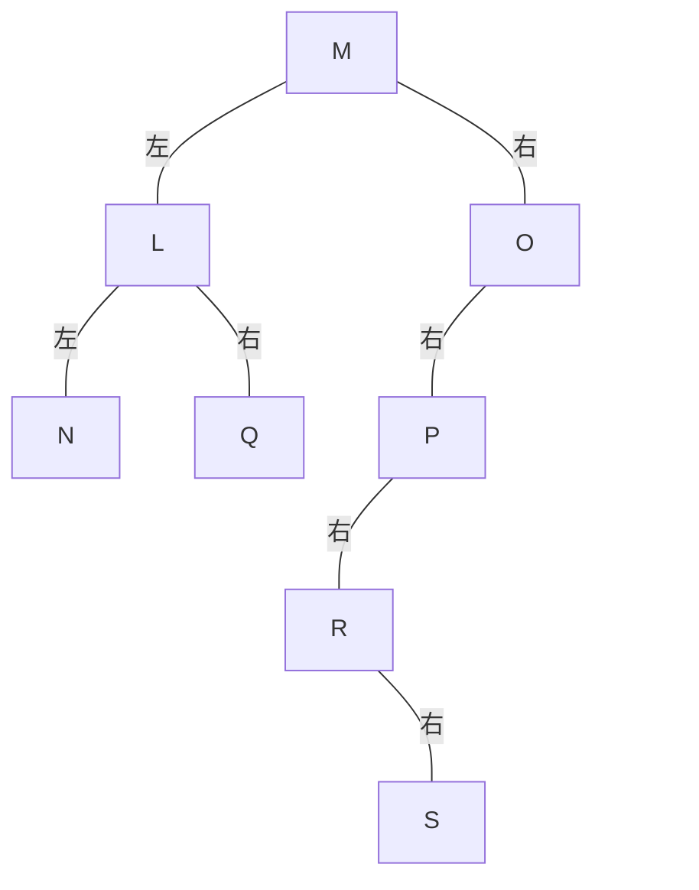

**后序答案：`N, Q, L, S, R, P, O, M`**

左子树后序是 `N,Q,L`，右子树后序是 `S,R,P,O`，最后访问根 M；核对时可重新读出图的前序和中序，检查是否与输入完全一致

#### 按模块准备问答题

以下是练习方向，不是对实际问答题题目的确定预测

| 模块 | 要练到能够手写的内容 | 作答时保留的关键过程 |
| --- | --- | --- |
| 算法分析 | 循环、求和、递归的渐近分析；最佳/平均/最坏与上下界区别 | 基本操作、求和/递推式、化简结果、假设 |
| 表、栈、队列 | 实现比较、指针操作、循环队列过程、空间分界点 | 指针含义、每次状态、边界、成本 |
| 二叉树/BST | 重建、遍历、构造、查找、插入、删除 | 子树划分、删除分类、替代结点、最终树 |
| AVL/Splay | 插入或访问后的旋转 | 失衡/访问结点、旋转类型、顺序、中间树 |
| 多路树 | 2-3 树、B/B+ 树的性质与操作 | 阶/容量、键与记录所在位置、分裂/借位/合并 |
| 哈希 | 分离链接，线性/伪随机/二次/双重探测 | 每个关键字的完整探测序列、最终表、删除状态 |
| 堆 | 插入、删除极值、自底向上建堆 | 数组与树对应、上滤/下滤路径、每轮堆范围 |
| 排序 | 所学算法的思想、每趟过程、性质、实现与复杂度 | 比较与移动、稳定性、辅助空间、最坏输入 |
| 并查集 | 按大小/高度合并与路径压缩 | 找根结果、父数组、负数意义、压缩后连接 |
| 图 | 矩阵/邻接表、DFS/BFS、连通分量、拓扑序 | 起点、邻居顺序、访问/入度状态 |
| 路径与生成树 | Dijkstra、Prim、Kruskal | 选取对象、更新表、前驱/选边、最终距离/权重 |

多路树的概念也要准备：2-3 树内部结点有 2 或 3 个孩子，常规搜索树形式对应 1 或 2 个关键字，所有叶子处在同一层；做 B/B+ 树操作时，要先确认是否允许内部结点保存记录，不能混用两种规则

**图算法过程表建议：**

- Dijkstra：每轮列出确定顶点、各点 `dist`、改善时的 `prev`，最后给出路径与长度
- Prim：每轮列出新顶点、连接边、剩余顶点 `key`，最终核对 $V-1$ 条边及总权重
- Kruskal：按权处理，逐条标出接受/因成环拒绝，写出合并后的分量
- 拓扑排序：列出当前零入度顶点、输出序列、相关入度变化，最后检查输出数

### 四、设计题：在时间与空间约束下选择算法

#### 例 7：找竞赛第 k 名，要求最坏时间与额外空间

**题意：** 每个参赛者有姓名与分数，找排名第 $k$ 的参赛者，要求额外空间 $O(1)$、最坏时间 $O(N\log N)$ 或更好

**采用方案：在原记录数组上建最大堆，删除最大值 $k-1$ 次，剩余堆顶就是第 $k$ 名**

默认按分数从高到低排名，$1\le k\le N$，允许修改原数组；分数相同时按题目给定的并列或次序规则处理。若题目采用“同分同名次”的竞赛排名/稠密排名，就不能直接把第 $k$ 个元素当作第 $k$ 名

**a）数据结构设计**

- 每个数组元素保存完整参赛记录 `Participant{name, score}`
- 原数组同时充当最大堆，根下标为 0，孩子下标分别为 `2*i+1` 和 `2*i+2`
- 比较使用分数，交换时交换完整记录，保证姓名和分数一直对应
- `size` 表示当前有效堆长度，移出堆的记录放到数组尾端
- 假设记录可用固定数量字段/引用表示，比较与交换成本按 $O(1)$ 计

**b）算法与伪代码**

下滤必须使用迭代版，避免递归调用栈破坏严格的 $O(1)$ 额外空间约束

```text
siftDownMax(A, root, size):
    while 2*root + 1 < size:
        child = 2*root + 1
        if child + 1 < size and A[child+1].score > A[child].score:
            child = child + 1
        if A[root].score >= A[child].score:
            break
        swap(A[root], A[child])       // 交换完整参赛记录
        root = child

kthParticipant(A, N, k):
    if k < 1 or k > N:
        report invalid k

    // 原地、自底向上建最大堆
    i = floor(N/2) - 1
    while i >= 0:
        siftDownMax(A, i, N)
        i = i - 1

    size = N
    repeat k - 1 times:
        swap(A[0], A[size-1])        // 当前第一名放到有效堆之外
        size = size - 1
        siftDownMax(A, 0, size)

    return A[0]                     // 姓名与分数完整返回
```

若有指定的同分次序，把伪代码中分数比较统一改为完整排名比较器即可；循环下标 `i` 要支持负值，避免无符号整数在减到 0 后回绕

**正确性：** 建堆后，堆顶是全部参赛者中分数最高者；每次删除堆顶并下滤，剩余记录重新构成最大堆。执行 $k-1$ 次后，恰好移除了排名前 $k-1$ 的记录，因此剩余堆顶是原序列第 $k$ 名

**复杂度：**

$$
T(N,k)=O(N)+O((k-1)\log N)=O(N+k\log N)\subseteq O(N\log N)
$$

建堆线性，最多执行 $N-1$ 次删除，每次最多沿堆高下滤；只维护固定数量的下标与临时交换记录，**额外空间为 $O(1)$**

例如分数 `92,75,88,99,83`，找第 3 名：建最大堆后连续取出 `99`、`92`，剩余堆顶为 `88`，返回其对应姓名与分数

#### 为什么这个设计满足两个硬约束？

| 方案 | 最坏时间 | 额外空间 | 是否直接满足题意 |
| --- | --- | --- | --- |
| 原地堆选择，迭代下滤 | $O(N+k\log N)$ | $O(1)$ | 满足，不必排完整个数组 |
| 原地堆排序后取第 k 项 | $O(N\log N)$ | $O(1)$ | 满足，但做了更多排序工作 |
| 常规归并排序 | $O(N\log N)$ | $O(N)$ | 空间不满足 |
| 常规快排/随机 Quickselect | 最坏可为 $O(N^2)$ | 另有递归栈开销 | 不提供所需的最坏保证 |
| 另建大小为 k 的辅助堆 | 可达 $O(N\log(k+1))$ | $O(k)$ | 对一般输入，空间不满足 |

不要因为 Quickselect 的期望时间是线性，就忽略题目明确要求的 **worst case**；也不要只说“用优先队列”，还必须说明它是否额外分配了堆数组

#### 设计题作答顺序

1. **读约束：** 输入规模、允许修改原数据与否、最坏还是平均、额外空间限制、同分规则
2. **设计结构：** 记录有哪些字段，怎样存储，比较与交换的单位是什么
3. **写算法：** 初始化、主循环、更新动作、停止条件、输出，明确空输入与非法参数
4. **说明正确性：** 写出一直维护的性质，再解释它如何保证最终答案
5. **算时间空间：** 分开计建结构、循环次数、单步成本，额外数组与递归栈都要算

### 五、考前按提纲查漏

| 章节 | 理解/了解的内容 | 需要掌握的操作与分析 |
| --- | --- | --- |
| 1 绪论与数学 | 数据结构、算法、ADT；数学基础 | 指数、对数、级数计算与递归 |
| 2 算法分析 | 增长率、上下界、最佳/平均/最坏情况 | 渐近分析、求和与递推 |
| 3 表、栈、队列 | 逻辑结构与存储结构的关系 | 各种实现与变体、复杂度、空间分界点 |
| 4 树 | 树与二叉树、完全/严格二叉树、平衡树、2-3 树、B 树；摊还分析 | 遍历及实现空间，BST 全套操作，AVL 维护与旋转，Splay 伸展及其实现 |
| 5 查找与哈希 | 查找概念 | 二分查找、典型哈希函数、分离链接、开放寻址；线性、伪随机、二次、双重探测 |
| 6 优先队列与堆 | 优先队列、完全二叉树 | 二叉堆插入、删除、建堆与复杂度 |
| 7 排序 | 内部/外部排序、比较排序下界 | 所学排序算法的思想、性质、过程、实现与复杂度 |
| 8 并查集 | 等价类、动态等价问题 | union/find、按大小/高度合并、路径压缩 |
| 9 图 | 图的基本概念 | 两种存储表示、BFS/DFS、拓扑排序、Dijkstra、Prim、Kruskal；最短路、MST、连通分量的思想、过程与实现 |

**最后核对：** 链表先看是否有哨兵，树先看根从第几层算，队列先看下标定义，排序先看具体版本，图先看有向/无向与权值条件，复杂度先看最坏/平均与额外空间要求

## 关键词中英对照表

因为本质上还是全英试卷，所以如果依旧是中文复习的话会吃大亏（

### 1. 基础概念与算法分析

| 英文 / 缩写 | 中文 | 识别要点 |
| --- | --- | --- |
| data structure | 数据结构 | 数据的组织方式及相关操作 |
| algorithm | 算法 | 解决问题的有限步骤 |
| abstract data type / ADT | 抽象数据类型 | 规定数据与操作，不限定具体实现 |
| implementation | 实现 | 用什么存储结构、怎样完成操作 |
| logical structure | 逻辑结构 | 数据元素之间的关系 |
| storage structure / physical structure | 存储结构 / 物理结构 | 数据在存储空间中的表示 |
| data element / data item | 数据元素 / 数据项 | 两者具体含义看定义，数据项常指组成元素的不可再分字段 |
| record / field | 记录 / 字段 | 一条记录可包含姓名、分数等字段 |
| key / key value | 关键字 / 关键字值 | 用于查找、比较、排序 |
| input size / problem size | 输入规模 / 问题规模 | 常用 $n$ 表示 |
| time complexity | 时间复杂度 | 运行成本随规模的增长阶 |
| space complexity | 空间复杂度 | 所需存储空间的增长阶 |
| auxiliary space / extra space | 辅助空间 / 额外空间 | 额外数组和递归栈都要考虑 |
| running time | 运行时间 | 通常按基本操作次数分析 |
| growth rate | 增长率 | 常数、对数、线性、平方等 |
| asymptotic analysis | 渐近分析 | 关注输入充分大时的增长趋势 |
| upper bound / lower bound | 上界 / 下界 | 对应 $O$ / $\Omega$ |
| tight bound | 紧确界 | 对应 $\Theta$ |
| best case / average case / worst case | 最佳情况 / 平均情况 / 最坏情况 | 区分不同输入下的成本 |
| expected time | 期望时间 | 需要明确随机性或概率分布 |
| amortized analysis / amortized cost | 摊还分析 / 摊还成本 | 对一串操作的总成本进行分摊 |
| constant / logarithmic / linear | 常数级 / 对数级 / 线性级 | $1$ / $\log n$ / $n$ |
| quadratic / cubic / exponential | 平方级 / 立方级 / 指数级 | $n^2$ / $n^3$ / $c^n$，$c>1$ |
| factorial | 阶乘 | $n!$ |
| exponent / logarithm / series | 指数 / 对数 / 级数 | 常用于复杂度化简 |
| recursion / recursive call | 递归 / 递归调用 | 函数调用自身处理较小问题 |
| base case / recursive case | 基本情况 / 递归情况 | 停止递归与继续递归的分支 |
| recurrence relation | 递推关系 / 递归方程 | 例如 $T(n)=2T(n/2)+n$ |
| iteration / iterative | 迭代 / 迭代的 | 使用循环完成处理 |
| divide and conquer | 分治 | 分解、递归求解、合并 |
| correctness / invariant | 正确性 / 不变式 | 说明算法为何得到正确结果 |
| maximum subsequence sum | 最大连续子序列和 | 该问题中的 subsequence 指连续区间 |

### 2. 线性表、栈与队列

| 英文 / 缩写 | 中文 | 识别要点 |
| --- | --- | --- |
| list / linear list | 表 / 线性表 | 按位置排列的有限序列 |
| array-based list / sequential list | 数组实现的表 / 顺序表 | 连续存储，支持随机访问 |
| linked list | 链表 | 用指针连接结点 |
| singly linked list / doubly linked list | 单链表 / 双向链表 | 单个后继指针 / 前驱与后继指针 |
| circular linked list | 循环链表 | 尾部重新连接到首部 |
| node / link / pointer | 结点 / 链接 / 指针 | link 也可能用作链表结点的类型名 |
| head pointer / tail pointer | 头指针 / 尾指针 | 指向首部 / 尾部，注意是否有哨兵 |
| header node / dummy node / sentinel node | 头结点 / 虚设结点 / 哨兵结点 | 额外设置，用于统一边界操作 |
| predecessor / successor | 前驱 / 后继 | 在线性表或有序结构中位于前 / 后的元素 |
| current position / curr | 当前位置 | 变量可能指向当前元素，也可能指向其前驱 |
| insert / remove / delete | 插入 / 移除 / 删除 | 留意是否还需要释放内存 |
| append | 尾部追加 | 在序列末端添加元素 |
| random access / sequential access | 随机访问 / 顺序访问 | 直接按下标定位 / 逐项前进 |
| capacity / length / size | 容量 / 长度 / 大小 | 容量通常不等于实际元素个数 |
| break-even point | 临界点 / 空间分界点 | 两种实现占用空间相同的位置 |
| null / non-null | 空 / 非空 | 可能描述指针或已占用数组位置，要结合题意 |
| stack / top | 栈 / 栈顶 | 只在一端插删 |
| push / pop / peek | 入栈 / 出栈 / 查看栈顶 | peek 通常只读取、不删除 |
| last in, first out / LIFO | 后进先出 | 栈的规则 |
| queue / front / rear | 队列 / 队首 / 队尾 | front、rear 的下标定义需先确认 |
| enqueue / dequeue | 入队 / 出队 | 尾部加入、首部移除 |
| first in, first out / FIFO | 先进先出 | 队列的规则 |
| circular queue / deque | 循环队列 / 双端队列 | deque 允许两端插删；不要与 dequeue 混淆 |
| overflow / underflow | 上溢 / 下溢 | 容器已满仍插入 / 容器为空仍取出 |

### 3. 树与搜索树

| 英文 / 缩写 | 中文 | 识别要点 |
| --- | --- | --- |
| root / parent / child / sibling | 根 / 父结点 / 子结点 / 兄弟结点 | 树的基本关系 |
| leaf / internal node | 叶结点 / 内部结点 | 没有孩子 / 至少有一个孩子 |
| ancestor / descendant | 祖先 / 后代 | 位于向根或向下的路径上 |
| subtree / forest | 子树 / 森林 | 某结点及其后代 / 若干互不相交的树 |
| path / path length | 路径 / 路径长度 | 长度通常按边数计 |
| depth / height / level | 深度 / 高度 / 层数 | 先确认根从 0 还是 1 开始计数 |
| binary tree | 二叉树 | 每个结点至多两个孩子，左右有区别 |
| full binary tree | 严格二叉树 / 正则二叉树 | 每个结点有 0 或 2 个孩子，不能直接理解为每层都满 |
| complete binary tree | 完全二叉树 | 最底层从左向右填充 |
| perfect binary tree | 每层都满的二叉树 | 所有内部结点都有两个孩子，叶子同层 |
| balanced tree / height-balanced tree | 平衡树 / 高度平衡树 | 高度平衡关注左右子树高度差 |
| traversal / enumeration | 遍历 / 枚举序列 | 题面中的 enumeration 常指遍历次序 |
| preorder / inorder / postorder | 前序 / 中序 / 后序 | 根左右 / 左根右 / 左右根 |
| level-order traversal | 层序遍历 | 按层访问，使用队列 |
| binary search tree / BST | 二叉搜索树 / 二叉排序树 | 左子树小、右子树大，重复值规则另定 |
| inorder predecessor / inorder successor | 中序前驱 / 中序后继 | 当前关键字之前最大 / 之后最小的关键字 |
| findMin / findMax | 查找最小值 / 查找最大值 | BST 中一直向左 / 向右 |
| degenerate tree / skewed tree | 退化树 / 偏斜树 | 可能接近一条链 |
| AVL tree / balance factor | AVL 树 / 平衡因子 | 常用左高减右高 |
| left rotation / right rotation | 左旋 / 右旋 | 改变局部根，保持中序顺序 |
| single rotation / double rotation | 单旋 / 双旋 | LL、RR 用单旋；LR、RL 用双旋 |
| rebalancing | 重新平衡 | 插删后修复平衡性质 |
| splay tree / splaying | 伸展树 / 伸展操作 | 把访问结点旋转到根 |
| self-adjusting tree | 自调整树 | 通过访问操作调整结构 |
| zig / zig-zig / zig-zag | 单旋伸展 / 同向双旋 / 异向双旋 | 区分旋转对象与先后顺序 |
| locality of reference | 访问局部性 | 最近访问的数据可能很快再次被访问 |
| multiway search tree | 多路搜索树 | 一个结点可有多个导航键与孩子 |
| 2-3 tree / B-tree / B+ tree | 2-3 树 / B 树 / B+ 树 | 先确认阶数、容量及记录存放位置 |
| order / branching factor | 阶 / 分支数 | 多路树中常与最大孩子数有关 |
| separator key | 分隔键 / 导航键 | 用于区分孩子子树的关键字范围 |
| split / redistribution / merge | 分裂 / 重分配（借位）/ 合并 | 对应结点溢出或低于容量下限后的处理 |
| Huffman tree / Huffman coding | 哈夫曼树 / 哈夫曼编码 | 在部分练习卷中出现，与带权路径长度有关 |

### 4. 查找与哈希

| 英文 / 缩写 | 中文 | 识别要点 |
| --- | --- | --- |
| searching / sequential search / linear search | 查找 / 顺序查找 / 线性查找 | 顺序查找与线性查找通常指同一方法 |
| binary search | 二分查找 / 折半查找 | 有序数组中按中点缩小范围 |
| successful / unsuccessful search | 成功 / 失败查找 | 目标存在 / 不存在 |
| exact-match query / range query | 精确匹配查询 / 范围查询 | 查同键记录 / 查某个关键字区间 |
| average search length / ASL | 平均查找长度 | 通常表示平均关键字比较次数 |
| self-organizing list | 自组织表 | 按访问情况调整次序 |
| move-to-front / transpose | 移至表头 / 与前驱交换 | 两种自组织策略 |
| direct addressing | 直接寻址 | 关键字直接作为下标 |
| hash table / hash function | 哈希表 / 哈希函数 | 散列表 / 散列函数 |
| slot / bucket / home position | 槽位 / 桶 / 初始散列地址 | bucket 在不同实现中含义可能不同 |
| collision / collision resolution | 冲突 / 冲突处理 | 不同关键字映射到相同地址 |
| separate chaining | 分离链接 / 链地址法 / 拉链法 | 每个槽位连接一组记录 |
| open addressing | 开放寻址 | 所有记录存表内，冲突后继续探测 |
| probe / probe sequence | 探测 / 探测序列 | 逐个检查候选槽位 |
| linear probing | 线性探测 | 按固定步长前进 |
| pseudo-random probing | 伪随机探测 | 使用可重现的伪随机偏移序列 |
| quadratic probing | 二次探测 | 典型偏移为 $i^2$ |
| double hashing | 双重散列 / 双散列 | 第二个函数决定探测步长 |
| primary / secondary clustering | 主聚集 / 次聚集 | 连续区域聚集 / 同初始地址共用探测路径 |
| load factor | 装填因子 / 负载因子 | 元素数除以表长 |
| lazy deletion / tombstone | 惰性删除 / 墓碑标记 | 查找遇到该标记仍需继续 |
| rehashing / resizing | 重哈希 / 调整容量 | 新表中通常要重新计算地址 |
| modulo / relatively prime | 取模 / 互质 | 判断探测序列能否覆盖全表 |

### 5. 堆与优先队列

| 英文 / 缩写 | 中文 | 识别要点 |
| --- | --- | --- |
| priority queue | 优先队列 | 按优先级取元素，不按到达顺序 |
| binary heap | 二叉堆 | 完全二叉树加堆序性质 |
| min-heap / max-heap | 最小堆 / 最大堆 | 根保存最小 / 最大值 |
| structure property / heap-order property | 结构性质 / 堆序性质 | 完全性 / 父子大小约束 |
| percolate up / sift up | 上滤 | 插入后沿父链调整 |
| percolate down / sift down | 下滤 | 根或局部结点向下调整 |
| buildHeap / heap construction | 建堆 | 自底向上通常为线性时间 |
| heapify | 堆化 / 恢复堆性质 | 可能指局部调整，也可能指建堆，需看上下文 |
| deleteMin / deleteMax | 删除最小值 / 删除最大值 | 取出堆顶并修复堆 |
| extract-min / extract-max | 取出最小值 / 取出最大值 | 通常包含删除动作 |
| decrease-key / increase-key | 降低关键字 / 提高关键字 | 修改优先级并恢复堆序 |
| implicit pointer | 隐式指针 | 用数组下标公式表达父子关系 |

### 6. 排序与外部排序

| 英文 / 缩写 | 中文 | 识别要点 |
| --- | --- | --- |
| ascending / descending order | 升序 / 降序 | 从小到大 / 从大到小 |
| stable / unstable sorting | 稳定 / 不稳定排序 | 是否保持同键记录的相对次序 |
| in-place / out-of-place | 原地 / 使用额外存储的 | 递归栈仍需单独考虑 |
| comparison-based sorting | 基于比较的排序 | 通过关键字大小比较获得次序 |
| bubble / selection / insertion sort | 冒泡 / 选择 / 插入排序 | 相邻交换 / 选极值 / 扩展有序前缀 |
| Shellsort / diminishing increment sort | 希尔排序 / 缩小增量排序 | 按间隔做插入排序 |
| gap / increment sequence | 间隔（步长）/ 增量序列 | 决定希尔排序的分组与效率 |
| heapsort / mergesort / quicksort | 堆排序 / 归并排序 / 快速排序 | 三种常见高效比较排序 |
| pivot / partition | 枢轴 / 分区 | 快排中的基准值及划分操作 |
| median-of-three | 三数取中 | 取三个候选值的中位值 |
| inversion / inversion count | 逆序对 / 逆序对数 | 前面的值大于后面的值 |
| bucket sort / counting sort | 桶排序 / 计数排序 | 利用分桶或有限值域 |
| radix sort / radix | 基数排序 / 基数 | 按数位进行分配与收集 |
| least significant digit / LSD | 最低有效位 | LSD 排序从低位到高位处理 |
| most significant digit / MSD | 最高有效位 | MSD 排序从高位开始处理 |
| pass / round | 一趟 / 一轮 | 可能是一轮分区、分配或归并，结合算法理解 |
| decision tree / permutation | 决策树 / 排列 | 用于比较排序下界证明 |
| internal / external sorting | 内部 / 外部排序 | 全部数据能否装入内存 |
| main memory / external memory | 内存 / 外存 | 外部排序重点关注外存读写 |
| disk access / I/O | 磁盘访问 / 输入输出 | 外存问题的重要成本 |
| run / initial run | 有序段 / 初始有序段 | 这里 run 不指程序的一次运行 |
| two-way / multiway merge | 二路 / 多路归并 | 同时合并两个 / 多个有序段 |
| replacement selection | 置换选择 | 用堆生成较长初始有序段 |
| polyphase merge | 多阶段归并 | 一种外部归并组织方式 |

### 7. 并查集

| 英文 / 缩写 | 中文 | 识别要点 |
| --- | --- | --- |
| disjoint sets / disjoint-set union / DSU | 不相交集合 / 并查集 | 各集合互不重叠 |
| equivalence relation / equivalence class | 等价关系 / 等价类 | 自反、对称、传递 |
| dynamic equivalence problem | 动态等价问题 | 随合并操作更新等价类 |
| representative / root | 代表元 / 根 | 标识一个集合 |
| find / union | 查找所属集合 / 合并集合 | 同集合可由根是否相同判断 |
| parent-pointer representation / up-tree | 父指针表示 / 向上树 | 通过父链找到根 |
| union by size / weighted union | 按大小合并 / 加权合并 | 将较小集合挂到较大集合根上 |
| union by height / union by rank | 按高度合并 / 按秩合并 | 路径压缩后，秩不必等于实际高度 |
| path compression | 路径压缩 | find 后让经过的结点直接连根 |
| inverse Ackermann function | 反 Ackermann 函数 | 用于极慢增长的摊还成本界 |

### 8. 图与图算法

| 英文 / 缩写 | 中文 | 识别要点 |
| --- | --- | --- |
| graph / vertex / edge | 图 / 顶点 / 边 | vertex 的复数为 vertices |
| directed / undirected graph | 有向图 / 无向图 | 边是否带方向 |
| weighted / unweighted graph | 带权图 / 无权图 | 边是否有成本 |
| weight / cost | 权重 / 代价 | 常用于路径或边的成本 |
| adjacent / neighbor | 邻接的 / 邻居 | 两顶点由相应边连接 |
| degree / indegree / outdegree | 度 / 入度 / 出度 | 有向图区分进入与离开 |
| adjacency matrix / adjacency list | 邻接矩阵 / 邻接表 | 两种主要存储方式 |
| dense / sparse graph | 稠密图 / 稀疏图 | 边多 / 边少 |
| simple graph / complete graph | 简单图 / 完全图 | 无自环重边 / 所有允许的顶点对均有边 |
| simple path / cycle | 简单路径 / 环 | 简单路径不重复顶点 |
| reachable / connected | 可达的 / 连通的 | 有向图要注意方向 |
| connected component | 连通分量 | 无向图中极大的连通部分 |
| strongly / weakly connected | 强连通 / 弱连通 | 互相可达 / 忽略方向后连通 |
| depth-first search / DFS | 深度优先搜索 | 用栈或递归，先深入再回溯 |
| breadth-first search / BFS | 广度优先搜索 | 用队列，按层扩展 |
| visited / unvisited | 已访问 / 未访问 | 访问标记状态 |
| spanning tree / spanning forest | 生成树 / 生成森林 | 覆盖全部顶点且无环 |
| directed acyclic graph / DAG | 有向无环图 | 能做拓扑排序 |
| topological sort / topological ordering | 拓扑排序 / 拓扑序 | 每条边的起点排在终点之前 |
| prerequisite / dependency | 先修条件 / 依赖关系 | 常转化为有向边 |
| source / destination | 源点 / 终点 | 路径的起点与目标 |
| shortest path / single-source shortest paths | 最短路径 / 单源最短路径 | 从一个源点求到各点的最短距离 |
| all-pairs shortest paths | 全源最短路径 / 所有点对最短路径 | 求任意两点间的距离 |
| relaxation / relax an edge | 松弛 / 松弛一条边 | 用新路径尝试改善距离 |
| predecessor / previous vertex | 前驱顶点 | 用于从终点反推路径 |
| Dijkstra's algorithm | Dijkstra 算法 / 迪杰斯特拉算法 | 非负权单源最短路 |
| negative edge / negative cycle | 负权边 / 负环 | 会影响最短路算法的适用性 |
| greedy algorithm | 贪心算法 | 每一步选当前看起来最优的选择 |
| minimum spanning tree / MST | 最小生成树 | 最小化全部所选边的总权重 |
| minimum-cost spanning tree | 最小代价生成树 | 与最小生成树通常同义 |
| Prim's / Kruskal's algorithm | Prim / Kruskal 算法 | 逐点扩树 / 按权选边并合并分量 |
| cut / cut property | 割 / 割性质 | 最小生成树正确性的常用依据 |
| cycle detection | 环检测 / 判环 | Kruskal 中通过并查集判断 |

### 9. 题目常用表达

| 英文表达 | 中文 | 答题时要注意什么 |
| --- | --- | --- |
| select the correct choice / statement | 选择正确选项 / 表述 | 先看有没有 not、except 等否定词 |
| which is NOT correct / all … EXCEPT | 哪项不正确 / 以下均成立，除了 | 要选错误或例外项 |
| true / false | 正确 / 错误 | 可能是判断题或判断陈述 |
| finite / infinite / terminate | 有限的 / 无限的 / 终止 | 算法特征题常出现 |
| ambiguous / unambiguous | 有歧义的 / 无歧义的 | 算法步骤应明确、无歧义 |
| fill in the blanks / complete the code | 填空 / 补全代码 | 保持变量含义与边界一致 |
| draw / construct | 画出 / 构造 | 通常需要给出具体结构图 |
| show the process / trace the algorithm | 展示过程 / 跟踪算法 | 按轮次给中间状态，不能只写最终答案 |
| give the traversal enumeration | 给出遍历序列 | 看清 preorder、inorder、postorder |
| design / implement | 设计 / 实现 | 说明结构、算法与操作规则 |
| give pseudocode | 给出伪代码 | 写出可执行逻辑，而非只描述算法名字 |
| explain / justify / prove | 解释 / 论证 / 证明 | 写清原因、不变式或推导 |
| analyze the complexity | 分析复杂度 | 分别说明时间与额外空间 |
| at most / at least / exactly | 至多 / 至少 / 恰好 | 上限、下限和准确值不可混淆 |
| maximum / minimum number | 最多 / 最少个数 | 区分某层结点数与整棵树结点数 |
| distinct / duplicate keys | 互异的 / 重复关键字 | 影响计数、排序和排名规则 |
| kth smallest / kth largest | 第 $k$ 小 / 第 $k$ 大 | 不是前 $k$ 个的集合，也不是下标 $k$ |
| ranks kth / top k | 排名第 $k$ / 前 $k$ 名 | 看排名方向及同分规则 |
| in the worst case | 在最坏情况下 | 不能用平均或期望复杂度代替 |
| O(1) extra space | 常数额外空间 | 留意辅助容器和递归调用栈 |
| preserve the relative order | 保持相对顺序 | 稳定性的核心要求 |
| root at level 1 | 根在第 1 层 | 第 $k$ 层至多 $2^{k-1}$ 个结点 |
| after the ith pass / after inserting … | 第 $i$ 趟后 / 插入……后 | 要给出该时刻的中间状态 |
