# 前言

这个是课堂笔记，属于上课的时候写的，后面要记得整理一下

这一届好像改革了（2026），现在的离散数学变成中文授课了，但是仍然不知道是中文还是英文出题

如果期末考是英文卷的话，我会加入关键词及对应英文速查表

# 1.3 谓词与量词

## 谓词

在 1\.1 里面我们没有办法判断带有变量的命题是真的还是假的，但是现在可以了

我们用$`P(x)`$来表示$`x>3`$这个逻辑，后面的$`>3`$就是谓词

那么显然有$`P(2)=F, P(4)=T`$

## 量词

这个很简单啊，无论在高中还是大学都会碰到的$`\forall，\exists`$。老熟人了，全程量词和存在量词，不过多赘述

哦对了这里还有一个论域，跟定义域差不多，$`\forall x>0`$这里的$`x>0`$就是论域

但是我们通常直接用的是$`\forall xP(x)`$，只有当对于论域内每一个$`x`$，对应的$`P(x)`$均为真时才为真

## 约束论域的量词

这里会有一个受限变量和自由变量的区别，说白了受限变量就是量词后面跟着的那个变量，如果在一个命题中有没有被量词约束的变量，那那个变量就是自由变量

例如$`\forall x_1P(x_1)Q(x_2)`$，后者是自由变量，前者是受限变量

然后我们考虑一下否定的情况，直接记公式

$`\lnot\forall xP(x)\Leftrightarrow \exists x \lnot P(x)`$

这个展开没有那么随意：

```math
\begin{aligned}
&\forall x(P(x)\land Q(x))\Leftrightarrow \forall xP(x)\land \forall xQ(x) \\
&\forall x(P(x)\lor Q(x))\nLeftrightarrow \forall xP(x)\lor \forall xQ(x) \\
&\exists x(P(x)\land Q(x))\nLeftrightarrow \exists xP(x)\land \exists xQ(x) \\
&\exists x(P(x)\lor Q(x))\Leftrightarrow \exists xP(x)\lor \exists xQ(x)
\end{aligned}
```

这个展开的第二第三个式子是单项蕴含，要注意了！

这里要注意论域的区别，例如：

表示“这个班上的学生都学过微积分”令$`S(x)`$为“x属于班上的同学”，$`C(x)`$为“x学过微积分”

我们表达必须用$`\forall x(S(x)\to C(x))`$而不是$`\forall x(S(x)\land C(x))`$因为不知道论域是什么，要用这个单项蕴含来限定一下

那如果是存在呢？那我们这时候就只能用$`\exists x(S(x)\land C(x))`$因为是“存在”“学过微积分的班上的学生”

~~我草了这个是真考语文功底，还要把命题翻译成自然语言的很赤石~~

# 1.4 嵌套量词

嵌套量词的意思就是对于两个命题变元的命题，例如$`\forall x\forall y(P(x)\land Q(y))`$

举个例子：

$`B(x,y)`$表示“y是x最好的朋友”

“每个人都只有一个最好的朋友”可以表示为$`\forall x\exists y(B(x,y)\land \forall z((z\neq y)\to \lnot B(x,z)))`$

拆分一下，我们要让y是x最好的朋友，那么除了y的任何人都不是x最好的朋友，所以是$`B(x,y)`$与上一个跟z（除了y的人）有关的条件“如果不是y，那就不是x最好的朋友”

## 带有嵌套量词逻辑表达式的否定

先举一个简单的例子$`\exists w\forall a\exists f(P(w,f)\land Q(f,a))`$否定之后每个部分都取反就好了，会变成$`\forall w\exists a\forall f(\lnot P (w,f)\lor \lnot Q(f,a))`$

还有一个简单的例子就直接用极限的定义好了$`\forall\epsilon >0,\exists \delta >0, \forall x>0((0<\vert x-a\vert <\delta)\to(\vert f(x)-L\vert <\epsilon))`$

这个我相信大伙都会（如果数学好好学了的话😋）

量词的顺序不能乱换啊卧槽

$`\forall x\exists y(xy=1)\nLeftrightarrow\exists y\forall x(xy=1)`$这俩是不等价的啊但是如果两个都是$`\forall`$的话就可以混着写

# 1.5 推理规则

（1）附加律 $`p\Rightarrow(p\lor q)`$

（2）化简律$`p\land q\Rightarrow p`$

（3）假言推理$`((p\to q)\land p)\Rightarrow q`$

（4）拒取式$`((p\to q)\land \lnot q)\Rightarrow \lnot q`$

（5）析取三段论$`((p\lor q)\land\lnot p)\Rightarrow q`$

（6）假言三段论$`((p\to q)\land(q\to r))\Rightarrow(p\to r)`$

（7）等价三段论$`((A\leftrightarrow B)\land(B\leftrightarrow C))\Rightarrow(A\leftrightarrow C)`$

（8）构造性二难$`(A\to B)\land(C\to D)\land(A\lor C)\Rightarrow(B\lor D)`$

（9）破坏性二难$`(A\to B)\land(C\to D)\land(\lnot B\lor\lnot D)\Rightarrow (\lnot A\lor\lnot C)`$

## 谬误

p:你知道高松灯    q:你看过Mygo

肯定结论的谬误

$`((p\to q)\land q)\to p`$，显然，你看过Mygo不能推出你知道高松灯（万一你只知道粉色奶龙呢），这个论证是无效的

否定假设的谬误

$`((p\to q)\land \lnot p)\to \lnot q`$，显然，你没看过Mygo并不能推出你不知道高松灯，这个论证显然也是无效的

# 1.6 布尔代数（不考，随便搞了）

用乘法（AND）和加法（OR）来代替上面的逻辑运算

$`(\overline1*\overline0)+(1*\overline0)=0+1=1`$

对偶原理：表达函数f的布尔表达式$`e`$的对偶$`e^d`$是通过在$`e`$中用乘替换成加，1替换成0达成的，而如果$`e_1\Leftrightarrow e_2`$,那么$`e^d_1\Leftrightarrow e^d_2`$

布尔变元及变元补称为文字

小项：n个文字的布尔积

大项：n个文字的布尔和

析取范式：积之和

合取范式：和之积

# 2.1 集合的基本性质~~（这节课是调休补课的好困记的很乱）~~

哎呀这个东西高中学的那么多就不记了~~（才不是因为我懒）~~

就记一个**集合元素的顺序没有关系就行了**哈哈（哦对了重复元素也没有区别）

$`\{a, a, c, c, c, c\} = \{a,c\}`$

$`S \subseteq T`$表示S是T的子集，$`S\subset T :\equiv_{def} (S\subseteq T)\land(T\nsubseteq S)`$表示S是T的真子集

基数：$`\vert S\vert `$，表示S有多少个不同元素，哦对了集合的元素可以是一个集合，所以$`\vert \{\{1,2,3\},\{4,5\}\}\vert =2`$

罗素悖论（不用管）：$`S=\{x\vert x\neq x\},S\subseteq S?`$

## 集合的幂集

$`P(S) :\equiv_{def}\{x\vert x\subseteq S\}`$

例如$`P(\{a,b\})=\{\varnothing,\{a\},\{b\},\{a,b\}\}`$

有时候会写成$`2^{S}`$因为$`\vert P(S)\vert =2^{\vert S\vert }`$

## 集合的笛卡尔积

对于集合$`A,B,A\times B :\equiv_{def}\{(a,b)\vert a\in A\land b\in B\}`$

对于有限集 $`A,B,\vert A\times B\vert =\vert A\vert *\vert B\vert `$

笛卡尔积是有序集

## 集合的运算

这个交和并就不多说了，高中都有讲过的，交就是两个都有的元素，并就是只要有一个有就行了

哦对了还有个差：$`A-B:\equiv_{def}\{x\vert x\in A\land x\notin B\}`$

至于补也和高中的差不多，要有一个全集$`U`$，然后可以表示为$`\overline A`$或者$`\complement_U A`$

然后还有个类似真值表的东西啊，叫关系表，也是用来判断两个命题是否等价的

# 2.2 函数的阶与算法复杂度

正式定义（不算很正式）一下函数：从A到B的函数f是将一个元素$`x\in B`$映射到$`f(x)\in A`$

然后至此我们之前学过的东西都可以当成函数

先拿集合举个例子：假设全集 $`U = \{1,2,3,4,5\}, S\{1,3\}`$表示$`S(2或4或5) = F`$而剩下的是 T

哦对了要注意一个点啊，**取值范围是值域的子集**。例如将全班同学映射到$`\{ABCDE\}`$，但是不想给C以下的评级，导致了CDE无人映射，这时候取值范围就是$`\{AB\}`$但是值域是$`\{ABCDE\}`$

$`f(S):\equiv_{def} \{f(s)\vert s\in S\}`$

至于满射就是取值范围就是值域，可以一一对应（说实话这个我在学微积分那块就没好好学所以这个无所谓了）

双射就是又单射又满射
然后我们考虑函数的运算符 $`\times`$ 和 + ：

```math
(f+g):R\to R, 其中(f+g)(x)=f(x)+g(x)
```

 ```math
 (f\times g):R\to R,其中(f\times g)(x) = f(x)*g(x)
 ```

哦对了还有一个**复合运算符** $`\circ`$ ，就跟复合函数一样，将g的结果作为f的输入来复合一个函数：$`(f\circ g):A\to C`$, 其中 $`(f\circ g)(a):\equiv_{def}f(g(a))`$
这个也不是很难，毕竟工数也学过，举个例子：$`\forall x\in R,f(x) = \sin x , g(x)=x^2,h(x)=3x`$ 则显然有

```math
f\circ g \circ h(x)=f(g(h(x))) = f(g(3x))=f(9x^2)=\sin 9x^2
```

~~哇好棒你已经精通了这块地方！~~
哦对了还有向下取整 $`\lfloor x \rfloor`$ 和向上取整 $`\lceil x\rceil`$ ，这个作用就不多说了
然后是阶的增长，这个就跟**数据结构**那块的时间复杂度啥的挂钩了：对于 $`f_A(n)=30n+8`$ 是 $`n`$ 阶，或者说是 $`O(n)`$ ；而 $`f_B(n) = n^2+1`$ 是 $`n^2`$ 阶，或者说是 $`O(n^2)`$

* 显然 $`O(n^2)`$ 的增长是要比 $`O(n)`$ 要快的

## 那我要问了，这个大O是什么东西？？？

定义 $`O(g)`$ 为**渐进上界g**，有 $`O(g):\equiv_{def}\{f:R\to R\vert  \exists c,k: \forall x>k: f(x)\le cg(x)\}`$ ，注意了，“g是f的渐进上界”，“f为$`O(g)`$”，“$`f=O(g)`$”都只是表示 $`f\in O(g)`$

这个大O具有传递性：$`f\in O(g) \land g\in O(h)\to f\in O(h)`$

函数之和：$`g\in O(f)\land h\in O(f) \to g+h\in O(f)`$

还有一堆 $`\forall c>0, O(cf)=O(f-c)=O(f+c)=O(f)`$

然后还有

>渐进紧确界 $`\Theta(g)`$\
>渐进下界 $`\Omega(g)`$\
>非渐进紧确下界 $`\omega(g)`$\
>非渐进紧确上界 $`o(g)`$

假设$`E_1`$和$`E_2`$是函数集S和T相对应的增长阶表达式，$`E_1=E_2:\equiv_{def} \forall f\in S,\exists g\in T: f=g`$ ，或者简称 $`S\subseteq T`$

例如 $`x^2+O(x) = O(x^2)`$ 就表示 $`\forall f\in O(x):\exists g\in O(x^2):x^2+f(x)=g(x)`$

## 渐进紧确界 $`\Theta(g)`$

因为这个渐进紧确界真的很紧，所以不分上下的

```math
f = \Theta(g):\equiv_{def}f\in O(g) \land g\in O(f)
```

这个与大O基本相同，但是有些不一样：
>$`af\in\Theta(f)`$ ←相同\
>$`f\notin \Theta(fg)除非g=\Theta(1)`$ ←不同\
>$`\vert f\vert ^{1-b}\notin\Theta(f)`$ ←不同\
>$`(\log_b\vert f\vert ^c)\notin\Theta(f)`$ ←不同

## 函数的阶的严格排序

* 暂且把 $`f\prec g`$ 写成 $`f\in o(g)`$ ，$`f\sim g`$ 表示 $`f\in\Theta(g)`$

我们有 $`f\prec g \Leftrightarrow\lim\limits_{x\to\infty}\frac{f(x)}{g(x)}=0`$

设 $`k>1`$ 则下列各项为真：

```math
1\prec\log\log n\prec\log n\sim\log_kn\prec\log^kn\prec n^{\frac1k}\prec kn\prec n\log n\prec n^k\prec k^n\prec n!\prec n^n
```

这个很重要

函数的阶的定义

```math
(\forall g: \mathbf{R} \to \mathbf{R})
\begin{aligned}
O(g) &:= \{ f \mid \exists c>0 \ \exists k \ \forall x>k \ |f(x)| \leq |cg(x)| \} \\
o(g) &:= \{ f \mid \forall c>0 \ \exists k \ \forall x>k \ |f(x)| < |cg(x)| \} \\
\Omega(g) &:= \{ f \mid g \in O(f) \} \\
\omega(g) &:= \{ f \mid \forall c>0 \ \exists k \ \forall x>k : |cg(x)| < |f(x)| \} \\
\Theta(g) &:= O(g) \cap \Omega(g)
\end{aligned}
```

## 算法复杂度

这个我们一般考虑算法的**时间复杂度**，考虑一个算法的 `最坏情况`，`最佳情况`，`平均情况`

```cpp
Class Solultion{
public:
	void printAll(vector<int> s){
		int maxSize = s.size();       // t1
		for(int i = 0; i < maxSize ; i++){
			std::cout << s[i] << " "; // t2
		}
	}
};
```

这段代码讲的是输出一个数组的所有元素，我们假设每一个行为的耗时在右侧，那么总用时就是 $`t(n)=t_1+n*(t_2)`$ （其中n为数组长度），那么显然这个 $`\Theta(n) = t(n)`$ ，但是我们考虑最坏情况和平均情况比较多，用的一般是 $`O(n) = n`$ ，这个常数全部舍掉

# 3.1 关系及其性质
## 二元关系

*   **设 $`A`$、$`B`$ 为任意集合**，从 $`A`$ 到 $`B`$ 的二元关系 $`R`$（记为 $`R: A \times B`$）可以由 $`A \times B`$ 的子集确定
    *   例如，$`<`$ 可以看作 $`\{(n,m) \mid n < m\}`$
*   **$`(a,b) \in R`$ 表示** $`a`$ 与 $`b`$ 相关（通过 $`R`$）
*   也写作 $`aRb`$；也写作 $`R(a,b)`$
    *   例如，$`a<b`$ 和 $`< (a,b)`$ 都表示 $`(a,b) \in <`$
    *   二元关系 $`R`$ 对应一个特征函数 $`P_R: A \times B \to \{T, F\}`$

### 逆关系

*   任何二元关系 $`R: A \times B`$ 都有一个逆关系 $`R^{-1}: B \times A`$，其定义为

    ```math
    R^{-1} := \{(b, a) \mid (a, b) \in R\}
    ```

    例如，$`<^{-1} = \{(b, a) \mid a < b\}^{-1} = \{(b, a) \mid b > a\} = >`$

~~哎不是这个好怪啊看了半天没看懂~~

### 函数性 (Functionality)

*   **定义**：关系 $`R: A \to B`$ 满足**函数性**当且仅当对于每一个 $`a \in A`$，**最多有一个** $`b \in B`$，使得 $`(a,b) \in R`$
    *   谓词逻辑表达：$`\forall a \in A, \forall b_1, b_2 \in B, (a R b_1 \land a R b_2) \to b_1 = b_2`$
    *   注意：满足函数性的关系称为**部分函数**（Partial Function），它允许某些 $`a \in A`$ 没有对应的 $`b`$

*   **全性 (Totality)**
    *   关系 $`R`$ 满足**全性**当且仅当对于每一个 $`a \in A`$，**至少有一个** $`b \in B`$，使得 $`(a,b) \in R`$
    *   谓词逻辑表达：$`\forall a \in A, \exists b \in B, a R b`$

*   **全函数 (Total Function)**
    *   关系 $`R`$ 是（全）函数当且仅当它**同时满足函数性和全性**
    *   即：每一个输入都**有且仅有一个**输出

*   **逆关系与双射**
    *   关系 $`R`$ 满足函数性 $`\iff`$ 其逆关系 $`R^{-1}`$ 满足单值性。
    *   当 $`R`$ 和 $`R^{-1}`$ 都满足“函数性+全性”时，$`R`$ 是一个**双射（Bijection）**

哈哈这么讲很抽象吧，来个**例子**：
#### 练习：列出关系中的有序对

**题目**：
列出关系 $`R`$ 中从 $`A = \{1, 2, 3, 4\}`$ 到 $`B = \{1, 2, 3\}`$ 的有序对，其中 $`(a, b) \in R`$，当且仅当 $`a \mid b`$

**解题思路**：
$`R`$ 是从 $`A`$ 到 $`B`$ 的关系，所以 $`a`$ 依次取 $`A`$ 中的元素，$`b`$ 依次取 $`B`$ 中的元素。条件 $`a \mid b`$ 表示 $`a`$ 能整除 $`b`$（即 $`b \div a`$ 的余数为 0）

*   当 $`a = 1`$ 时：$`1`$ 能整除 $`1, 2, 3`$，得到 $`(1,1), (1,2), (1,3)`$
*   当 $`a = 2`$ 时：$`2`$ 能整除 $`2`$，得到 $`(2,2)`$
*   当 $`a = 3`$ 时：$`3`$ 能整除 $`3`$，得到 $`(3,3)`$
*   当 $`a = 4`$ 时：$`4`$ 无法整除 $`B`$ 中的任何数（$`1, 2, 3`$），无符合条件的有序对

**答案**：

```math
R = \{(1,1), (1,2), (1,3), (2,2), (3,3)\}
```

哦对了这个不满足函数性，因为A四个元素，B三个元素，没法一一对应

### 关系的性质

#### 1. 自反性 (Reflexive)
*   **定义**：对于集合 $`A`$ 中的每一个元素 $`x`$，都有 $`(x,x) \in R`$
*   **例子**：$`A=\{1,2,3\}`$，$`R = \{(1,1),(2,2),(3,3)\}`$ 是自反的
*   **反例**：$`R = \{(1,1),(2,2)\}`$ 不是自反的（缺了 $`(3,3)`$）
*   **实数集上的常见自反关系**：$`a \le b`$、$`a \ge b`$、$`a = b`$ 、“有相同基数” 等

#### 2. 反自反性 (Irreflexive)
*   **定义**：对于集合 $`A`$ 中的每一个元素 $`x`$，都有 $`(x,x) \notin R`$
*   **补关系判定**：$`R`$ 是反自反的 $`\iff`$ 它的补关系 $`R'`$ 是自反的
*   **例子**：实数集上的 $`a < b`$ 是反自反的，还有 $`a>b`$ , $`a\subset b`$ ，“有不同基数”

#### 易错：非自反 $`\neq`$ 反自反
*   **非自反 (Not Reflexive)**：只要有一个元素不和自己相连即可
*   **反自反 (Irreflexive)**：必须所有元素都不和自己相连
*   **经典例子**：$`A=\{a,b,c\}`$，$`R = \{(a,a),(b,b)\}`$ 既不是自反的（缺 $`(c,c)`$），也不是反自反的（有 $`(a,a)`$ 和 $`(b,b)`$）
*   **空集特例**：空集上的空关系既是自反的，也是反自反的
#### 3. 对称性 (Symmetry)
*   **定义**：对于 $`A`$ 上的二元关系 $`R`$，对于所有 $`a, b \in A`$，如果 $`(a, b) \in R`$，则必有 $`(b, a) \in R`$
*   **谓词逻辑表达**：$`\forall a, b \in A, (a R b \to b R a)`$
*    **例子**（$`A`$ 为实数集）：
    *   $`R_1 = \{(a, b) \mid a \le b\}`$：**不对称**（例如 $`1 \le 2`$ 但 $`2 \nleq 1`$）
    *   $`R_2 = \{(a, b) \mid a > b\}`$：**不对称**
    *   $`R_3 = \{(a, b) \mid a = b \text{ 或 } a = -b\}`$：**对称**
    *   $`R_4 = \{(a, b) \mid a = b\}`$：**对称**
    *   $`R_5 = \{(a, b) \mid a = b + 1\}`$：**不对称**
    *   $`R_6 = \{(a, b) \mid a + b \le 3\}`$：**对称**（加法交换律）

#### 4. 反对称性 (Antisymmetry)
*   **定义**：对于 $`A`$ 上的二元关系 $`R`$，对于所有 $`a, b \in A`$，如果 $`(a, b) \in R`$ 且 $`(b, a) \in R`$，则必有 $`a = b`$
*   **谓词逻辑表达**：$`\forall a, b \in A, ((a R b \land b R a) \to a = b)`$
*   **例子**（$`x \le y`$）：
    *   对称吗？不
    *   反对称吗？是（因为 $`x \le y`$ 且 $`y \le x \implies x = y`$）
    *   自反吗？是
    *   反自反吗？不
*   **易错点**：
    *   非对称（Not symmetric）不等于反对称（Antisymmetric）
    *   教材原话：“非对称的关系**不一定**是反对称的”（例如 $`\{(1,2), (2,1)\}`$ 是对称的，但也非反对称）

#### 5. 传递性 (Transitivity)
*   **定义**：对于 $`A`$ 上的二元关系 $`R`$，对于所有 $`a, b, c \in A`$，如果 $`(a, b) \in R`$ 且 $`(b, c) \in R`$，则必有 $`(a, c) \in R`$
*   **谓词逻辑表达**：$`\forall a, b, c \in A, ((a R b \land b R c) \to a R c)`$
*  **哦对了**，如果 $`\forall a, b, c \in A, ((a R b \land b R c) \to \lnot a R c)`$ 就是反传递
*   **例子**（$`A`$ 为实数集）：
    *   $`R_1 = \{(a, b) \mid a \le b\}`$：**传递**
    *   $`R_2 = \{(a, b) \mid a > b\}`$：**传递**
    *   $`R_3 = \{(a, b) \mid a = b \text{ 或 } a = -b\}`$：**传递**
    *   $`R_4 = \{(a, b) \mid a = b\}`$：**传递**
    *   $`R_5 = \{(a, b) \mid a = b + 1\}`$：**不传递** （$`a=b+1`$ 且 $`b=c+1 \implies a=c+2`$，无法推出 $`a=c+1`$）
    *   $`R_6 = \{(a, b) \mid a + b \le 3\}`$：**不传递** （反例：$`2+1 \le 3`$ 且 $`1+2 \le 3`$，但 $`2+2 > 3`$）

### 复合关系 (Composite Relations)

#### 1. 定义
设 $`R: A \times B`$，$`S: B \times C`$。那么 $`R`$ 和 $`S`$ 的合成 $`S \circ R`$ 定义如下：

```math
S \circ R = \{(a, c) \mid \exists b : a R b \land b S c\}
```

*   **理解**：先通过 $`R`$ 从 $`a`$ 走到 $`b`$，再通过 $`S`$ 从 $`b`$ 走到 $`c`$
*   **注意**：$`S \circ R`$ 表示先 $`R`$ 后 $`S`$（类似函数 $`S(R(a))`$）
*   **性质**：即使 $`R`$ 和 $`S`$ 都是函数，$`S \circ R`$ 也不一定满足函数性

#### 2. 复合关系的计算
*   **已知**：
    $`R = \{(1,1), (1,4), (2,3), (3,1), (3,4)\}`$
    $`S = \{(1,0), (2,0), (3,1), (4,2)\}`$
*   **求**：$`S \circ R`$
*   **解**（枚举接力）：
    *   从 $`a=1`$ 出发：通过 $`R`$ 到 $`1, 4`$。再由 $`S`$ 到 $`0, 2`$。得到 $`(1,0), (1,2)`$
    *   从 $`a=2`$ 出发：通过 $`R`$ 到 $`3`$。再由 $`S`$ 到 $`1`$。得到 $`(2,1)`$
    *   从 $`a=3`$ 出发：通过 $`R`$ 到 $`1, 4`$。再由 $`S`$ 到 $`0, 2`$。得到 $`(3,0), (3,2)`$
*   **答案**：$`S \circ R = \{(1,0), (1,2), (2,1), (3,0), (3,2)\}`$
    *(同理，$`R \circ R = \{(1,1), (1,4), (3,1), (3,4)\}`$)*

**一定要记住** $`S \circ R`$ 表示 `先 R 再 S` ，不要搞混了
#### 3. 关系的幂与传递性
*   **幂定义**：$`R^1 = R`$，$`R^2 = R \circ R`$，$`R^n = R^{n-1} \circ R`$。
*   **定理1**：$`R`$ 是传递的 $`\iff`$ 对于 $`n=1,2,3...`$，都有 $`R^n \subseteq R`$
*   **定理2**：$`R`$,$`S`$是自反的 $`\iff`$ $`R\circ S`$ 是自反的

# 3.2 N元关系及其应用
N元关系说白了就是二元关系的promaxplus版
## N元关系 (n-ary Relation)
*   **定义**：关于集合 $`A_1, A_2, \dots, A_n`$ 的 $`n`$ 元关系 $`R`$，是笛卡尔积 $`A_1 \times A_2 \times \dots \times A_n`$ 的一个子集，记为 $`R \subseteq A_1 \times A_2 \times \dots \times A_n`$。
*   二元关系是 $`n=2`$ 的特例。$`n`$ 元组 $`(a_1, a_2, \dots, a_n)`$ 表示 $`n`$ 个元素之间的一种关联。
*   **举例（三元关系）**：
    *   $`a`$ 位于 $`b`$ 和 $`c`$ 之间
    *   $`a`$ 把 $`b`$ 给 $`c`$

## 关系数据库 (Relational Database)
关系数据库本质上就是一组 $`n`$ 元关系
*   **表 (Table)**：对应一个 $`n`$ 元关系 $`R`$
*   **列 (Column)**：对应域（Domain），即集合 $`A_i`$
*   **行 (Row)**：对应一个 $`n`$ 元组 $`(a_1, \dots, a_n)`$
*   **主键 (Primary Key)**：能唯一标识表中每一行的属性组合
*   **函数性**：如果 $`R`$ 在域 $`A_1`$ 上满足函数性，则对于任意给定的前 $`n-1`$ 个元素，最多只有一个第 $`n`$ 个元素与之对应

## N元关系的运算
### 1. 选择操作 (Selection)
*   **定义**：设 $`R`$ 是 $`n`$ 元关系，$`C: A_1 \times \dots \times A_n \to \{T, F\}`$ 是关于元组的条件。选择操作 $`\sigma_C`$ 从 $`R`$ 中提取满足条件 $`C`$ 的所有 $`n`$ 元组
*   **公式**：

    ```math
    \sigma_C(R) = \{ (a_1, \dots, a_n) \in R \mid C(a_1, \dots, a_n) = T \}
    ```

*   相当于关系数据库 SQL 语句中的 `WHERE` 子句（如 `SELECT * FROM R WHERE C`）
*   **示例**：
    设关系 $`R`$ 表示学生信息（姓名, 年级, 学号）。令条件 $`C_1`$ 为“年级 = 大三”，则 $`\sigma_{C_1}(R)`$ 得到所有大三学生的元组

### 2. 投影运算 (Projection)
*   **定义**：从 $`n`$ 元关系中挑选出指定的若干列，丢弃其余列
*   **公式**：设索引序列 $`\{i_k\} = (i_1, \dots, i_m)`$，
    $`P_{\{i_k\}} (a_1, \dots, a_n) = (a_{i_1}, \dots, a_{i_m})`$
*   相当于 SQL 中的 `SELECT 列名` ，只挑列
*   **注意**：投影可能产生重复行（在严格的集合论中会自动去重，SQL 中默认不去重）
*   **示例**：$`Cars = Model \times Year \times Color`$ 中，取索引 1, 3，得到 $`(\text{model}, \text{color})`$ 组合列表

### 3. 连接运算 (Join)
*   **定义**：将两个关系通过公共属性拼接在一起，构成一个更宽的关系
*   **规则**：如果 $`(A,B) \in R_1`$ 且 $`(B,C) \in R_2`$，则 $`(A,B,C) \in J(R_1, R_2)`$
*  相当于 SQL 中的 `JOIN`
*   **示例**：讲师与课程关系 $`R_1`$（讲师, 课程）+ 课程与教室关系 $`R_2`$（课程, 教室, 时间）= 完整课表（讲师, 课程, 教室, 时间）

### 4. 查询语言 (SQL)
SQL 是关系运算的具体实现
*   `SELECT` 对应投影 (Projection)
*   `FROM` + `JOIN` 对应连接 (Join)
*   `WHERE` 对应选择 (Selection)

*   **SQL 示例**：
```sql
检索籍贯为福建的学生的姓名、学号和选修的课程号
SELECT 姓名, S.学号, 课程号
FROM SC, S
WHERE 籍贯 = '福建' AND S.学号 = SC.学号;
```
## 3.3 用矩阵表示关系

### 1. 定义

设二元关系 $`R:A\times B`$，其中 $`\vert A\vert =m,\ \vert B\vert =n`$。  
用 $`m\times n`$ 的 0-1 矩阵 $`M_R=[m_{ij}]`$ 表示：

```math
m_{ij}=
\begin{cases}
1,& (a_i,b_j)\in R\\
0,& (a_i,b_j)\notin R
\end{cases}
```

若 $`R:A\times A`$，则矩阵为方阵，行和列按相同顺序列出元素。

### 2. 例子

小白喜欢小黄和小黑，小红喜欢小黑，小绿喜欢小蓝。

设行：小白、小红、小绿；列：小黄、小黑、小蓝。

```math
M_R=
\begin{bmatrix}
1&1&0\\
0&1&0\\
0&0&1
\end{bmatrix}
```

**讲解：**
- 小白喜欢小黄，所以第 1 行第 1 列为 1；
- 小红不喜欢小黄，所以第 2 行第 1 列为 0；
- 矩阵中的 1 表示“有关系”，0 表示“无关系”。

### 3. 由 0-1 矩阵判断关系性质

| 性质 | 矩阵特征 |
|---|---|
| 自反 | 主对角线全为 1 |
| 反自反 | 主对角线全为 0 |
| 对称 | 关于主对角线对称，即 $`m_{ij}=m_{ji}`$ |
| 反对称 | 若 $`i\ne j`$，不能同时有 $`m_{ij}=1`$ 和 $`m_{ji}=1`$ |
| 传递 | 若 $`m_{ij}=1`$ 且 $`m_{jk}=1`$，则 $`m_{ik}=1`$ |

**注意：**
- 自反和反自反不是“非此即彼”；
- 对称和反对称也不是“非此即彼”，有的关系既不对称也不反对称，有的关系既对称又反对称（如恒等关系）。
## 用有向图表示关系

### 1. 定义

有向图 $`G=(V_G,E_G)`$ 由顶点集合 $`V_G`$ 和边集合 $`E_G`$ 组成：

```math
E_G\subseteq V_G\times V_G
```

边 $`(a,b)`$ 中：
- $`a`$ 是初始顶点；
- $`b`$ 是终端顶点。

关系 $`R:A\times B`$ 可表示为有向图：

```math
G_R=(V_G=A\cup B,\ E_G=R)
```

节点用点表示，边用箭头表示。

### 2. 例子

喜欢关系的有向图：

- 小白 $`\to`$ 小黄；
- 小白 $`\to`$ 小黑；
- 小红 $`\to`$ 小黑；
- 小绿 $`\to`$ 小蓝。

- 每个有序对对应一条有向边；
- 自环 $`(a,a)`$ 表示节点 $`a`$ 指向自身。

### 3. 由有向图判断关系性质

| 性质  | 有向图特征                            |
| --- | -------------------------------- |
| 自反  | 每个节点都有自循环                        |
| 反自反 | 每个节点都没有自循环                       |
| 对称  | 每条边都是双向边；若 $`a\to b`$，则 $`b\to a`$   |
| 反对称 | 没有双向边；不同节点之间至多一个方向               |
| 传递  | 若 $`a\to b`$ 且 $`b\to c`$，则 $`a\to c`$ |
优点：
- 容易看出孤立元素；
- 容易看出循环；
- 容易观察关系的复合；
- 容易理解 $`R`$ 的 n 次幂。

## 布尔操作

设 $`M_R,M_S`$ 为关系矩阵。

### 1. 并、交

并：

```math
M_{R\cup S}=M_R\vee M_S
```

逐元素逻辑或。

交：

```math
M_{R\cap S}=M_R\wedge M_S
```

逐元素逻辑与。

**示例：**

```math
M_{R_1}=
\begin{bmatrix}
1&0&1\\
1&0&0\\
0&1&0
\end{bmatrix},
\quad
M_{R_2}=
\begin{bmatrix}
1&0&1\\
0&1&1\\
1&0&0
\end{bmatrix}
```

```math
M_{R_1\cup R_2}=
\begin{bmatrix}
1&0&1\\
1&1&1\\
1&1&0
\end{bmatrix}
```

```math
M_{R_1\cap R_2}=
\begin{bmatrix}
1&0&1\\
0&0&0\\
0&0&0
\end{bmatrix}
```

### 2. 复合与幂

复合：

```math
M_{S\circ R}=M_R\odot M_S
```

其中 $`\odot`$ 为布尔矩阵乘法：

```math
(M_R\odot M_S)_{ij}=\bigvee_k (m_{ik}\wedge n_{kj})
```

**注意：** $`S\circ R`$ 表示先 $`R`$ 后 $`S`$。

幂：

```math
M_{R^2}=M_R^{[2]}
```

为布尔矩阵平方。

**示例：**

```math
M_R=
\begin{bmatrix}
1&0&1\\
1&1&0\\
0&0&0
\end{bmatrix},
\quad
M_S=
\begin{bmatrix}
0&1&0\\
0&0&1\\
1&0&1
\end{bmatrix}
```

```math
M_{S\circ R}=M_R\odot M_S=
\begin{bmatrix}
1&1&1\\
0&1&1\\
0&0&0
\end{bmatrix}
```

**示例：**

```math
M_R=
\begin{bmatrix}
0&1&0\\
0&1&1\\
1&0&0
\end{bmatrix}
```

```math
M_{R^2}=
\begin{bmatrix}
0&1&1\\
1&1&1\\
0&1&0
\end{bmatrix}
```

### 3. 逆关系与补关系

逆关系：

```math
M_{R^{-1}}=M_R^T
```

补关系：

```math
M_{\overline R}=\overline{M_R}
```

即逐元素取反。

**示例：**

```math
M_R=
\begin{bmatrix}
1&0&1\\
1&1&0\\
0&0&0
\end{bmatrix}
```

```math
M_{R^{-1}}=
\begin{bmatrix}
1&1&0\\
0&1&0\\
1&0&0
\end{bmatrix}
```

```math
M_{\overline R}=
\begin{bmatrix}
0&1&0\\
0&0&1\\
1&1&1
\end{bmatrix}
```

# 3.4 关系闭包

之前我们讲了关系的表示方法，那如果有关系不够“完美”，缺了点性质，我们能不能给它“补”上？这就是**闭包**要干的事

对于任何属性 X，集合 A 的“X 闭包”被定义为具有 X 属性的集合 A 的**最小**超集

放到关系 \(R\) 里，就是：
*   **自反闭包**：包含 \(R\) 的最小自反关系
*   **对称闭包**：包含 \(R\) 的最小对称关系
*   **传递闭包**：包含 \(R\) 的最小传递关系

> 注意“最小”两个字！只补必须要补的边

设 \(R\) 是集合 \(A\) 上的关系：
*   **自反闭包**：直接 $`(R \cup I_A)`$ （$`I_A`$ 为恒等关系，即在 $`R`$ 基础上给每个元素强行加上 $`(a,a)`$）
*   **对称闭包**：直接 $`(R \cup R^{-1})`$ （对 $`R`$ 中的每个 $`(a,b)`$，把 $`(b,a)`$ 也加进去）
*   **传递闭包**：通过“重复”将 $`(a,c)`$ 添加到 $`R`$ 中（若 $`R`$ 中有 $`(a,b)`$ 和 $`(b,c)`$），直到不能加为止。在矩阵里就是布尔乘法多算几次
## 示例

**示例 1**：在整数集合上，关系 $`R = \{(a,b) \mid a < b\}`$ 的自反闭包是什么？

答案：

```math
R \cup I_A = \{(a,b) \mid a < b\} \cup \{(a,a) \mid a \in \mathbb{Z}\} = \{(a,b) \mid a \leq b\}
```

（因为既然要自己包含自己，那把 $`<`$ 加上 $`=`$ 不就是 $`\leq`$ 嘛，没毛）

**示例 2**：在正整数集合上，关系 $`R = \{(a,b) \mid a > b\}`$ 的对称闭包是什么？

答案：

```math
R \cup R^{-1} = \{(a,b) \mid a > b\} \cup \{(b,a) \mid b > a\} = \{(a,b) \mid a \neq b\}
```

（大于的对称闭包就是要么大于，要么小于，合起来就是不等于）

---

## 传递闭包：
### 连通关系 $`R^*`$

让 R 成为集合 A 上的一个关系。**连通关系 $`R^*`$** 由 $`(a,b)`$ 组成，其中 $`(a,b)`$ 为 $`R`$ 中从 a 到 b 至少有一条**长度为 1 的路径**

形式化定义 $`R^*`$ ：其实就是所有次幂的并集：

```math
R^* = \bigcup_{i=1}^{\infty} R^i
```

但真的有无穷无尽的路径吗？不是的，因为 $`A`$ 是有限集合。如果我们设 $`n = \vert A\vert `$，任何最短路径的长度都不会超过 $`n`$（没路了就绕圈了），所以：

```math
R^* = \bigcup_{i=1}^{n} R^i
```

### 定理 1：$`R^*`$ 就是 $`R`$ 的传递闭包

为什么？证明两步：
1.  **证明 $`R^*`$ 具有传递性**：
    假设 $`x R^* y`$ 和 $`y R^* z`$。那就说明分别有长度 $`n`$ 和 $`m`$ 的路径。那么 $`x`$ 到 $`z`$ 就有长度 $`n+m`$ 的路径，所以 $`x R^* z`$
2.  **证明它是最小的**：
    任何包含 $`R`$ 的传递关系 $`S`$，必然包含 $`R^*`$。因为如果 $`x R^* y`$，必存在 $`x R^n y`$。又由于 $`R \subseteq S`$ 且 $`S`$ 传递，那 $`x`$ 肯定也能通过 $`S`$ 的传递性走到 $`y`$，所以 $`R^* \subseteq S`$

### 引理 1：路径长度限制

设 $`A`$ 是个有 $`n`$ 个元素的有限集合

如果 $`R`$ 中存在一条从 $`a`$ 到 $`b`$ 的路径，那就一定存在一条从 $`a`$ 到 $`b`$ 的长度不超过 $`n`$ 的路径

如果 $`a≠b`$，则长度不超过 $`n−1`$

证明：这玩意用抽屉原理。如果路径长度 $`m≥n+1`$，那就有 $`m+1`$ 个顶点，但集合总共才 $`n`$ 个元素，那必然有重复的节点啊！重复了就是个环，直接把那个环剪掉，路径就更短了。直到最短为止，肯定不超过 $`n`$

### 定理 2：传递闭包的矩阵求法

设 $`M(R)`$ 是有 $`n`$ 个元素的集合上关系 $`R`$ 的 0-1 矩阵。那么传递闭包 $`R^*`$ 的 0-1 矩阵为：

```math
M(R^*) = M(R) \lor (M(R))^{[2]} \lor (M(R))^{[3]} \lor \dots \lor (M(R))^{[n]}
```

（注：上标 $`[k]`$ 表示布尔矩阵的 $`k`$ 次幂）
就是把 $`R`$ 到 $`R^n`$ 的矩阵全部逐元素做逻辑或

**栗子：**

```math
M(R) = \begin{bmatrix} 1 & 0 & 1 \\ 0 & 1 & 0 \\ 1 & 1 & 0 \end{bmatrix}, \quad
M(R)^2 = \begin{bmatrix} 1 & 1 & 1 \\ 0 & 1 & 0 \\ 1 & 1 & 1 \end{bmatrix}, \quad
M(R)^3 = \begin{bmatrix} 1 & 1 & 1 \\ 0 & 1 & 0 \\ 1 & 1 & 1 \end{bmatrix}
```

然后全都逻辑或起来：

```math
M(R^*) = M(R) \lor M(R)^2 \lor M(R)^3 = \begin{bmatrix} 1 & 1 & 1 \\ 0 & 1 & 0 \\ 1 & 1 & 1 \end{bmatrix}
```

### 基础算法（暴力）

基于定理 2，我们完全可以让计算机硬算：
```text
A := M(R)
B := A
for i := 2 to n
begin
    A := A ⊙ M(R)  // 布尔矩阵乘法
    B := B ∨ A     // 布尔矩阵逻辑或
end
// 循环结束后，B 就是传递闭包 R* 的矩阵
```

复杂度呢？一共算 n-1 次矩阵乘法，每次 n^3 次操作，加起来就是 O(n^4)（慢成啥了）

## Warshall 算法（传递闭包的快速求法）

更快的方法，Warshall 算法（也叫 Roy-Warshall 算法）
它的时间复杂度是 O(n^3)，比暴力法好多了（吗）

### 核心思想

算法基于矩阵序列的构建。定义矩阵 $`W^{(0)}, W^{(1)}, \dots, W^{(n)}`$

$`W^{(0)} = M(R)`$
$`W^{(k)} = [w_{ij}^{(k)}]`$ 表示：如果存在一条从 $`v_i`$ 到 $`v_j`$ 的路径，且该路径的所有内部顶点都在集合 $`\{v_1, v_2, \dots, v_k\}`$ 中，那么 $`w_{ij}^{(k)} = 1`$，否则为 0
* 最终 $`W^{(n)}`$ 就是 $`M(R^*)`$

### 核心递推公式（引理 2）

怎么从 $`W^{(k-1)}`$ 变到 $`W^{(k)}`$ 呢？我们考虑能不能利用一下新增的节点 $`v_k`$：

```math
w_{ij}^{(k)} = w_{ij}^{(k-1)} \lor (w_{ik}^{(k-1)} \land w_{kj}^{(k-1)})
```

解释： 从 $`i`$ 到 $`j`$ 且中间节点只允许用前 $`k`$ 个节点的路径，要么没用到 $`v_k`$（对应前半部分），要么用到了 $`v_k`$（也就是 $`i \to v_k`$ 且 $`v_k \to j`$，对应后半部分）

伪代码：

```text
Procedure Warshall( M(R) : n x n 0-1 矩阵 )
W := M(R)
for k := 1 to n
begin
    for i := 1 to n
    begin
        for j := 1 to n
            w[i][j] = w[i][j] ∨ (w[i][k] ∧ w[k][j])
        end
    end
end
// 循环结束后 W 即为 M(R*)
```

只要三个嵌套循环，O(n^3) 直接搞定，优雅

# 3.5 等价关系
## 1. 等价关系

### 1.1 定义

集合 $`A`$ 上的**等价关系**是 $`A`$ 上任何一个具有以下三条性质的二元关系：

- 自反性
- 对称性
- 传递性

例如，$`=`$ 是等价关系。许多其他关系也遵循这种模式

对于任何函数 $`f:A\to B`$，关系式“具有相同的 $`f`$ 值”，即

```math
=_f:=\{(a_1,a_2)\mid f(a_1)=f(a_2)\}
```

是等价关系

例如，令 $`m=`$“的母亲”，那么 $`=_m`$ 表示“有同一个母亲”，它也是等价关系
### 1.2 更多例子

- “字符串 $`a`$ 和 $`b`$ 的长度相同”是等价关系
- “整数 $`a`$ 和 $`b`$ 的绝对值相同”是等价关系

考虑函数之间的关系：

1. $`R(f,g)\iff f(2)=g(2)`$  
   这是等价关系
   - 自反：对任意 $`f`$，$`f(2)=f(2)`$；
   - 对称：$`f(2)=g(2)\Rightarrow g(2)=f(2)`$；
   - 传递：$`f(2)=g(2)`$ 且 $`g(2)=h(2)\Rightarrow f(2)=h(2)`$

2. $`R(f,g)\iff f(1)=g(1)\lor f(2)=g(2)`$  
   这**不是**等价关系

   反例：取

   ```math
   f(1)=a,\ f(2)=b;\quad
   g(1)=a,\ g(2)=c;\quad
   h(1)=b,\ h(2)=c.
   ```

   则 $`fRg`$ 且 $`gRh`$，但 $`f\lnot Rh`$，传递性不成立

### 1.3 同余关系

设 $`m`$ 为正整数，且 $`m>1`$。证明关系

```math
R=\{(a,b)\mid a\equiv b\pmod m\}
```

是整数集合上的等价关系

证明要点：

- 自反性：$`a\equiv a\pmod m`$；
- 对称性：$`a\equiv b\pmod m\Rightarrow b\equiv a\pmod m`$；
- 传递性：$`a\equiv b\pmod m`$ 且 $`b\equiv c\pmod m\Rightarrow a\equiv c\pmod m`$

因此 $`R`$ 是等价关系

### 1.4 任务调用子程序例子

设

```math
A=\{T_1,T_2,T_3,T_4,T_5,T_6\}
```

是某台微机上 6 项任务的集合，有五个子程序 $`S_1,S_2,S_3,S_4,S_5`$ 供它们选择调用

| 任务名称 | 调用的子程序 |
|---|---|
| $`T_1`$ | $`S_1,S_2`$ |
| $`T_2`$ | $`S_2,S_3`$ |
| $`T_3`$ | $`S_3,S_1`$ |
| $`T_4`$ | $`S_5`$ |
| $`T_5`$ | $`S_4`$ |
| $`T_6`$ | $`S_5`$ |

定义 $`A`$ 上的关系

```math
\varphi=\{(x,y)\mid x,y\in A\text{ 且 }x\text{ 与 }y\text{ 调用了相同的子程序}\}.
```

$`\varphi`$ 是一个等价关系。关系可整理为：

```math
\varphi=\bigl\{
\begin{aligned}
&(T_1,T_1),(T_1,T_2),(T_1,T_3),\\
&(T_2,T_1),(T_2,T_2),(T_2,T_3),\\
&(T_3,T_1),(T_3,T_2),(T_3,T_3),\\
&(T_4,T_4),(T_4,T_6),(T_6,T_4),(T_6,T_6),\\
&(T_5,T_5)
\end{aligned}
\bigr\}.
```

其等价类可写为：

```math
\{T_1,T_2,T_3\},\quad \{T_4,T_6\},\quad \{T_5\}.
```

### 1.5 应用 1：$`S\times S`$ 上的等价关系

设 $`R`$ 表示 $`S\times S`$ 上的二元关系，当且仅当 $`xy=uv`$ 时，有

```math
\langle x,y\rangle R\langle u,v\rangle.
```

证明 $`R`$ 是 $`S\times S`$ 上的等价关系

证明：

1. **自反性**  
   对任意 $`\langle x,y\rangle\in S\times S`$，由 $`xy=xy`$，所以

   ```math
   \langle x,y\rangle R\langle x,y\rangle.
   ```

2. **对称性**  
   对任意 $`\langle x,y\rangle,\langle u,v\rangle\in S\times S`$，

   ```math
   \langle x,y\rangle R\langle u,v\rangle
   \Rightarrow xy=uv
   \Rightarrow uv=xy
   \Rightarrow \langle u,v\rangle R\langle x,y\rangle.
   ```

3. **传递性**  
   对任意 $`\langle x,y\rangle,\langle u,v\rangle,\langle w,t\rangle\in S\times S`$，

   ```math
   \begin{aligned}
   &\langle x,y\rangle R\langle u,v\rangle
   \land \langle u,v\rangle R\langle w,t\rangle\\
   &\Rightarrow (xy=uv)\land(uv=wt)\\
   &\Rightarrow xy=wt\\
   &\Rightarrow \langle x,y\rangle R\langle w,t\rangle.
   \end{aligned}
   ```

由 (1)(2)(3) 知，$`R`$ 是等价关系

## 2. 等价类

### 2.1 定义

设 $`R`$ 是集合 $`A`$ 上的等价关系。与 $`A`$ 的元素 $`a`$ 相关的所有元素的集合称为 $`a`$ 的**等价类**

$`a`$ 相对于 $`R`$ 的等价类用 $`[a]_R`$ 表示。当只考虑一种关系时，可省略下标 $`R`$，记作 $`[a]`$

即：

```math
[a]_R=\{s\mid (a,s)\in R\}.
```

如果 $`b\in[a]_R`$，那么 $`b`$ 叫做这个等价类的**代表元**。一个类中的任何元素都可以作为这个类的代表元

例如，模 $`4`$ 同余关系下：

```math
[0]=\{\ldots,-8,-4,0,4,8,\ldots\}
=\{a\mid a\equiv 0\pmod 4\}.
```

### 2.2 等价类与代表元

为什么可以“松散地”谈论元素之间的等价关系，好像这种关系没有方向？

因为以等价类的哪个代表作为起点并不重要：

如果 $`aRb`$，那么

```math
\{x\mid aRx\}=\{x\mid bRx\}.
```

证明：

- 假设 $`aRb`$ 且 $`bRx`$，由传递性可直接得出 $`aRx`$
- 假设 $`aRb`$ 且 $`aRx`$。由 $`aRb`$ 和对称性得 $`bRa`$。再由 $`bRa`$ 和 $`aRx`$，根据传递性得 $`bRx`$

同理，由于对称性，如果 $`aRb`$，则

```math
\{x\mid xRa\}=\{x\mid xRb\}.
```

换句话说，基于 $`R`$ 的等价类只是 $`R`$ 所关联事物的最大集合

### 2.3 等价类例子

- “字符串 $`a`$ 和 $`b`$ 长度相同”  
  假设 $`a`$ 的长度为 $`3`$，则 $`[a]`$ 是所有长度为 $`3`$ 的字符串的集合

- “整数 $`a`$ 和 $`b`$ 具有相同的绝对值”  

  ```math
  [a]=\{a,-a\}.
  ```

## 3. 等价和划分

### 3.1 划分的定义

集合 $`A`$ 的一个**划分**是 $`A`$ 的一个不相交的非空子集的集合

直观地说：$`A`$ 的划分将 $`A`$ 分成不同的部分，且没有剩余

考虑将集合 $`A`$ 划分为 $`A_1,\ldots,A_n`$，则：

- $`A_i`$ 两两不相交：  
  对所有 $`x`$ 和所有 $`i,j\in[1,n]`$，如果 $`x\in A_i`$ 且 $`x\in A_j`$，那么 $`A_i=A_j`$
- $`A_i`$ 的并集为 $`A`$：

  ```math
  A_1\cup A_2\cup\cdots\cup A_n=A.
  ```

集合 $`A`$ 的一个划分可视为 $`A`$ 上某个等价关系的所有等价类 $`\{A_1,A_2,\ldots\}`$ 的集合

例如，考虑集合

```math
A=\{1,2,3,4,5,6\}
```

及其划分

```math
\{\{1,2,3\},\{4\},\{5,6\}\}.
```

对应的等价关系为：

```math
R=(\{1,2,3\}\times\{1,2,3\})
\cup\{(4,4)\}
\cup(\{5,6\}\times\{5,6\}).
```

### 3.2 划分诱导等价关系

**定理**：给定集合 $`A`$ 的一个划分

```math
\pi=\{S_1,S_2,\ldots,S_m\},
```

则由该划分确定的关系

```math
R=(S_1\times S_1)\cup(S_2\times S_2)\cup\cdots\cup(S_m\times S_m)
```

是 $`A`$ 上的等价关系

证明要点：

- **自反性**：  
  对任意 $`x\in A`$，必存在 $`i>0`$，使得 $`x\in S_i`$，所以 $`\langle x,x\rangle\in S_i\times S_i`$，即 $`\langle x,x\rangle\in R`$。

- **对称性**：  
  对任意 $`x,y\in A`$，如果 $`\langle x,y\rangle\in R`$，必存在 $`j>0`$，使得 $`\langle x,y\rangle\in S_j\times S_j`$，从而 $`\langle y,x\rangle\in S_j\times S_j`$，即 $`\langle y,x\rangle\in R`$。

- **传递性**：  
  对任意 $`x,y,z\in A`$，如果 $`\langle x,y\rangle\in R`$，$`\langle y,z\rangle\in R`$，必存在 $`i,j>0`$，使得

  ```math
  \langle x,y\rangle\in S_i\times S_i,\quad
  \langle y,z\rangle\in S_j\times S_j,
  ```

  即 $`x,y\in S_i`$ 且 $`y,z\in S_j`$。从而 $`y\in S_i\cap S_j`$。由划分定义，必有 $`S_i=S_j`$。因此 $`x`$ 和 $`z`$ 同属于一个划分块 $`S_i`$，从而 $`\langle x,z\rangle\in R`$

所以 $`R`$ 是传递的。综上，$`R`$ 是等价关系

### 3.3 等价关系与划分的一一对应

我们有时会说：

- $`A`$ 的一个划分在 $`A`$ 上引起一个等价关系
- $`A`$ 上的等价关系会诱导出 $`A`$ 的一个划分
- $`A`$ 的一个划分与 $`A`$ 上的一个等价关系之间存在一一对应关系

例如，$`A=\{1,2,3\}`$，集合 $`A`$ 上有 $`5`$ 个等价关系，因为 $`A`$ 有 $`5`$ 种划分：

```math
\{\{1\},\{2\},\{3\}\},\
\{\{1,2\},\{3\}\},\
\{\{1,3\},\{2\}\},\
\{\{2,3\},\{1\}\},\
\{\{1,2,3\}\}.
```

### 3.4 等价类的重要性质

**定理 1**：假设 $`R`$ 是集合 $`A`$ 上的等价关系，则以下三条等价：

1. $`aRb`$
2. $`[a]=[b]`$
3. $`[a]\cap[b]\neq\varnothing`$

**定理 2**：假设 $`R`$ 是集合 $`S`$ 上的等价关系，那么 $`R`$ 的等价类构成集合 $`S`$ 的一个划分

```math
\{A_i\mid i\in I\}.
```

反过来，给定 $`S`$ 的一个划分，也存在一个等价关系 $`R`$，它以集合 $`A_i\ (i\in I)`$ 为等价类

例如，对于

```math
S=\{1,2,3,4,5,6\},
```

```math
A_1=\{1,2,3\},\quad A_2=\{4,5\},\quad A_3=\{6\}
```

是一个划分

### 3.5 应用 2：由关系图判断等价关系

令 $`A=\{1,2,3\}`$，根据关系图判断关系是否为等价关系。

- 图 (a)：关系是自反、对称、传递的，所以图 (a) 表示等价关系
- 图 (b)：关系是自反、对称的，但不传递。例如 $`2R1`$ 且 $`1R3`$，但 $`2\not R3`$，所以图 (b) 不是等价关系
# 3.6 偏序关系

## 一、 基本概念
1. **偏序关系**：集合 $`S`$ 上的关系 $`R`$ 如果满足**自反性**、**反对称性**和**传递性**，则称 $`R`$ 为偏序关系。集合 $`S`$ 和偏序 $`R`$ 一起称为**偏序集**，记作 $`(S, R)`$ 或 $`(S, \le)`$
2. **常见偏序示例**：
   - “大于等于”关系（$`\ge`$）是整数集合上的偏序关系
   - “整除关系”（$`\vert `$）是正整数集合上的偏序关系
   - “包含关系”（$`\subseteq`$）是集合幂集 $`P(S)`$ 上的偏序关系
1. **调度问题**：偏序关系的经典应用。给定任务集和偏序关系，如果 $`t_1 < t_2`$，表示 $`t_1`$ 完成后 $`t_2`$ 才能开始。合理的调度需满足任务先后约束、机器数量约束和截止时间约束

## 二、 特殊元素与集合类型
1. **可比与不可比**：
   - 在偏序集 $`(S, \le)`$ 中，如果 $`a \le b`$ 或 $`b \le a`$，则称 $`a`$ 和 $`b`$ 是**可比**的
   - 若两者都不成立，则称为**不可比**。例如在 $`(\mathbb{Z}^+, \vert )`$ 中，3 和 9 可比，5 和 7 不可比
1. **全序集（线序集）**：如果 $`S`$ 中的**每两个元素都是可比的**，则称 $`S`$ 为全序集。例如 $`(\mathbb{Z}, \le)`$ 是全序的，但 $`(\mathbb{Z}^+, \vert )`$ 不是
2. **良序集**：如果一个偏序集是全序集，并且 $`S`$ 的**每个非空子集都有一个最小元素**，则称其为良序集。例如 $`(\mathbb{Z}^+, \le)`$ 是良序的
3. **良序归纳原理**：
   - **基本步骤**：对于 $`S`$ 中最小的元素 $`x_0`$，$`P(x_0)`$ 为真
   - **归纳步骤**：对于每个 $`y \in S`$，如果对所有 $`x < y`$ 的 $`P(x)`$ 为真，则 $`P(y)`$ 为真

## 三、 字典序 (Lexicographic Order)
对于两个 $`n`$ 元组 $`(a_1, a_2, \dots, a_n)`$ 和 $`(b_1, b_2, \dots, b_n)`$：
- 若 $`a_1 < b_1`$；或 $`a_1 = b_1`$ 且 $`a_2 < b_2`$；或 $`a_1 = b_1, a_2 = b_2`$ 且 $`a_3 < b_3`$……依此类推，则定义 $`(a_1, \dots, a_n) < (b_1, \dots, b_n)`$
- 常用于字符串比较，例如 `discreet < discrete`

## 四、 哈塞图 (Hasse Diagram)
用于简化偏序关系的图形表示，构造规则：
1. 删除所有自环（自反性）
2. 删除所有因传递性产生的边（如已知 $`a<b`$ 且 $`b<c`$，则删除 $`a<c`$ 的边）
3. 排列每个顶点，使较小的元素在下方，较大的元素在上方
4. 删除边上的所有箭头（默认方向向上）

## 五、 极大/极小元素与上下界
1. **极大元与极小元**：
   - **极大元**：没有比它更大的元素（在哈塞图的“顶部”）
   - **极小元**：没有比它更小的元素（在哈塞图的“底部”）
   - *注意：极大/极小元不唯一，且不一定存在最大/最小元。
1. **上界与下界**：
   - **上界** $`u`$：集合 $`A`$ 中所有元素 $`a`$ 都满足 $`a \le u`$
   - **下界** $`l`$：集合 $`A`$ 中所有元素 $`a`$ 都满足 $`l \le a`$
1. **最小上界 (LUB) 与最大下界 (GLB)**：
   - **最小上界**：所有上界中最小的那个
   - **最大下界**：所有下界中最大的那个

## 六、 格与拓扑排序
1. **格 (Lattice)**：偏序集中**每一对元素**都拥有**最小上界**和**最大下界**，则称其为格
   - 例如 $`(\mathbb{Z}^+, \vert )`$ 和 $`(P(S), \subseteq)`$ 是格
1. **拓扑排序**：
   - **相容**：如果全序 $`\le`$ 与偏序 $`R`$ 满足，当 $`a R b`$ 时就有 $`a \le b`$，则称全序与偏序相容
   - **拓扑排序**就是从偏序构建一个相容的全序的过程
- **算法**：不断从有限偏序集中寻找**极小元**（或选择没有前置依赖的任务），输出并删除它，直到集合为空，即可得到一个相容的全序序列

# 4.1 图

## 图的定义与分类

### 基本定义

**无向图（Undirected Graph）**：$`G=(V,E)`$

- $`V`$：顶点的非空有限集合 $`v_1,v_2,\dots`$
- $`E`$：边的有限集合 $`e_1,e_2,\dots`$，边 $`e`$ 连接顶点 $`u,v`$

**有向图（Directed Graph）**：$`G=(V,E)`$

- $`V`$：顶点集合
- $`E`$：边的集合，元素为连接两个节点的有序二元组

### 特殊类型定义

**多边图（Multigraph）**

- 包含映射 $`f:E\to\{\{u,v\}\mid u,v\in V,u\ne v\}`$
- 若 $`f(e_1)=f(e_2)`$，则 $`e_1,e_2`$ 称为平行边（多重边）

**伪图（Pseudograph）**

- 包含映射 $`f:E\to\{\{u,v\}\mid u,v\in V\}`$
- 若 $`f(e)=\{u,u\}`$，其中 $`u\in V`$，则该边成环（自环）

**有向多边图（Directed Multigraph）**

- 包含映射 $`f:E\to\{(u,v)\mid u,v\in V\}`$
- 若 $`f(e_1)=f(e_2)`$，则 $`e_1,e_2`$ 为有向平行边

### 总结

| 类型 | 有向边 | 多重边 | 有环 |
|---|---|---|---|
| 简单图 | 否 | 否 | 否 |
| 多边图 | 否 | 是 | 否 |
| 伪图 | 否 | 是 | 是 |
| 有向图 | 是 | 否 | 否 |
| 有向多边图 | 是 | 是 | 否（通常指平行有向边） |

> 注意：简单图既没有多重边，也没有自环，且通常为无向（除非特指有向简单图；基础定义中简单图常指无向简单图

> 至此这一节就没了，后面的都是例子，想看就看不想看就不看了

## 图的应用示例（期末比较紧张这个可以不用看）

### 社交与人际关系

- **社交网络**：描述相识、对话、影响关系
- **熟人关系图**：顶点为人，无向边表示互相认识（如QQ好友，假设为简单图）
- **影响图**：顶点为人，有向边表示 $`a`$ 影响 $`b`$
- **合作图**：顶点为论文作者，无向边表示存在合作（如DBLP数据）

### 交通与地理

- **交通运输网**：停靠点为顶点，路线为边（如高德地图）
- **高铁线路图**：节点为交汇点，线为路径
- **示例判断**：若存在不同线路连接同一对站点，则为有向多边图或多图；若仅表示连接且无方向，可能为简单图或多图

### 网络与数据

- **文档链接图**：分析网页相关性、信息源
- **网络数据流量图**：IP为顶点，数据包传输为边，用于网络安全分析
- **万维网（WWW）**：有向图。网页为顶点，链接为有向边（从源页指向目标页）
- **通话图**：有向多图。电话号码为顶点，通话为有向边（拨打者为起点，接听者为终点）

### 生态与依赖

- **生态位重叠图**：顶点为物种，无向边表示竞争关系
- **依赖图**：描述项目优先级与依赖，用于规划耗时与成本
- **流程图**：顶点为任务，有向边表示执行顺序（$`t_1`$ 完成后才能执行 $`t_2`$）

### 其他领域

- **语义网络**：顶点为单词/概念，边表示关系
- **机器人计划图**：顶点为状态，边为状态过渡，将连续运动离散化
- **锦标赛**：有向图。顶点为队伍，$`a\to b`$ 表示 $`a`$ 战胜 $`b`$

## 图在人工智能中的应用

### 4.1 人工神经网络（ANN）

- **节点**：神经元
- **边**：权重（参数流向）

#### 1. 前馈神经网络（Feedforward Neural Network）

- **特点**：信息单向传输，无反馈（循环）
- **图结构**：有向无环图（DAG）
- **常见类型**：
  - **全连接神经网络（FCN）**：当前层每个神经元接入前一层所有神经元输入
  - **卷积神经网络（CNN）**：卷积层参数较少，突出图像重要部分
  - **生成对抗网络（GAN）**：鉴别器与生成器竞争

#### 2. 反馈神经网络（Feedback Neural Network）

- **特点**：神经元可接收自身或其他神经元的反馈信号
- **图结构**：有向循环图或无向图
- **常见类型**：
  - **循环神经网络（RNN）**：包含环和自重复
  - **长短期记忆网络（LSTM）**：包含循环连接的内存单元和门控机制
  - **布尔玻尔兹曼机（Boltzmann Machine）**：
    - 节点分为隐藏层和可见层
    - 完全无向图（层内无连接，层间全连接）
  - **限制玻尔兹曼机（RBM）**：
    - 二分图结构
    - 层内神经元独立，给定隐藏层后，可见层激活独立

### 图结构区块链

- **传统区块链**：单链结构，每个区块指向之前的唯一区块
- **DAG结构区块链**：
  - 使用有向无环图（DAG）
  - 区块可以指向之前的多个区块
  - **优势**：利于数据异步录入，解决单链生成效率低下的问题
# 4.2 图的术语
## 基本术语
 * **度** ：记作 $`\deg(v)`$ ，是与 $`v`$ 相交的边的数量，**自环算两个度**
 > 边数 * 2 = 度数 ->
 > 所以度数一定是**偶数**

* **入度/出度**：记作 $`\deg^-(v)`$ 或 $`\deg^+(v)`$ ，只在有向图里面出现，$`a\to b`$ ，a 多一个出度， $`b`$ 多一个入度

## 一些特殊的简单图

| 图 | 顶点数 | 边数 | 每个顶点的度 |
|---|---|---|---|
| 完全图 $`K_n`$ | $`n`$ | $`\dfrac{n(n-1)}{2}`$ | $`n-1`$ |
| 圈图 $`C_n`$ | $`n`$ | $`n`$ | $`2`$ |
| 轮图 $`W_n`$ | $`n+1`$ | $`2n`$ | 中心 $`n`$，外圈 $`3`$ |
| $`n`$ 立方体图 $`Q_n`$ | $`2^n`$ | $`n\cdot 2^{n-1}`$ | $`n`$ |
| 完全二部图 $`K_{m,n}`$ | $`m+n`$ | $`mn`$ | $`n`$ 或 $`m`$ |

### 完全图 $`K_n`$（例 2.5）

$`n`$ 个顶点，**每两个顶点都相邻**的简单图

```math
\binom{n}{2}=\frac{n(n-1)}{2}\ \text{条边},\qquad \deg(v)=n-1
```

### 圈图 $`C_n`$（例 2.6）

由顶点集 $`V=\{v_1,v_2,\dots,v_n\}`$ 和边集

```math
E=\{(v_1,v_2),(v_2,v_3),\dots,(v_{n-1},v_n),(v_n,v_1)\}
```

构成，就是一个首尾相接的环。要求 $`n\ge 3`$

### 轮图 $`W_n`$（例 2.7）

在圈图 $`C_n`$ 上加一个**与圈上所有顶点都相邻的中心顶点** $`v_n`$ 构成

### $`n`$ 立方体图 $`Q_n`$（例 2.8）

用顶点表示 $`2^n`$ 个长度为 $`n`$ 的**位串**，两个位串**只有一位不同**时，对应两个顶点相邻。

* 顶点 $`2^n`$ 个，每个顶点度 $`n`$（每一位都能翻），所以边数 $`=\dfrac{2^n\cdot n}{2}=n\cdot 2^{n-1}`$
* 熟悉点说：$`Q_1`$ 是两个点一条边，$`Q_2`$ 是个正方形，$`Q_3`$ 是正方体的骨架

**递推构造**（课件第 20–22 页）：

1. 复制两份 $`n`$ 立方体图，记作 $`Q_{n,\text{old}}`$ 和 $`Q_{n,\text{new}}`$
2. 在两个图所代表的位串前面分别补 `0` 和 `1`
3. 按「只差一位就相邻」的原则，把前一位不同的对应顶点连起来

## 二部图

**定义 2.5** 给定简单图 $`G`$，如果顶点可以分成两个**不相交的非空集合** $`V_1,V_2`$，使得图中每条边都**一头在 $`V_1`$、一头在 $`V_2`$**，则 $`G`$ 是**二部图**（二分图）

也就是说：二部图里没有「同一组内部」的边。

* **例 2.9** $`C_6`$ 是二部图（偶数长度的圈都可以两组交替染色）
* **例 2.10** $`K_{3,3}`$ 是二部图
* **例 2.11** 课件第 28 页的 $`G`$ 是二部图，$`H`$ 不是（$`H`$ 里能找到奇数长度的圈）

**定理 2.4（判别法）** 一个简单图是二部图，**当且仅当**能给每个顶点涂两种颜色之一，使得**没有相邻的两个顶点同色**

> 实操：随便挑一个点涂蓝，它的邻居全涂绿，邻居的邻居再涂蓝……一路 BFS 下去。如果某个点被迫涂成和已涂邻居一样的颜色，那就不是二部图。
>
> 补充一个等价说法（课件没细讲，但做题很好用）：**一个图不是二部图 $`\iff`$ 它含有奇数长度的圈**。所以看见三角形、五边形、七边形直接判「不是」。

**完全二部图 $`K_{m,n}`$**（例 2.13）：顶点分成大小为 $`m`$ 和 $`n`$ 的两组，且**一组里任一点都和另一组所有点相邻**

* 顶点 $`m+n`$，边 $`mn`$
* $`K_{3,3}`$ 就是著名的「三户人家三口水井」那个图

### 子图（定义 2.6）

图 $`H=(W,F)`$ 是 $`G=(V,E)`$ 的**子图**，如果

```math
W\subseteq V \quad\text{且}\quad F\subseteq E
```

也就是顶点取一部分、边也只能从原来的边里取。例：$`G`$ 是 $`K_5`$ 的子图。

### 并（定义 2.7）

简单图 $`G_1=(V_1,E_1)`$ 与 $`G_2=(V_2,E_2)`$ 的并：

```math
G_1\cup G_2=(V_1\cup V_2,\ E_1\cup E_2)
```

# 4.3 图的表示和同构

## 一、邻接表

用顶点作为表的行，每一行记录**与这个顶点邻接的所有顶点**

课件第 5 页的例子：

| 顶点 | 相邻顶点 |
|---|---|
| $`a`$ | $`b, c`$ |
| $`b`$ | $`a, c, e, f`$ |
| $`c`$ | $`a, b, f`$ |
| $`d`$ | （空） |
| $`e`$ | $`b`$ |
| $`f`$ | $`c, b`$ |

注意 $`d`$ 那一行是空的——它是孤立点，但**表里必须有这一行**，不能省

**有向图**的邻接表只记**出边**：行里放的是从该顶点出发能直接到达的顶点。所以 $`a \to b`$ 会在 $`a`$ 的行里出现，但不会在 $`b`$ 的行里自动出现

> 为什么用它：稀疏图（边很少）时，邻接表只存真正存在的边，空间是 $`O(\vert V\vert +\vert E\vert )`$；而邻接矩阵不管有没有边都要开 $`n^2`$ 个格子

## 二、邻接矩阵

**定义** 设 $`G=(V,E)`$ 是简单图，$`\vert V\vert =n`$，$`V=\{v_1,v_2,\dots,v_n\}`$。邻接矩阵 $`A`$ 是一个 $`n\times n`$ 的 0-1 矩阵：

```math
a_{ij}=\begin{cases}1, & \{v_i,v_j\}\ \text{是}\ G\ \text{的边}\\ 0, & \text{otherwise}\end{cases}
```

**性质（简单图）**：

* **对称**：$`a_{ij}=a_{ji}`$（无向边没有方向）
* **对角线全 0**：$`a_{ii}=0`$，因为简单图没有自环
* 每行的和 = 该顶点的度（**行和就是度**，这个经常用）
* 非零元素个数 $`=2\vert E\vert `$

**稀疏矩阵**：边相对很少的图的邻接矩阵，里面绝大多数是 0

### 多重边的情况

有平行边时，邻接矩阵**不再是 0-1 矩阵**，因为 $`a_{ij}`$ 等于 $`\{a_i,a_j\}`$ 之间**关联的边的条数**

课件示例 5 那个图（$`a,b,c,d`$ 四个顶点，$`ab`$ 之间有 3 条边，$`ac`$ 有 2 条，$`bc`$ 有 1 条，$`bd`$ 有 1 条，$`cd`$ 有 2 条）：

```math
A=\begin{bmatrix}0&3&2&0\\3&0&1&1\\2&1&0&2\\0&1&2&0\end{bmatrix}
```

* 对角线还是 0（因为没有自环）
* 每行的和 = 该顶点的度（重复边按条数算）
* 非零元素全部加起来再除以 2 才是**边的条数**：$`3+2+1+1+2=9`$ 条边，分别是 $`ab`$ 3 条、$`ac`$ 2 条、$`bc`$ 1 条、$`bd`$ 1 条、$`cd`$ 2 条

### 有向图的邻接矩阵

$`G=\langle V,E\rangle`$，如果**存在从 $`v_i`$ 到 $`v_j`$ 的边**，则 $`a_{ij}=1`$，否则 0

* 一般**不对称**（$`i\to j`$ 有边不代表 $`j\to i`$ 有边）
* **行和 = 出度**，**列和 = 入度**
* 对角线 $`a_{ii}=1`$ 表示 $`v_i`$ 上有个自环

## 三、关联矩阵

**定义** 设 $`G=(V,E)`$ 是无向图，$`V=\{v_1,\dots,v_n\}`$，$`E=\{e_1,\dots,e_m\}`$。关联矩阵是 $`n\times m`$ 的矩阵 $`M=[m_{ij}]`$：

```math
m_{ij}=\begin{cases}1, & e_j\ \text{与}\ v_i\ \text{关联}\\ 0, & \text{其他}\end{cases}
```

注意**尺寸不一样**：邻接矩阵是 $`n\times n`$（顶点对顶点），关联矩阵是 $`n\times m`$（顶点对边）

**性质**：

* 每一列恰好有两个 1（一条边有两个端点）
* 每行的和 = 该顶点的度
* 有自环时该列只有一个 1（自环两端是同一个点）

### 有向图的关联矩阵

改成三个取值：

```math
m_{ij}=\begin{cases}1, & e_j\ \text{是}\ v_i\ \text{的出边}\\ -1, & e_j\ \text{是}\ v_i\ \text{的入边}\\ 0, & e_j\ \text{与}\ v_i\ \text{不关联}\end{cases}
```

例子：

```math
M_2=\begin{bmatrix}-1&1&0&0&0\\1&-1&1&0&0\\0&0&0&1&1\\0&0&-1&-1&-1\end{bmatrix}
```

* 每一列**一个 1、一个 $`-1`$**（一条边一个起点一个终点）
* 每行的和 = 出度 $`-`$ 入度

### 综合信息矩阵（拓展）

4.3课件第 17 页给了一种把上面的 $`\pm 1`$ 推广到"**互相指向**"的写法，用在 SA 模型的构件连接分析上：

```math
a_{ij}=\begin{cases}-1, & \text{连接件 } i \text{ 被构件 } j \text{ 指向}\\ 1, & \text{连接件 } i \text{ 指向构件 } j\\ x, & \text{连接件 } i \text{ 与构件 } j \text{ 互相指向}\\ 0, & \text{其他}\end{cases}
```

本质就是有向图关联矩阵加了一个"双向"取值，知道有这么个东西就行

~~猪猪老师说这个图错了其实这个图没错~~

## 四、图的同构

### 定义

设 $`G_1(V_1,E_1)`$ 和 $`G_2(V_2,E_2)`$ 是简单图。如果存在从 $`V_1`$ 到 $`V_2`$ 的**双射** $`f`$，使得

```math
a,b\ \text{在}\ G_1\ \text{中相邻} \iff f(a),f(b)\ \text{在}\ G_2\ \text{中相邻}
```

则称 $`G_1`$ 与 $`G_2`$ **同构**，$`f`$ 称为**重命名函数**

**非正式说法**：两个图除了顶点名字不同之外，**完全一样**。同一个图可以画成完全不同的样子（顶点挪位置、边拉长弯曲），但结构没变

> 注意是**双射**：一一对应，不能多也不能少。而且是"**当且仅当**"——不能只保证原来的边还在，还要保证没有凭空多出边来

### 同构保持哪些性质

同构的两个图共享所有"重要"属性：

* 顶点数、边数
* 每个顶点的度数（$`v`$ 和 $`f(v)`$ 的度相同）
* 各种度数的顶点个数
* 连通性、连通分支数
* 是不是二部图、有没有奇圈
* 任意子图都能在对方找到一个同构的副本

### 必要条件（**不充分**！）

```math
|V_1|=|V_2|,\qquad |E_1|=|E_2|
```

两个图中度数为 $`n`$ 的顶点个数相同

**这些都满足也可能是不同构的**！！！！

### 判断有多难

* $`n`$ 个顶点的两个简单图，顶点之间的一一对应最多有 $`n!`$ 种，暴力试是 $`O(n!)`$
* 已知最好的算法最坏情况是**指数级**（$`2^{O(\log^2 n)}`$ 那种，Babai 的 quasi-polynomial 结果）
* 实践中最优的算法叫 **NAUTY**，判定两个 100 顶点的图不到 1 秒

### 证明同构 / 证伪同构

**证伪（更容易，考试多数是这个）**：找一条对方不满足的**不变量**

* 顶点数、边数不同 → 不同构
* 度数序列（排序后）不同 → 不同构
* 某个度数的顶点诱导出的**子图**不同构 → 不同构
* 一边有奇圈、一边没有 → 不同构

**证明同构**：构造出 $`f`$，然后**把每条边都验一遍**

> 用矩阵的思路：如果 $`f`$ 是同构，那么把 $`G`$ 的邻接矩阵按 $`f`$ 做行、列置换之后，应该**正好等于** $`H`$ 的邻接矩阵

哎呀反正有这种题目就纯靠你的空间想象力了

# 4.4 连通性

## 一、通路与回路

### 通路的定义

**通路（Path，也叫路径）**：从起点到终点，首尾相接走过的一串边

设 $`G=(V,E)`$ 是无向图，从 $`u`$ 到 $`v`$ 的一条长度为 $`n`$ 的通路可以写成

```math
u=x_0,e_1,x_1,e_2,\dots,e_n,x_n=v
```

其中每条边 $`e_i`$ 连接 $`x_{i-1}`$ 和 $`x_i`$

* **长度数的是边，不是顶点**，长度为 $`n`$ 的通路写出来有 $`n+1`$ 个顶点位置，顶点可以重复
* **长度为 0** 的通路只有一个顶点，没有边
* **简单图**中可以只写顶点序列 $`x_0,x_1,\dots,x_n`$，因为相邻顶点之间的边是唯一的
* 有**多重边**时，同一个顶点序列可能对应不同通路。要分清到底走了哪条平行边，就得把边也标出来

> 长度为 $`n`$ 就要走 $`n`$ 条边，终点当然也得记上

### 回路与简单通路

| 名称 | 条件 |
| --- | --- |
| 通路 | 相邻两步之间有边，能从起点一路走到终点 |
| 回路（Circuit） | **起点 = 终点**，且长度 $`n>0`$ |
| 简单通路 | **没有重复的边** |
| 简单回路 | 既是回路，又没有重复的边 |

**这里一定注意术语！** 用“简单”表示**边不重复**，不要求顶点都不重复

一定要说明一下， $v_1 \to v_2 \to v_1$ 和 $v_2\to v_1\to v_2$ 是同一条简单回路，不能重复计数

### 例 1

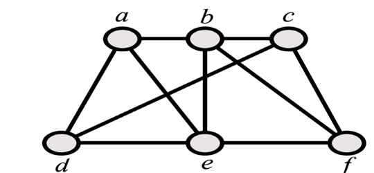

* $`a,d,c,f,e`$：长度为 **4** 的简单通路。
* $`d,e,c,a`$：**不是通路**，因为 $`e,c`$ 之间没有边。
* $`b,c,f,e,b`$：长度为 **4** 的回路，也没有重复边。
* $`a,b,e,d,a,b`$：长度为 **5** 的通路，但**不简单**，因为边 $`\{a,b\}`$ 走了两次。

### 有向图中的通路

定义和无向图类似，但每一步必须满足

```math
e_i=(x_{i-1},x_i)
```

也就是**必须顺着箭头走**。有 $`a\to b`$ 不代表能从 $`b`$ 沿这条边走回 $`a`$

有向回路同样要求起点和终点相同、长度大于 0；简单通路/回路同样要求不重复边

## 二、无向图的连通性

### 连通图

**定义 3**：如果无向图中**每一对不同顶点之间都存在通路**，则称它为**连通图**

通俗点说，就是任意两个点都能走到，允许中间绕路，**不要求两个点直接相邻**

* 一个孤立顶点单独构成的图也是连通图
* 多个顶点的图里如果有孤立点，那整个图一定不连通

**定理 1**：在连通无向图中，每一对不同顶点之间都有一条简单通路

**证明思路**：

1. 连通，所以从 $`u`$ 到 $`v`$ 至少有一条通路，选其中**长度最短**的一条
2. 如果某个顶点重复出现，说明中间绕了一圈，可以把这一段删掉
3. 删掉后仍然能从 $`u`$ 到 $`v`$，但长度更短，和“最短”矛盾

所以最短通路连顶点都不会重复，自然也不会重复边

### 连通分量（连通分支）

**连通分量**：图中**极大的连通子图**，也就是一个完整的“连成一片的部分”

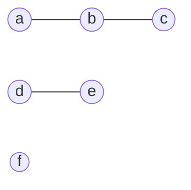

上图有 **3 个连通分量**，顶点集分别为 $`\{a,b,c\}`$、$`\{d,e\}`$、$`\{f\}`$

* 连通图有且只有 **1 个**连通分量
* 非连通图有**至少 2 个**连通分量
* 不同连通分量的顶点不重叠，分量之间没有边
* **孤立点也算一个连通分量**，不要漏掉

> “极大”是说不能再往里面加顶点、边而保持连通，**不是说只挑顶点最多的那一块**。每一块完整的连通部分都是分量

## 三、割点与割边

### 定义

用 $`c(G)`$ 表示图 $`G`$ 的连通分量数：

| 名称 | 删除什么 | 判断标准 |
| --- | --- | --- |
| **割点（Cut Vertex）** | 顶点 $`v`$ **以及与它关联的所有边** | $`c(G-v)>c(G)`$ |
| **割边（Cut Edge / Bridge，桥）** | 边 $`e`$，保留它的端点 | $`c(G-e)>c(G)`$ |

对于原本连通的图，删掉后变得不连通，就说明删的是割点/割边。原图不连通时，要比较删除前后的**分量数量**

### 示例

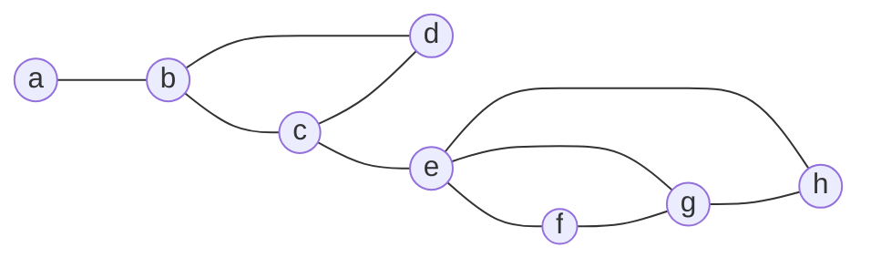

* **割点**：$`b,c,e`$
* **割边**：$`\{a,b\}`$、$`\{c,e\}`$

例如删掉 $`c`$，左边的 $`a,b,d`$ 和右边的 $`e,f,g,h`$ 就分开了；删掉边 $`\{b,c\}`$ 却不会断，因为还能沿 $`b,d,c`$ 绕过去

### 做题怎么判断

* **割点**：假装把这个点和它所有的边擦掉，看是不是多分出来一块
* **割边**：假装只把这条边擦掉，看两端是否还存在其他通路
* **补充判别（无向简单图）**：一条边是割边，当且仅当它不属于任何回路。能绕圈回来的边，删掉后就还有替代路线
* 度数很大不代表一定是割点。度数为 1 的顶点本身不是割点，但与它相连的边是割边

> 割点和割边不能混着判断：两个三角形只共用一个顶点时，共用顶点是割点，但图中没有割边

### 课件练习

**第 24 页**：完全二部图 $`K_{6,10}`$ 有多少条割边？

**答案：0 条** 对任意一条边 $`uv`$，在两组各另选一个点 $`u',v'`$，都能找到替代通路 $`u,v',u',v`$，所以删掉 $`uv`$ 不会断

**第 25 页**：$`b,e,i,f`$ 中哪一个不是割点？

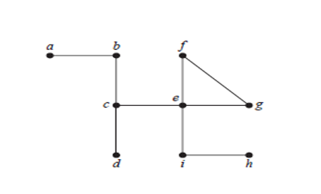

**答案：$`f`$** 删去 $`f`$ 后，$`g`$ 仍可通过 $`e`$ 与其余部分相连；而删去 $`b,e,i`$ 都会增加连通分量数

**第 26 页**：图中有多少条割边？

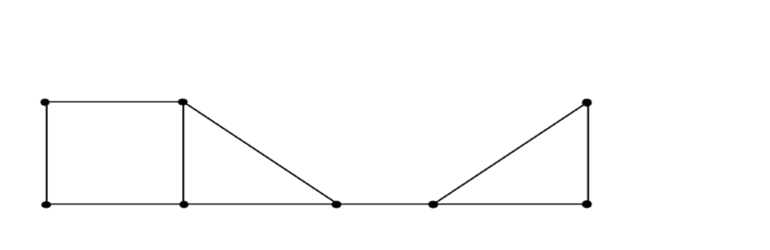

**答案：1 条** 只有连接左右两部分的中间那条边是割边，其余边都能绕回路

## 四、有向图的强连通与弱连通

### 强连通（Strongly Connected）

有向图中，**对任意两个不同顶点 $`a,b`$**，既存在从 $`a`$ 到 $`b`$ 的有向通路，也存在从 $`b`$ 到 $`a`$ 的有向通路，则称这个图**强连通**

这里是“任意两个”，不能只找出一对能来回走的点就说整个图强连通

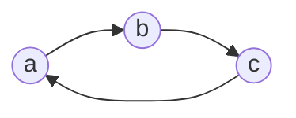

上图强连通。比如从 $`b`$ 回到 $`a`$，虽然没有直接的箭头，但可以走 $`b\to c\to a`$

### 弱连通（Weakly Connected）

**忽略所有边的方向后**，得到的底层无向图是连通图，则原有向图**弱连通**

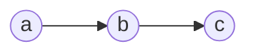

上图弱连通，但不强连通，因为从 $`c`$ 走不回 $`a`$。

```math
\text{强连通}\Rightarrow\text{弱连通}
```

**反过来不成立！** 弱连通也包含强连通的情况，并不专指“弱连通但不强连通”

### 强连通分量（Strongly Connected Component，SCC）

**强连通分量**：不包含在更大的强连通子图中的强连通子图，也就是**极大的强连通子图**

* 同一个强连通分量里的顶点，任意两个都能**相互到达**
* 不同强连通分量的顶点集不重叠，但分量之间**可以存在单向的边**
* 单个顶点也可以构成一个强连通分量，即使没有自环

课件第 32 页的例子有 **3 个**强连通分量：$`\{a\}`$、$`\{e\}`$、$`\{b,c,d\}`$。其中 $`b\to c\to d\to b`$，三个点能相互到达

> 如果题目专门问“最大的强连通分支”，才需要从所有分量里挑规模最大的

### 应用例：找最大的分支（第 59 页）

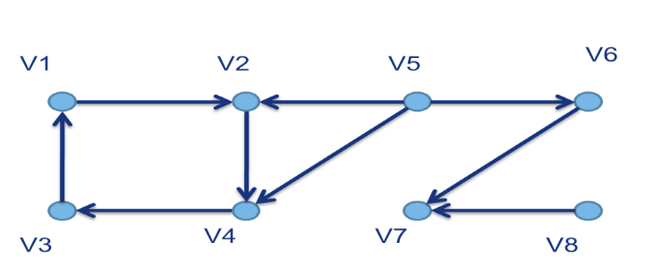

* 强连通分量的顶点集为 $`\{v_1,v_2,v_3,v_4\}`$、$`\{v_5\}`$、$`\{v_6\}`$、$`\{v_7\}`$、$`\{v_8\}`$
* **最大的强连通分支**是 $`\{v_1,v_2,v_3,v_4\}`$ 导出的子图，因为四个点形成有向回路，且不能把外面的点加进来保持相互可达
* 忽略方向后全图连在一起，所以**最大的弱连通分支就是整个图 $`G`$**

## 五、通路、回路与图的同构

### 用回路证明不同构

同构会保持通路、回路的结构，所以**是否存在某个长度的简单回路**也是同构不变量

**例 12**：

* 两图都有 **6 个顶点、8 条边**
* 两图都有 **4 个 3 度顶点、2 个 2 度顶点**
* 但 $`H`$ 中有长度为 3 的回路 $`v_1,v_2,v_6,v_1`$，而 $`G`$ 中没有三角形

所以 $`G`$ 与 $`H`$ **不同构**

> 顶点数、边数、度数序列都相同，仍然可能不同构。前面 4.3 讲过的必要条件，到这里又多了一个很好用的检查项：**有没有三角形、四边形等回路**

### 沿通路寻找同构映射

**课件例 13（第 38–41 页）**：

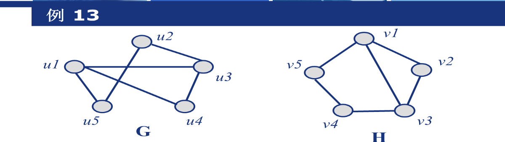

两图各有 5 个顶点、6 条边，度数序列相同，也都有长度为 3、4、5 的简单回路

沿着两图中经过所有顶点的通路，按顺序对应：

```math
u_1,u_4,u_3,u_2,u_5\quad\longleftrightarrow\quad v_3,v_2,v_1,v_5,v_4
```

两边沿途的度数都是 $`3,2,3,2,2`$，于是得到候选映射：

| $`G`$ 中的顶点 | $`H`$ 中对应顶点 |
| --- | --- |
| $`u_1`$ | $`v_3`$ |
| $`u_4`$ | $`v_2`$ |
| $`u_3`$ | $`v_1`$ |
| $`u_2`$ | $`v_5`$ |
| $`u_5`$ | $`v_4`$ |

**最后还得检查所有边**，不能只看选出来的那条通路。这里通路上的 4 条边都对应，剩下的 $`\{u_1,u_3\}`$、$`\{u_1,u_5\}`$ 也分别对应 $`\{v_3,v_1\}`$、$`\{v_3,v_4\}`$，因此这个映射确实是同构

### 练习

**4 个顶点的非同构连通简单图有多少个？**

按边数分类最清楚：

| 边数 | 类型 | 个数 |
| --- | --- | --- |
| 3 | 一条四顶点链 $`P_4`$、星形图 $`K_{1,3}`$ | 2 |
| 4 | 圈图 $`C_4`$、三角形上接一个悬挂顶点 | 2 |
| 5 | 完全图 $`K_4`$ 删去一条边 | 1 |
| 6 | 完全图 $`K_4`$ | 1 |

总共 $`2+2+1+1=6`$ 个

## 六、用邻接矩阵计算通路数

### 定理 2

设图的邻接矩阵为 $`A`$，顶点顺序为 $`v_1,\dots,v_n`$，则从 $`v_i`$ 到 $`v_j`$ 的**长度恰好为 $`r`$ 的通路数**为

```math
\boxed{(A^r)_{ij}}
```

也就是**先算矩阵的 $`r`$ 次方，再取第 $`i`$ 行、第 $`j`$ 列**

* 这里用的是**普通矩阵乘法**，不是布尔乘法，也不是每个元素各自乘方
* 统计的是**允许重复顶点、重复边的通路**，不限定为简单通路。比如 $`a,b,a,b,d`$ 也要算
* 有向图的邻接矩阵仍然是“行表示起点，列表示终点”
* 有平行边时，邻接矩阵元素记录边的条数，经过不同平行边的通路分别计数

> 把结果简写成 $`A^r`$，准确说应该是 **$`A^r`$ 的 $`(i,j)`$ 项**。矩阵给出所有起终点之间的计数，某一对顶点的答案只是其中一个数

### 为什么成立

长度为 1 的通路数就是 $`a_{ij}`$。假设长度为 $`r`$ 的情况已经成立，则

```math
(A^{r+1})_{ij}=\sum_{k=1}^{n}(A^r)_{ik}a_{kj}
```

意思就是：先用 $`r`$ 步从 $`v_i`$ 走到某个 $`v_k`$，再用 1 步从 $`v_k`$ 走到 $`v_j`$。对所有可能的中间点求和，就得到长度为 $`r+1`$ 的通路总数

### 课件例 14（第 45 页）

按顶点 $`a,b,c,d`$ 排序，邻接矩阵为

```math
A=\begin{bmatrix}
0&1&1&0\\
1&0&0&1\\
1&0&0&1\\
0&1&1&0
\end{bmatrix},\qquad
A^4=\begin{bmatrix}
8&0&0&8\\
0&8&8&0\\
0&8&8&0\\
8&0&0&8
\end{bmatrix}
```

所以从 $`a`$ 到 $`d`$ 长度为 4 的通路数为 $`(A^4)_{14}=8`$

这 8 条分别是：

| 前两步 | 完整通路 |
| --- | --- |
| $`a,b,a`$ | $`a,b,a,b,d`$；$`a,b,a,c,d`$ |
| $`a,b,d`$ | $`a,b,d,b,d`$；$`a,b,d,c,d`$ |
| $`a,c,a`$ | $`a,c,a,b,d`$；$`a,c,a,c,d`$ |
| $`a,c,d`$ | $`a,c,d,b,d`$；$`a,c,d,c,d`$ |

### 练习：$`K_4`$ 中两个不同顶点之间长度为 4 的通路数

课件第 46 页，邻接矩阵对角线为 0，其余都是 1。计算得到

```math
A^4=\begin{bmatrix}
21&20&20&20\\
20&21&20&20\\
20&20&21&20\\
20&20&20&21
\end{bmatrix}
```

题目问的是**不同顶点**，取非对角线元素，**答案是 20**。21 是从某个顶点出发、4 步后回到自身的通路数

### 练习：有向图的邻接矩阵与通路数（第 47 页）

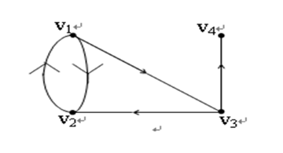

图中的有向边为 $`v_1\to v_2`$、$`v_2\to v_1`$、$`v_1\to v_3`$、$`v_3\to v_2`$、$`v_3\to v_4`$

按 $`v_1,v_2,v_3,v_4`$ 排序：

```math
A=\begin{bmatrix}
0&1&1&0\\
1&0&0&0\\
0&1&0&1\\
0&0&0&0
\end{bmatrix},\qquad
A^2=\begin{bmatrix}
1&1&0&1\\
0&1&1&0\\
1&0&0&0\\
0&0&0&0
\end{bmatrix}
```

* 全图长度为 2 的通路总数，是 $`A^2`$ **所有元素之和**，得到 **6 条**
* 简单回路有 **2 个**：$`v_1,v_2,v_1`$ 和 $`v_1,v_3,v_2,v_1`$。同一个回路换起点写，不重复计数

> 问“从谁到谁”就取一个元素；问“全图一共有多少条长度为 $`r`$ 的通路”就把 $`A^r`$ 的全部元素加起来。矩阵对角线统计闭通路，但其中可能有重复边，不能直接拿来当简单回路个数

## 七、连通性的应用（了解即可）

### 共同语言与间接交流

七个人会的语言如下：

| 人 | 会的语言 |
| --- | --- |
| $`a`$ | 英语 |
| $`b`$ | 汉语、英语 |
| $`c`$ | 英语、西班牙语、俄语 |
| $`d`$ | 日语、汉语 |
| $`e`$ | 德语、西班牙语 |
| $`f`$ | 法语、日语、俄语 |
| $`g`$ | 法语、德语 |

把人当顶点，有共同语言就连一条无向边：

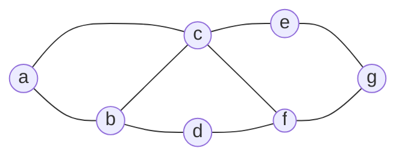

这个图是连通图，所以任意两个人都可以**直接交流或借助其他人翻译来间接交流**。例如 $`a`$ 和 $`g`$ 没有共同语言，但可以通过 $`a\to c\to e\to g`$ 传递信息

注意：**连通只保证存在交流链，不代表任意两个人都有共同语言**

课件还用熟人关系中的人链、桥梁、公路和铁路网络说明连通性的意义：把人或地点当作顶点，把关系或交通连接当作边，就能研究两点之间是否可达、哪里断开会造成分离。

## 八、关键词总结

| 关键词 | 重点解释 |
| --- | --- |
| 通路长度 | 数边，不数顶点位置 |
| 简单通路 | 边不重复，顶点可以重复 |
| 回路 | 起终点相同，而且长度必须大于 0 |
| 连通与直接相邻 | 连通允许经过中间点 |
| 割点与割边 | 删除后连通分量数增加；删点时要连同关联边一起删 |
| 强连通与弱连通 | 强连通要顺着方向来回可达；弱连通先忽略方向 |
| 强连通分量里的“极大” | 不能继续扩大，不一定是全图规模最大的一块 |
| 同构不变量 | 不同可以证伪；都相同还要找映射并检查边 |
| $`(A^r)_{ij}`$ | 允许重复的通路数，不是简单通路数 |
| 全图的定长通路数 | 把矩阵 $`A^r`$ 的所有元素相加 |

# 4.5 欧拉路和汉密尔顿路

## 一、总结定义

| 类型 | 要求走遍什么 | 能不能重复顶点 | 能不能重复边 | 是否回到起点 |
| --- | --- | --- | --- | --- |
| **欧拉通路** | 每条边恰好一次 | 可以 | 不可以 | 可以，也可以不回 |
| **欧拉回路** | 每条边恰好一次 | 可以 | 不可以 | 必须回到起点 |
| **汉密尔顿通路** | 每个顶点恰好一次 | 不可以 | 不可以 | 不回到起点 |
| **汉密尔顿回路** | 每个顶点恰好一次，再返回起点 | 仅起点在末尾再出现一次 | 不可以 | 必须回到起点 |

**欧拉看边，汉密尔顿看点**，这是整节最重要的区别

* 欧拉回路也是欧拉通路的一种，题目说“有欧拉通路，但没有欧拉回路”时，才专指起终点不同的情况
* 汉密尔顿通路和回路这里按通常的非退化情形讨论，汉密尔顿回路的简单图要求至少 3 个顶点
* “简单通路”指**边不重复**，而汉密尔顿通路还额外要求**顶点不重复**

## 二、欧拉通路与欧拉回路

### 定义 1

* **欧拉通路（Euler Path）**：包含图中**每一条边且每条边只经过一次**的通路
* **欧拉回路（Euler Circuit）**：包含图中**每一条边且每条边只经过一次**的回路
* 具有欧拉回路的图称为**欧拉图**

如果图有 $`m`$ 条边，那么欧拉通路/回路长度就是 $`m`$，用顶点序列表示时有 $`m+1`$ 个位置

> 经过同一个顶点很多次没有关系，只要没有把同一条边走两次就行

小学的时候玩过的一个**一笔画一整个图**的游戏，本质上就是找欧拉通路，如果首尾相接就是欧拉回路

### 无向图的判定条件

以下先假设图是**连通的无向图**，允许多重边

| 奇数度顶点的数量 | 欧拉通路 | 欧拉回路 | 起终点 |
| --- | --- | --- | --- |
| **0 个** | 有 | 有 | 起终点相同，可从任意非孤立顶点开始 |
| **2 个** | 有 | 无 | 必须是这两个奇数度顶点，一端出发、另一端结束 |
| **多于 2 个** | 无 | 无 | 无法一笔走完全部边 |

**定理 1**：连通无向多重图有欧拉回路，**当且仅当所有顶点的度数都是偶数**

```math
G\text{ 有欧拉回路}\iff \forall v\in V,\ \deg(v)\equiv0\pmod2
```

**定理 2**：连通无向多重图有欧拉通路但没有欧拉回路，**当且仅当恰好有两个奇数度顶点**

合起来，存在欧拉通路的条件就是：**奇数度顶点有 0 个或 2 个**

> 先检查连通，再数奇数度顶点，两个互不相连的圈虽然每个顶点都是偶数度，也不能一笔走遍所有边
>
> 补充：如果图里有孤立点，讨论“走完所有边”时可以忽略它们，只要求所有非零度顶点在同一个连通分量中，自环对顶点度数贡献 2，平行边按实际条数计算

### 为什么奇偶性能决定结果

**必要性**：

1. 经过一个中间顶点，必须“一条边进、一条边出”，所以使用的边成对出现
2. 对欧拉回路，起点的出发和最后返回也配成一对，因此所有顶点都是偶数度
3. 对起终点不同的欧拉通路，起点多一次出发，终点多一次进入，所以只有这两个点是奇数度

**充分性**：

* 所有顶点都是偶数度时，可以把若干条回路不断拼接成一条包含全部边的回路，具体方法见下一节
* 恰好有两个奇数度顶点 $`u,v`$ 时，在它们之间**额外加一条边**，允许它成为平行边
* 加边后所有顶点都是偶数度，于是存在欧拉回路，再删掉这条额外的边，就得到从 $`u`$ 到 $`v`$ 的欧拉通路

### 例：顶点可以重复

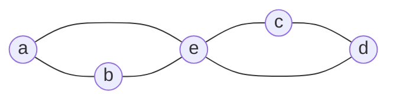

各顶点度数为 $`2,2,2,2,4`$，所以有欧拉回路，例如

```math
a,e,c,d,e,b,a
```

这里 $`e`$ 出现了两次，但每条边都只走了一次，完全没有问题

课件第 10 页的 $`G_3`$ 则只有 $`a,b`$ 是奇数度顶点，因此没有欧拉回路，但存在从 $`a`$ 到 $`b`$ 的欧拉通路

```math
a,c,d,e,b,d,a,b
```

## 三、怎么构造欧拉回路

### 拼接回路的算法

通常称为 **Hierholzer 算法**，核心就是**先走一个圈，没走完就把剩下的圈插进来**

1. 从一个非孤立顶点出发，每次选一条**没有走过的边**，持续走到没有未用边可走
2. 因为顶点全是偶数度，最后只能停在出发点，得到一条回路 $`C`$
3. 如果还有没走过的边，在 $`C`$ 上找一个仍关联未用边的顶点 $`w`$
4. 从 $`w`$ 出发，在剩余边中再走一条回路 $`C'`$
5. 把 $`C'`$ 插入 $`C`$ 中经过 $`w`$ 的位置，继续重复，直到所有边都用完

> 第一步得到的是“走到不能继续的回路”，不保证立刻包含所有边，剩余图也可能不连通，要在与当前回路相接的位置继续找圈

### 在完全图中拼接

在 $`K_5`$ 中，先找一个 5 条边的回路

```math
C_1=v_1,v_2,v_3,v_4,v_5,v_1
```

剩下的 5 条边又组成一个回路

```math
C_2=v_1,v_3,v_5,v_2,v_4,v_1
```

在公共顶点 $`v_1`$ 处拼接，得到欧拉回路

```math
v_1,v_2,v_3,v_4,v_5,v_1,v_3,v_5,v_2,v_4,v_1
```

$`K_5`$ 一共有 $`\frac{5\times4}{2}=10`$ 条边，这条回路也正好走了 10 步

### 栈的实现思路（补充）

```text
选起点 s，压入栈
结果序列设为空
只要栈不为空：
    令 v 为栈顶
    如果 v 还有未使用的关联边 e=(v,u)：
        标记这条边已使用
        将 u 压入栈
    否则：
        弹出 v，放入结果序列
将结果序列反转
```

* 所有度数都为偶数时，从任意非孤立顶点开始
* 恰好有两个奇数度顶点时，从其中一个奇数度顶点开始
* 无向图的一条边虽然出现在两份邻接表中，**只能标记和使用一次**，有平行边时要用边的编号区分

## 四、有向图的欧拉通路

有向图必须**顺着箭头走**，所以不能直接套无向图的“度数奇偶”条件，要比较**入度和出度**

以下都要求忽略方向后，所有非零度顶点位于同一个连通分量

| 类型 | 入度与出度条件 |
| --- | --- |
| 欧拉回路 | 每个顶点都满足 $`\deg^+(v)=\deg^-(v)`$ |
| 起终点不同的欧拉通路 | 起点 $`s`$ 满足出度比入度多 1，终点 $`t`$ 满足入度比出度多 1，其余顶点入度等于出度 |

```math
\begin{aligned}
\deg^+(s)-\deg^-(s)&=1\\
\deg^+(t)-\deg^-(t)&=-1\\
\deg^+(v)-\deg^-(v)&=0\qquad(v\ne s,t)
\end{aligned}
```

对于有边的有向图，也可以把欧拉回路的条件写成：**所有非零度顶点构成强连通图，且每个顶点入度等于出度**

**只有强连通还不够！** 入度、出度不平衡时，仍然不能形成欧拉回路

课件第 25 页的 $`H_3`$ 有欧拉通路

```math
c,a,b,c,d,b
```

起点 $`c`$ 的出度比入度多 1，终点 $`b`$ 的入度比出度多 1，所以不能再要求回到起点

## 五、汉密尔顿通路与汉密尔顿回路

### 定义 2

**汉密尔顿通路（Hamilton Path）**：经过图中每个顶点**恰好一次**的通路

设 $`G`$ 有 $`n`$ 个顶点，可以写成

```math
v_1,v_2,\dots,v_n
```

其中 $`v_1,\dots,v_n`$ 两两不同，恰好组成图的全部顶点，且相邻两个顶点之间有边

**汉密尔顿回路（Hamilton Circuit）**：在汉密尔顿通路的基础上，末尾还能沿一条边返回起点

```math
v_1,v_2,\dots,v_n,v_1
```

* 汉密尔顿通路长度为 $`n-1`$
* 汉密尔顿回路长度为 $`n`$，起点在末尾重复一次是为了闭合，其他顶点都只出现一次
* 具有汉密尔顿回路的图称为**汉密尔顿图**，也常简称哈密顿图
* 要走遍所有顶点，但**不要求使用所有边**

### 存在回路与存在通路的关系

有汉密尔顿回路，删掉回路中的任意一条边，就得到汉密尔顿通路

```math
\text{有汉密尔顿回路}\Rightarrow\text{有汉密尔顿通路}
```

反过来不成立，例如一条 4 个顶点的链

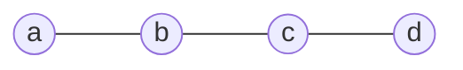

它有汉密尔顿通路 $`a,b,c,d`$，但两端没有边连起来，所以没有汉密尔顿回路

### 怎样快速排除汉密尔顿回路

以下针对至少 3 个顶点的无向简单图

* **不连通**：无法走遍所有顶点
* **有度数为 1 的顶点**：回路进来后没有另一条边可以出去
* **有割点**：要走遍割点两侧的顶点并闭合，就不得不重复经过这个点
* **有割边**：进入另一部分后还得原路返回，不可能构成经过每个顶点恰好一次的回路

> 这些是排除条件，通过这些检查并不代表一定存在汉密尔顿回路

补充一个检查通路的办法：**度数为 1 的顶点只能放在汉密尔顿通路的两端**，所以如果有超过 2 个度数为 1 的顶点，连汉密尔顿通路也不可能存在

课件第 50 页的图就有 $`a,d,f`$ 三个度数为 1 的顶点，因此既没有汉密尔顿回路，也没有汉密尔顿通路

### 和欧拉回路对照的经典反例

两个三角形只共用一个顶点 $`c`$

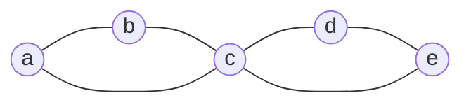

* 外围四个点度数为 2，$`c`$ 的度数为 4，所以**有欧拉回路**，例如 $`c,a,b,c,d,e,c`$
* $`c`$ 是割点，要绕遍两个三角形再闭合必须重复经过 $`c`$，所以**没有汉密尔顿回路**

> 所有顶点都有两个度数，应理解为所有顶点的度数至少为 2，共用顶点 $`c`$ 的实际度数是 4

另一个方向，$`K_4`$ 有汉密尔顿回路，但四个顶点的度数都是 3，所以没有欧拉回路

**欧拉图和汉密尔顿图互相不能推出！**

### 找汉密尔顿回路时的局部限制

* 每个顶点在**最终选出的回路中**恰好关联两条边
* 原图中度数为 2 的顶点，它的两条边都必须选入回路
* 如果在还有顶点没经过时，选出的边已经闭合成一个小圈，就不能再把剩下的点接进这条回路

> 课件说“汉密尔顿回路不能包含较小回路”，指的是选边时不能提前闭合，不是说原图里不能有三角形等小圈，完全图当然可以有很多小圈

## 六、汉密尔顿回路的充分条件

欧拉回路有简单的奇偶度数判别，但汉密尔顿回路不能只靠奇数度顶点数量来判断

### 狄拉克定理（Dirac）

设 $`G`$ 是有 $`n\ge3`$ 个顶点的**无向简单图**，如果**每一个顶点**都满足

```math
\deg(v)\ge\frac n2
```

那么 $`G`$ 一定有汉密尔顿回路

度数是整数，所以 $`n`$ 为奇数时要向上取整，例如 $`n=7`$ 时，每个顶点度数至少为 4

### 奥雷定理（Ore）

设 $`G`$ 是有 $`n\ge3`$ 个顶点的**无向简单图**，如果**每一对不相邻的顶点** $`u,v`$ 都满足

```math
\deg(u)+\deg(v)\ge n
```

那么 $`G`$ 一定有汉密尔顿回路

注意检查的是**不相邻的顶点对**，相邻的顶点对不用检查

| 定理 | 要检查什么 | 能得到什么 |
| --- | --- | --- |
| 狄拉克 | 每个顶点的度数至少为 $`n/2`$ | 一定有汉密尔顿回路 |
| 奥雷 | 每对不相邻顶点的度数和至少为 $`n`$ | 一定有汉密尔顿回路 |

狄拉克条件能推出奥雷条件，因为任取两点都有 $`\deg(u)+\deg(v)\ge n`$，奥雷的适用范围更广

**它们都是充分条件，不是必要条件！** 不满足条件时，只能说这个定理用不上，不能直接判断不存在汉密尔顿回路

例如圈图 $`C_5`$ 本身就是汉密尔顿回路，但每个顶点的度数只有 2，既不满足狄拉克条件，也不满足奥雷条件

### 奥雷定理的证明思路

**反证法的关键：先把反例补成“再加边就会出现汉密尔顿回路”的极大反例**

1. 假设 $`G`$ 满足奥雷条件，却没有汉密尔顿回路
2. 不断加入不会产生汉密尔顿回路的边，得到极大的非汉密尔顿图 $`G'`$，加边只会增大度数，所以奥雷条件仍成立
3. $`G'`$ 不可能是完全图，因此存在不相邻顶点 $`a,b`$，加上边 $`ab`$ 后出现的汉密尔顿回路必须经过这条新边
4. 删去新边 $`ab`$，在 $`G'`$ 中得到汉密尔顿通路 $`a=v_1,v_2,\dots,v_n=b`$

如果对某个 $`i\in\{1,\dots,n-1\}`$，同时存在边 $`av_{i+1}`$ 和 $`bv_i`$，就能构造回路

```math
a=v_1,v_2,\dots,v_i,b=v_n,v_{n-1},\dots,v_{i+1},a
```

它恰好经过全部顶点一次，和 $`G'`$ 没有汉密尔顿回路矛盾

因此，在 $`n-1`$ 个位置 $`i`$ 中，“$`a`$ 连接 $`v_{i+1}`$”与“$`b`$ 连接 $`v_i`$”不能同时发生，于是

```math
\deg_{G'}(a)+\deg_{G'}(b)\le n-1
```

但奥雷条件要求这个度数和至少为 $`n`$，矛盾，因此原假设不成立

> 课件第 62 页把 $`\deg(b)=n-1-k`$ 写成了等号，证明实际只需要并且一般只能得到 $`\deg(b)\le n-1-k`$

### 求解难度（了解即可）

“判断一个一般图是否存在汉密尔顿回路”为 **NP 完全问题**，所以不能指望像欧拉回路那样，仅数一遍奇数度顶点就得到完整判定

这也解释了为什么这节要同时掌握构造、排除条件和充分条件：有的题能直接画出回路，有的题能找反例排除，有的题则可以直接套定理

## 七、课件练习整理

### 练习 1、6：无向图的欧拉条件

**第 21 页**：连通无向图有欧拉回路，当且仅当没有奇数度顶点，**选 D**

**第 42 页**：完全图 $`K_n`$ 的每个顶点度数都是 $`n-1`$，所以在非退化情形下，**$`n`$ 为奇数时是欧拉图**

```math
n-1\text{ 为偶数}\iff n\text{ 为奇数}
```

### 练习 2：找一条欧拉通路

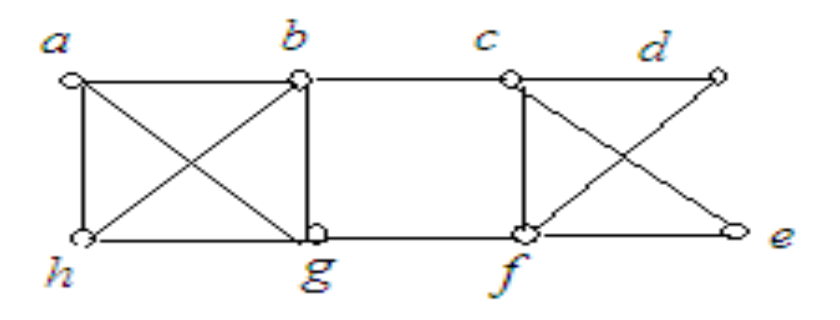

只有 $`a,h`$ 是奇数度顶点，其余顶点都是偶数度，因此可以从 $`a`$ 出发，在 $`h`$ 结束

一条可行的通路为

```math
a,g,f,e,c,d,f,c,b,g,h,b,a,h
```

一共 13 条边，每条恰好使用一次，图中没有标出顶点的交叉处不当作新顶点

### 练习 3、4：图形中的欧拉回路

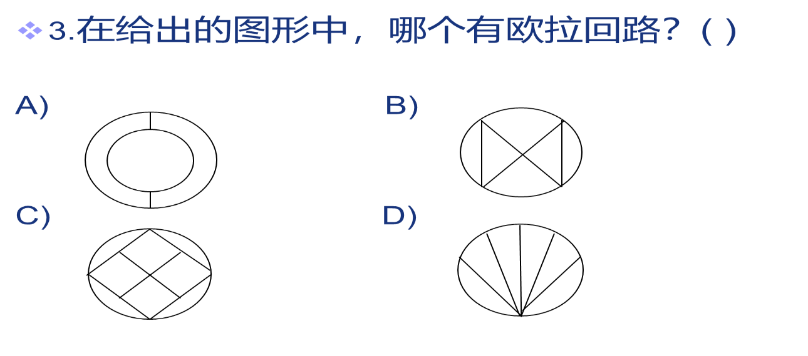

**第 27 页选 B**，B 的连接顶点都是偶数度，其他选项都存在奇数度顶点

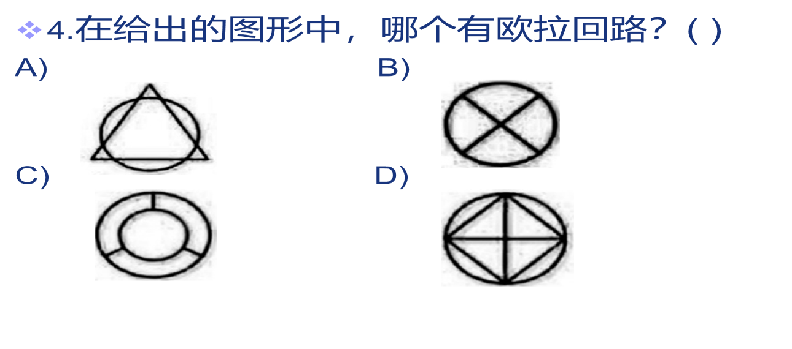

**第 28 页选 A**，按图中相交处作为连接点的画法，圆与三角形相交的位置度数为 4，三角形的角度数为 2，所以可以形成欧拉回路

> 这两题的图没有逐一标出顶点，数度数时要按实际连接关系判断，线条只是跨过而未连接时，不能擅自增加顶点

### 练习 5：有平行边的欧拉回路

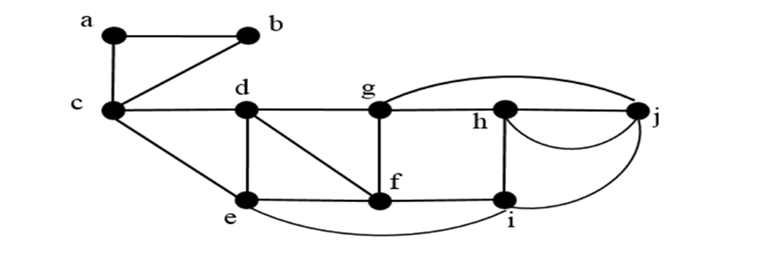

各顶点都是偶数度，一条欧拉回路为

```math
a,c,e,i,j,h,j,g,h,i,f,g,d,f,e,d,c,b,a
```

其中 $`h,j`$ 之间有两条平行边，序列中的 $`j,h,j`$ 分别走的是**两条不同的边**，不算重复用边

### 练习 7：有向图（第 43 页）

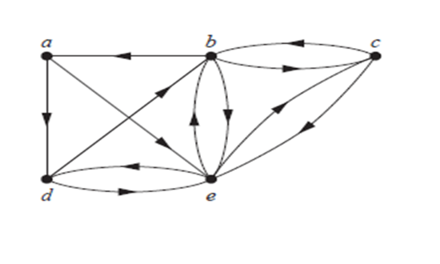

按图中的箭头统计：

| 顶点 | 出度 | 入度 | 出度减入度 |
| --- | --- | --- | --- |
| $`a`$ | 2 | 1 | 1 |
| $`b`$ | 3 | 3 | 0 |
| $`c`$ | 2 | 2 | 0 |
| $`d`$ | 2 | 2 | 0 |
| $`e`$ | 3 | 4 | -1 |

所以**没有欧拉回路，但存在从 $`a`$ 到 $`e`$ 的欧拉通路**，例如

```math
a,e,c,e,d,e,b,c,b,a,d,b,e
```

这里 $`e,c,e`$、$`e,d,e`$ 分别使用方向相反的两条有向边，允许这样走

### 练习 8、9、10：综合判断

**练习 8：按有向图且忽略孤立点的通常语境，错误项是 D**

* A：有向图有欧拉回路，所有非零度顶点之间可以沿回路相互到达
* B：无向图有割边，不可能有欧拉回路
* C：无向图有割点，不可能有汉密尔顿回路
* D：有向图强连通只保证可达性，不能保证每个顶点的入度和出度相等，所以不一定有欧拉回路

> A 没有限定图的类型，“强连通”应当用于有向图，若存在额外孤立点，也不能说整个图强连通，不能把这句话脱离前提使用

**练习 9：正确项是 C**

* A 错：$`K_4`$ 有汉密尔顿回路，但不是欧拉图
* B 错：$`K_n`$ 要求 $`n`$ 为奇数才有欧拉回路
* C 对：有 0 个或 2 个奇数度顶点的连通无向图存在欧拉通路
* D 错：$`K_5`$ 有汉密尔顿回路，但不是平面图

**第 66 页练习 10：同时有欧拉回路和汉密尔顿回路的图是 $`K_9`$，选 A**

| 选项 | 欧拉回路 | 汉密尔顿回路 | 理由 |
| --- | --- | --- | --- |
| $`K_9`$ | 有 | 有 | 每点度数为 8，完全图也能按任意顶点顺序绕一圈 |
| $`K_{10}`$ | 无 | 有 | 每点度数为 9 |
| $`K_{2,3}`$ | 无 | 无 | 有奇数度顶点，且二部图两组大小不同 |
| $`K_{3,3}`$ | 无 | 有 | 每点度数为 3，但可以两组交替走遍所有顶点 |

补充：二部图的回路必须在两组间交替经过，所以有汉密尔顿回路时，**两组顶点数一定相等**

### 练习 11、13：是否有汉密尔顿回路

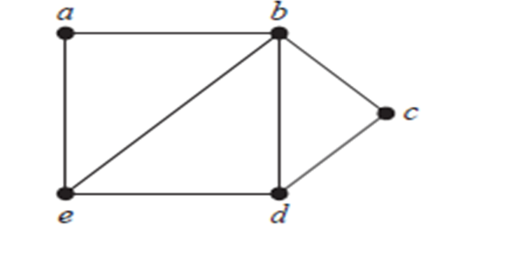

**第 67 页有汉密尔顿回路**，例如

```math
a,b,c,d,e,a
```

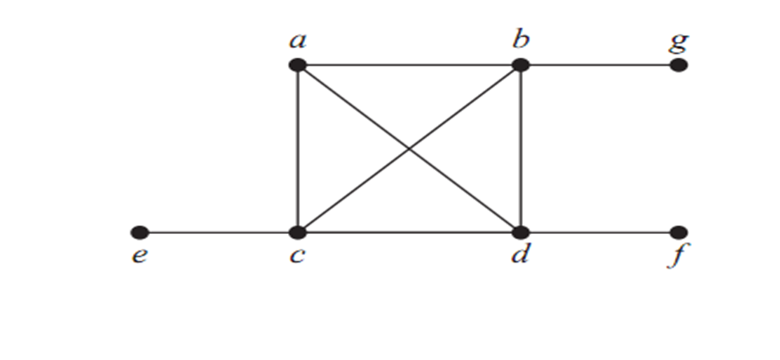

**第 69 页没有汉密尔顿回路**，因为 $`e,f,g`$ 的度数都是 1

进一步，它也没有汉密尔顿通路，因为通路只有两个端点，无法同时容纳三个度数为 1 的顶点

## 八、应用题

### 圆桌语言安排

沿用 4.4 的共同语言表：

| 人 | 会的语言 |
| --- | --- |
| $`a`$ | 英语 |
| $`b`$ | 汉语、英语 |
| $`c`$ | 英语、西班牙语、俄语 |
| $`d`$ | 日语、汉语 |
| $`e`$ | 德语、西班牙语 |
| $`f`$ | 法语、日语、俄语 |
| $`g`$ | 法语、德语 |

每人作为顶点，有共同语言就连边，要求所有人围成一圈且相邻的人能直接交流，就是在共同语言图中找**汉密尔顿回路**

一种可行座次为

```math
a,b,d,f,g,e,c,a
```

相邻两人使用的语言依次为：英语、汉语、日语、法语、德语、西班牙语、英语

> 4.4 的“连通”只要求能借助别人翻译来交流，这题要求**每个人和左右邻座直接交流**，因此需要汉密尔顿回路，单纯连通还不够

### 国际象棋的马：每种跳动恰好一次

把 $`8\times8`$ 棋盘的 64 个格子当顶点，两个格子之间能走一步马，就连一条无向边

课件问的是**完成每一种可能的跳动恰好一次**，按无向图模型，就是要求欧拉通路，不是通常“每个格子访问一次”的马踏棋盘问题

棋盘中有度数为 3 的顶点，例如角旁的部分格子，而且这样的奇数度顶点多于两个，所以**不存在经过每条边恰好一次的通路**

### 11 人午餐：每天两侧邻座都不能重复

把 11 个人作为 $`K_{11}`$ 的顶点，每天圆桌上的相邻关系构成一个汉密尔顿回路

两人不能重复做邻座，相当于每天选出的汉密尔顿回路之间**没有公共边**

```math
\text{总边数}=\frac{11\times10}{2}=55,\qquad
\text{每天用边数}=11
```

所以最多有 $`55/11=5`$ 天

这个上界确实可以达到，将人编号为 $`0,1,\dots,10`$，第 $`k`$ 天按模 11 每次前进 $`k`$ 个编号，取 $`k=1,2,3,4,5`$

```math
0,k,2k,\dots,10k,0\pmod{11}
```

因为 11 是质数，每一天都能走遍 11 个编号，各天使用的无向边步长又不同，所以五天的相邻关系不重复

**答案：最多 5 天**，只数出上界还不够，这里给出构造说明可以做到

### 7 人交友会：至少几次才能互相认识

每次圆桌安排中，一个人能认识左右两侧的 2 个人，一共要认识其余 6 个人，所以至少要 $`6/2=3`$ 次

把人编号为 $`0,1,\dots,6`$，以下三次安排可以覆盖所有两人组合：

| 次数 | 圆桌顺序，末尾再接回开头 |
| --- | --- |
| 第 1 次 | $`0,1,2,3,4,5,6`$ |
| 第 2 次 | $`0,2,4,6,1,3,5`$ |
| 第 3 次 | $`0,3,6,2,5,1,4`$ |

因此**至少安排 3 次座次**，如果把第一次安排算作初始座次，之后需要重新安排 2 次

对质数 $`n\ge3`$，同样取模 $`n`$ 的步长 $`1,2,\dots,(n-1)/2`$，得到

```math
\text{最少座次安排次数}=\frac{n-1}{2}
```

### 中国邮差问题与旅行商问题

| 问题 | 重点 | 图论模型 |
| --- | --- | --- |
| 中国邮差问题 | 走遍所有街道，研究总路程尽可能短的闭合巡回路线 | 走遍每条边，和欧拉回路有关 |
| 旅行商问题 | 访问每个城市一次并返回，要求总路程最短 | 带权图中寻找总权重最小的汉密尔顿回路 |

存在欧拉回路时，邮差可以每条边只走一次就返回，若不存在欧拉回路，为了走遍所有边并返回，通常需要重复部分边

**只有欧拉通路而没有欧拉回路时，可以不重复边走完，但终点会和起点不同**，不要把“可以走完”和“可以走完再回来”混为一谈

# 4.6 最短路径问题

## 一、带权图与最短路径

### 边的权重表示什么

**带权图（Weighted Graph）**：给图中每条边赋一个数，这个数称为边的**权重**，记作 $`w(u,v)`$

| 实际问题 | 顶点 | 边 | 权重 |
| --- | --- | --- | --- |
| 城市间的最短路线 | 城市 | 连接城市的道路 | 距离 |
| 飞行时间最短 | 机场或城市 | 可乘坐的航班 | 飞行时间 |
| 机票总价最低 | 城市 | 两城市之间的航线 | 票价 |

“最短”取决于权重表示什么，不一定是地图上距离最近，也可能是用时最少、花费最低

### 路径的长度

对路径 $`P=v_0,v_1,\dots,v_k`$，它的**总权重**为

```math
\ell(P)=\sum_{i=0}^{k-1}w(v_i,v_{i+1})
```

**最短路径**就是给定起点和终点后，总权重最小的路径

* 无权图通常把每条边看作权重为 1，此时最短就是经过的边数最少
* 带权图要把权重加起来，**经过的边少，不一定总权重小**
* 最短路径可能不唯一，但最短路径的长度是一个确定值
* 起终点之间没有任何路径时，距离记为 $`\infty`$

例如，一条两步路线的权重为 $`2+3=5`$，另一条一步直达路线的权重为 9，那么两步路线反而更短

最短路径**不要求走遍所有边，也不要求经过所有顶点**

## 二、Dijkstra 算法的基本思想

### 适用条件

**Dijkstra 算法** 用于求非负权图中的最短路径

* 所有边权都必须**大于等于 0**，正权图当然满足要求
* 可以用于无向图，也可以用于有向图，有向图只能沿箭头方向更新
* **存在负权边时不能直接套用**，即使某一次碰巧算对，也不能保证算法正确
* 从一个起点运行，可以求这个起点到其他所有可达顶点的最短距离
* 如果只问到某个终点的距离，可以在这个终点的距离**正式确定后**停止

### 两类顶点与两个记录

以起点 $`a`$ 为例，用以下记号记录状态

| 记号 | 含义 |
| --- | --- |
| $`S`$ | 最短距离已经确定的顶点集合 |
| $`L(v)`$ | 当前找到的从 $`a`$ 到 $`v`$ 的最短距离标记 |
| $`\operatorname{prev}(v)`$ | 当前这条路线中，进入 $`v`$ 前经过的顶点 |

* $`v\in S`$：$`L(v)`$ 已经是最终答案，以后不需要修改
* $`v\notin S`$：$`L(v)`$ 还是暂定值，后面可能找到更短的路线

**关键是每次从还没确定的顶点里，挑一个 $`L`$ 最小的顶点，把它的距离确定下来**

> 比较的是“从起点走到这个点的累计距离”，不是当前顶点连出去的哪条边最短

### 初始化

```math
L(a)=0,\qquad L(v)=\infty\quad(v\ne a),\qquad S=\varnothing
```

起点到自己的距离是 0，其他点先记为未知，前驱记录先设为空

若用权重矩阵表示图，通常约定

```math
w(u,v)=\begin{cases}
0,&u=v\\
\text{边的权重},&u\ne v\text{ 且存在边 }(u,v)\\
\infty,&u\ne v\text{ 且不存在边 }(u,v)
\end{cases}
```

无向图满足 $`w(u,v)=w(v,u)`$，有向图一般不满足

> 不能把“没有边”写成权重 0，权重为 0 的边和没有边是两回事

### 更新距离：松弛操作

确定了顶点 $`u`$ 后，尝试通过它去到尚未确定的顶点 $`v`$

```math
\boxed{L(v)\leftarrow\min\{L(v),\ L(u)+w(u,v)\}}
```

意思就是比较两种方案：

1. 保留原来找到的路线，距离是 $`L(v)`$
2. 先走到 $`u`$，再沿边 $`(u,v)`$ 过去，距离是 $`L(u)+w(u,v)`$

如果第二种更短，就更新距离，并记录

```math
\operatorname{prev}(v)\leftarrow u
```

这个“发现更短路线就替换”的过程叫做**松弛（Relaxation）**

## 三、完整算法与为什么正确

### 算法步骤

```text
输入：非负权图 G、起点 a、终点 z

对每个顶点 v：
    L(v) := ∞
    prev(v) := 空

L(a) := 0
S := 空集

只要 z 不在 S 中：
    从不在 S 中的顶点里，选取 L(u) 最小的顶点 u

    如果没有这样的 u，或 L(u) = ∞：
        停止，z 不可达

    将 u 加入 S

    如果 u = z：
        停止，终点的距离已经确定

    对每个不在 S 中、且能由 u 沿一条边到达的顶点 v：
        如果 L(u) + w(u,v) < L(v)：
            L(v) := L(u) + w(u,v)
            prev(v) := u

输出：L(z)，以及由 prev 还原的最短路径
```

**做题顺序：选最小标记、加入确定集合、更新相邻顶点，再重复**

* 并列最小的顶点可以任选一个先处理，最终最短距离不会变
* 想求起点到所有点的距离，就继续处理其余顶点，直到全部确定，或者剩余标记全是 $`\infty`$
* 只求某个终点时，必须等它被选入 $`S`$，不能在第一次更新它时就结束

### 为什么选最小标记就能确定

非负权保证：**沿着路径继续往后走，累计权重不会变小**

假设现在选出的最小暂定标记属于 $`u`$，但还存在一条更短的真实路线

沿这条更短路线，从起点走到第一个不在 $`S`$ 中的顶点 $`y`$，它前面的顶点已经在 $`S`$ 中，因此处理那个前驱时，算法就已经考虑过走到 $`y`$ 的方案

于是 $`L(y)`$ 不会大于这条路线到 $`y`$ 的前缀长度，而非负权又保证这个前缀不会长于整条路线

这样就得到一个尚未确定、标记比 $`L(u)`$ 更小的顶点 $`y`$，与“$`u`$ 的标记最小”矛盾

所以 $`u`$ 的标记可以放心确定，之后不会再被更短路线推翻

### 负权为什么会破坏这个结论

考虑下面这个有向图

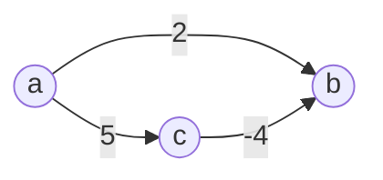

从 $`a`$ 出发，算法会先把 $`b`$ 的距离确定为 2，但实际存在更短路线

```math
a\to c\to b,\qquad 5+(-4)=1
```

如果已经把 $`b`$ 当作最终确定的顶点，就错过了后面负权边带来的改进

**Dijkstra 的正确性依赖非负权，这个前提不能漏**

## 四、完整算例：从 a 到 z

### 带权图

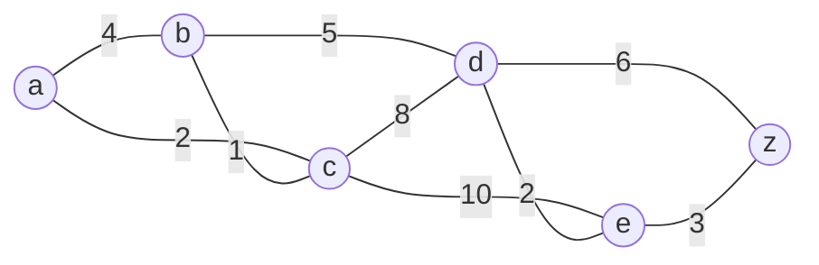

图是无向图，所有边权非负，可以直接使用 Dijkstra 算法

### 逐步更新距离标记

表中记录的是**本轮选入顶点并完成更新之后**的标记

| 轮次 | 本轮选入 $`S`$ 的点 | $`L(a)`$ | $`L(b)`$ | $`L(c)`$ | $`L(d)`$ | $`L(e)`$ | $`L(z)`$ |
| --- | --- | --- | --- | --- | --- | --- | --- |
| 初始化 | 无 | 0 | $`\infty`$ | $`\infty`$ | $`\infty`$ | $`\infty`$ | $`\infty`$ |
| 1 | $`a`$ | 0 | 4 | 2 | $`\infty`$ | $`\infty`$ | $`\infty`$ |
| 2 | $`c`$ | 0 | 3 | 2 | 10 | 12 | $`\infty`$ |
| 3 | $`b`$ | 0 | 3 | 2 | 8 | 12 | $`\infty`$ |
| 4 | $`d`$ | 0 | 3 | 2 | 8 | 10 | 14 |
| 5 | $`e`$ | 0 | 3 | 2 | 8 | 10 | 13 |
| 6 | $`z`$ | 0 | 3 | 2 | 8 | 10 | 13 |

确定顶点的顺序为

```math
a,c,b,d,e,z
```

### 几次关键更新

**确定 $`c`$ 时**：

```math
\begin{aligned}
L(b)&=\min\{4,2+1\}=3\\
L(d)&=\min\{\infty,2+8\}=10\\
L(e)&=\min\{\infty,2+10\}=12
\end{aligned}
```

所以虽然 $`a`$ 和 $`b`$ 直接相连，绕一下 $`c`$ 反而更短

**确定 $`b`$ 时**：

```math
L(d)=\min\{10,3+5\}=8
```

**确定 $`d`$ 时**：

```math
\begin{aligned}
L(e)&=\min\{12,8+2\}=10\\
L(z)&=\min\{\infty,8+6\}=14
\end{aligned}
```

这时 $`z`$ 虽然已经有标记 14，但还不能停止，因为它还没有被选入 $`S`$

**确定 $`e`$ 时**：

```math
L(z)=\min\{14,10+3\}=13
```

随后选入 $`z`$，它的最短距离才正式确定

### 根据前驱还原路线

最终前驱记录为

| 顶点 | 前驱 |
| --- | --- |
| $`c`$ | $`a`$ |
| $`b`$ | $`c`$ |
| $`d`$ | $`b`$ |
| $`e`$ | $`d`$ |
| $`z`$ | $`e`$ |

从终点反着找，是 $`z,e,d,b,c,a`$，再反转得到

```math
a\to c\to b\to d\to e\to z
```

总权重为

```math
2+1+5+2+3=\boxed{13}
```

> 不能把“顶点被确定的顺序”直接当作最短路线，这个例子中两者刚好一致，一般情况下要根据前驱记录回溯

## 五、算法复杂度与反向练习（后面都是例子，速通可以不用看）

### 朴素实现的时间复杂度

设图有 $`n`$ 个顶点

| 操作 | 每轮开销 |
| --- | --- |
| 扫描未确定的顶点，找最小标记 | $`O(n)`$ |
| 检查其他顶点，尝试更新标记 | $`O(n)`$ |
| 最多处理的轮数 | $`n`$ 轮 |

因此，使用线性扫描和权重矩阵的实现，总时间复杂度为

```math
\boxed{O(n^2)}
```

这是对应具体实现的复杂度，不是所有 Dijkstra 实现都必须用 $`O(n^2)`$，使用邻接表和优先队列还可以进一步优化

### 从 z 出发求到 a 的距离

仍使用上面的无向图，这次从 $`z`$ 出发

| 轮次 | 本轮确定的点 | $`L(a)`$ | $`L(b)`$ | $`L(c)`$ | $`L(d)`$ | $`L(e)`$ | $`L(z)`$ |
| --- | --- | --- | --- | --- | --- | --- | --- |
| 初始化 | 无 | $`\infty`$ | $`\infty`$ | $`\infty`$ | $`\infty`$ | $`\infty`$ | 0 |
| 1 | $`z`$ | $`\infty`$ | $`\infty`$ | $`\infty`$ | 6 | 3 | 0 |
| 2 | $`e`$ | $`\infty`$ | $`\infty`$ | 13 | 5 | 3 | 0 |
| 3 | $`d`$ | $`\infty`$ | 10 | 13 | 5 | 3 | 0 |
| 4 | $`b`$ | 14 | 10 | 11 | 5 | 3 | 0 |
| 5 | $`c`$ | 13 | 10 | 11 | 5 | 3 | 0 |
| 6 | $`a`$ | 13 | 10 | 11 | 5 | 3 | 0 |

得到路线

```math
z\to e\to d\to b\to c\to a
```

总权重仍然为 $`3+2+5+1+2=13`$

**无向图中，两点间的最短距离具有对称性**，但有向图不一定能反向走，更不能直接把原路线倒过来当答案

## 六、旅行商问题

### 问题定义

**旅行商问题（Traveling Salesperson Problem，TSP）**：从一个城市出发，访问其他每个城市恰好一次，最后返回起点，使总路程、总时间或总费用最小

在图论中，就是寻找**总权重最小的汉密尔顿回路**

```math
\min\left\{
w(v_1,v_2)+w(v_2,v_3)+\cdots+w(v_{n-1},v_n)+w(v_n,v_1)
\right\}
```

其中 $`v_1,\dots,v_n`$ 恰好是全部城市，且每个城市出现一次

### 与单纯寻找汉密尔顿回路的区别

* 找汉密尔顿回路：找到一个能走遍所有顶点并返回的回路就行
* TSP：可能有很多这样的回路，还要比较总权重，找其中最小的
* Dijkstra：只解决起点到某个终点的最短路径，不会自动保证访问所有城市

**对每一段都选局部最便宜的航班，也不保证整圈的总费用最低**，因为前面的选择会影响后面剩下哪些城市以及最后能怎样返回

### 完全无向图中有多少条候选回路

对 $`n\ge3`$ 个城市，假设任意两城之间都能直达，并且来回权重相同

1. 固定一个城市作为起点，剩下的 $`n-1`$ 个城市有 $`(n-1)!`$ 种排列
2. 同一个回路顺着走、反着走算同一条，所以再除以 2

```math
\boxed{\text{不同的汉密尔顿回路数}=\frac{(n-1)!}{2}}
```

例如 5 个城市有

```math
\frac{4!}{2}=12
```

**除以 2 的前提是无向、对称，而且把相反方向视为同一个回路**，有向图或往返费用不同时不能这样合并

### 为什么枚举很快就不够用

25 个城市需要检查的候选回路数为

```math
\frac{24!}{2}=310224200866619719680000
```

即使每检查一个回路只用 1 纳秒，总耗时也约为 $`9.83\times10^6`$ 年，接近一千万年

顶点数只增加一些，候选数量却按阶乘增长，所以“把所有城市顺序全部列出来”只适合很小的例子

## 七、机票最低总价的练习

### 城市与票价

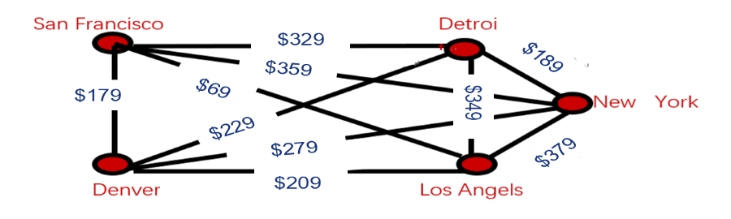

用字母简记城市，避免路线太长看不清

| 代号 | 城市 |
| --- | --- |
| $`S`$ | 旧金山 San Francisco |
| $`D`$ | 丹佛 Denver |
| $`T`$ | 底特律 Detroit |
| $`L`$ | 洛杉矶 Los Angeles |
| $`N`$ | 纽约 New York |

票价单位为美元，图中的边没有方向，因此往返价格按相同数值处理

| 城市 | $`S`$ | $`D`$ | $`T`$ | $`L`$ | $`N`$ |
| --- | --- | --- | --- | --- | --- |
| $`S`$ | 0 | 179 | 329 | 69 | 359 |
| $`D`$ | 179 | 0 | 229 | 209 | 279 |
| $`T`$ | 329 | 229 | 0 | 349 | 189 |
| $`L`$ | 69 | 209 | 349 | 0 | 379 |
| $`N`$ | 359 | 279 | 189 | 379 | 0 |

### 返回出发城市时的最低总价

固定从旧金山出发，把相反方向的同一回路合并后，共有 12 条候选路线

| 路线 | 总票价 |
| --- | --- |
| $`S,D,T,L,N,S`$ | 1495 |
| **$`S,D,T,N,L,S`$** | **1045** |
| $`S,D,L,T,N,S`$ | 1285 |
| $`S,D,L,N,T,S`$ | 1285 |
| $`S,D,N,T,L,S`$ | 1065 |
| $`S,D,N,L,T,S`$ | 1515 |
| $`S,L,D,T,N,S`$ | 1055 |
| $`S,L,D,N,T,S`$ | 1075 |
| $`S,L,T,D,N,S`$ | 1285 |
| $`S,L,N,D,T,S`$ | 1285 |
| $`S,N,D,L,T,S`$ | 1525 |
| $`S,N,L,D,T,S`$ | 1505 |

所以一种最低价航线为

```math
\text{旧金山}\to\text{丹佛}\to\text{底特律}\to\text{纽约}\to\text{洛杉矶}\to\text{旧金山}
```

总价为

```math
179+229+189+379+69=\boxed{1045\text{ 美元}}
```

反向走同一圈也有相同总价，从这条回路上的其他城市开始也不会改变总价

### 如果只要求访问每个城市，不要求返回

这时目标变成**总权重最小的汉密尔顿通路**，和 TSP 的闭合巡回要求不同

如果起终点也不作限制，一条最低价路线为

```math
\text{洛杉矶}\to\text{旧金山}\to\text{丹佛}\to\text{底特律}\to\text{纽约}
```

总价为

```math
69+179+229+189=\boxed{666\text{ 美元}}
```

> 读题时先确认是否要求返回起点，以及起终点是否指定，条件不同，答案也会不同

# 4.7 平面图

## 一、平面图与平面表示

### 基本定义

**平面图（Planar Graph）**：能够在平面上画出，并且任意两条边只允许在公共端点处相交的图

满足这个要求的一种具体画法，称为图的**平面表示**

* 边可以画成曲线，不要求一定是直线
* 可以移动顶点、弯曲边，只要顶点之间的连接关系不变
* 两条边在公共端点碰到是正常连接，不算边交叉
* 两条边在非端点的位置穿过彼此，才是这里要避免的交叉

**判断的是“能不能找到一种没有交叉的画法”，不是当前这张图有没有交叉**

> 某种画法有交叉，只能说明这次没画好，不能直接证明图是非平面图

### 两个能重画的例子

**完全图 $`K_4`$ 是平面图**，正方形加两条对角线的画法虽然有交叉，但可以把其中一条边绕到外侧

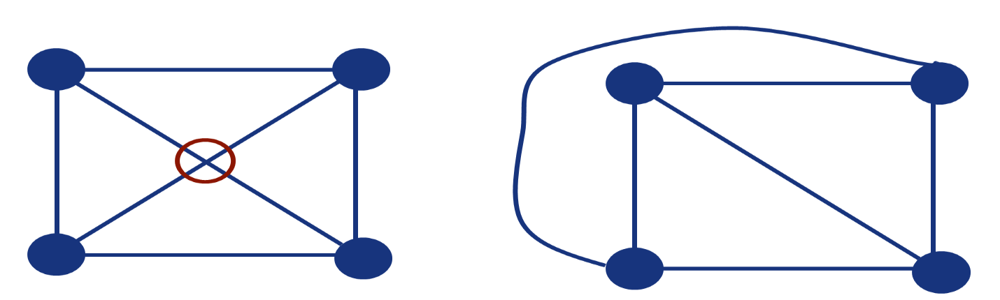

**立方体图 $`Q_3`$ 也是平面图**，可以画成两个相互嵌套的正方形，再连接对应顶点

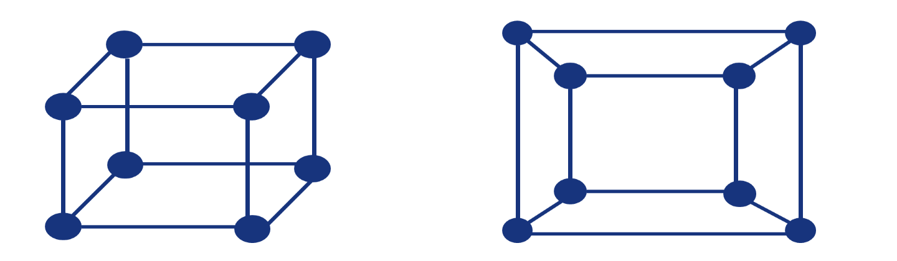

这些重画只改变顶点位置和边的形状，图本身的结构没有变

### 房屋与公用设施问题

把 3 座房屋作为一组顶点，水、电、燃气 3 种设施作为另一组顶点，每座房屋都要连接每一种设施

得到的图就是**完全二部图 $`K_{3,3}`$**

如果要求所有连接都在同一个平面内，且管线不能在非端点处交叉，那么这个任务不可能完成，因为 $`K_{3,3}`$ 是非平面图

## 二、区域与欧拉公式

### 区域怎么数

平面表示会把整个平面分成若干个**区域（面，Face）**，其中包含一个向外无限延伸的区域

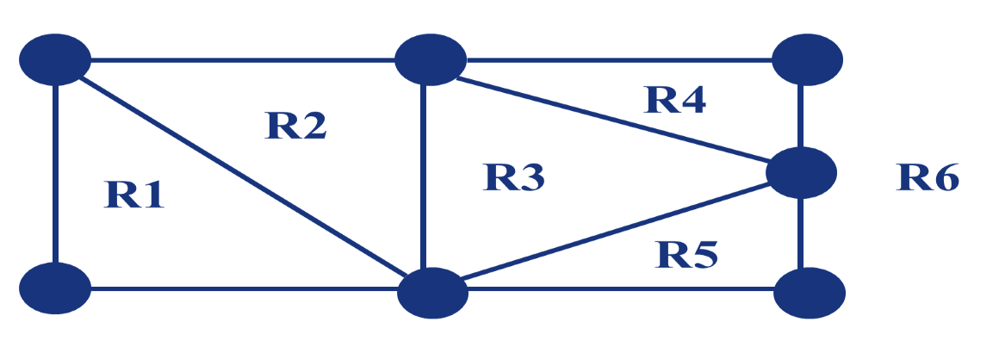

* **外部的无界区域也要算一个**，不能只数封闭图形内部的小块
* 一个圈把平面分成内外两个区域，所以区域数为 2
* 一棵树不围成封闭区域，整个平面仍然只有 1 个区域
* 无界区域也有边界，“无界”指区域向外无限延伸，不是说它没有边界

下面统一使用：

| 记号 | 含义 |
| --- | --- |
| $`v`$ | 顶点数 |
| $`e`$ | 边数 |
| $`r`$ | 区域数，包含外部区域 |
| $`c`$ | 连通分量数 |

### 欧拉公式

对**连通平面图**，有

```math
\boxed{v-e+r=2}
```

也可以写成

```math
\boxed{r=e-v+2}
```

因此，同一个连通平面图无论怎样进行平面重画，区域数都相同，因为 $`v,e`$ 没有变化

例如 $`K_4`$ 有 $`v=4,e=6`$，所以任何平面表示都有

```math
r=6-4+2=4
```

立方体图 $`Q_3`$ 有 $`v=8,e=12`$，因此

```math
r=12-8+2=6
```

> 公式的前提是图已经具有平面表示，不能拿一张边交叉的画法，直接把交叉处围出的碎块当作区域代入

### 为什么公式成立

从一个顶点开始，此时 $`v=1,e=0,r=1`$，所以 $`v-e+r=2`$

保持图连通，一条一条加入边，只有两种情况：

| 加边方式 | 顶点数变化 | 边数变化 | 区域数变化 |
| --- | --- | --- | --- |
| 从已有顶点连向一个新顶点 | $`+1`$ | $`+1`$ | 不变 |
| 连接两个已有顶点，并保持无交叉 | 不变 | $`+1`$ | $`+1`$ |

第一种情况只向某个区域伸出一条边，没有围出新区域

第二种情况会形成回路，把一个原有区域分成两块

两种情况下 $`v-e+r`$ 都不变，因此最终仍然等于 2

### 不连通时的推广

若平面图有 $`c`$ 个连通分量，则

```math
\boxed{v-e+r=1+c}
```

也就是

```math
r=e-v+1+c
```

可以在不同分量之间补上 $`c-1`$ 条不交叉的连接边，让图连通，这些边不会产生新区域，再套用连通情形的公式

例如两个互不相连的三角形，有 $`v=6,e=6,c=2`$，因此区域数为

```math
r=6-6+1+2=3
```

**看到区域数题，先确认图是否连通**

## 三、区域的度与边数限制

### 区域的度

**区域的度**是沿着这个区域的边界走一圈时，经过边的次数，记作 $`\deg(R)`$

边界不一定是没有重复的简单圈，如果同一条边在边界上出现两次，就要数两次

```math
\boxed{\sum_R\deg(R)=2e}
```

原因是每条边都有两侧，每一侧都属于一个区域

* 一条边的两侧属于不同区域时，分别给两个区域贡献 1
* **割边的两侧属于同一个区域**，因此给这个区域贡献 2

> 顶点度数之和是 $`2e`$，区域度数之和也是 $`2e`$，两种计数对象不同，但都可以用来解题

### 推论 1：一般简单平面图的边数上界

若 $`G`$ 是连通平面简单图，且 $`v\ge3`$，则

```math
\boxed{e\le3v-6}
```

**证明思路**：没有自环和多重边，且至少有 3 个顶点，每个区域的边界长度至少为 3，于是

```math
2e=\sum_R\deg(R)\ge3r
```

结合 $`r=e-v+2`$，得到

```math
2e\ge3(e-v+2)
\quad\Rightarrow\quad e\le3v-6
```

**怎么用**：如果一个简单图有 $`e>3v-6`$，就能直接证明它不是平面图

**反过来不成立！** 满足 $`e\le3v-6`$ 只是没有被这个条件排除，不代表一定是平面图

### 推论 2：至少有一个顶点的度数不超过 5

连通平面简单图中，**至少存在一个顶点**满足

```math
\boxed{\deg(x)\le5}
```

当 $`v\ge3`$ 时，由握手定理和边数上界可得

```math
\sum_{x\in V}\deg(x)=2e\le6v-12<6v
```

因此平均度数小于 6，不可能每个顶点的度数都至少为 6，所以至少有一个顶点度数不超过 5

只有 1 个或 2 个顶点的简单图，也显然满足这个结论

> **不是每个顶点的度数都不超过 5**，例如星形图可以有度数很大的中心，仍然是平面图

### 推论 3：没有三角形时的更强上界

若 $`G`$ 是连通平面简单图，$`v\ge3`$，并且**不含长度为 3 的圈**，则

```math
\boxed{e\le2v-4}
```

此时每个区域的边界长度至少为 4，所以

```math
2e=\sum_R\deg(R)\ge4r=4(e-v+2)
```

整理得到 $`e\le2v-4`$

二部图没有奇圈，当然也没有三角形，所以**平面简单二部图**可以使用这个更强的限制

| 图的条件 | 可以使用的边数上界 |
| --- | --- |
| 简单平面图，$`v\ge3`$ | $`e\le3v-6`$ |
| 简单平面图，$`v\ge3`$，不含三角形 | $`e\le2v-4`$ |
| 简单平面二部图，$`v\ge3`$ | $`e\le2v-4`$ |

以上上界也适用于不连通的简单平面图，但欧拉公式本身必须使用含 $`c`$ 的版本

## 四、两个最重要的非平面图

### 完全图 K5

$`K_5`$ 有 5 个顶点，每两个顶点之间都存在边，因此

```math
v=5,\qquad e=\frac{5\times4}{2}=10
```

如果它是平面图，应该满足 $`e\le3v-6`$，但

```math
10>3\times5-6=9
```

矛盾，所以 **$`K_5`$ 是非平面图**

### 完全二部图 K3,3

$`K_{3,3}`$ 有 $`v=6,e=9`$

先试一般上界，会发现

```math
9\le3\times6-6=12
```

这个条件满足了，却不能据此判断它平面

因为它是二部图，没有三角形，若它平面，就还必须满足

```math
e\le2v-4=2\times6-4=8
```

但实际有 9 条边，矛盾，所以 **$`K_{3,3}`$ 是非平面图**

> $`K_{3,3}`$ 同时说明：满足 $`e\le3v-6`$ 不能证明平面，选条件时还要看图有没有三角形

## 五、基本细分、同胚与库拉托夫斯基定理

### 基本细分

把一条边 $`\{u,v\}`$ 去掉，在这条边中间插入一个新顶点 $`w`$，改成两条边

```math
\{u,v\}\quad\longrightarrow\quad\{u,w\},\{w,v\}
```

这种操作称为**基本细分（Elementary Subdivision）**，新顶点的度数为 2

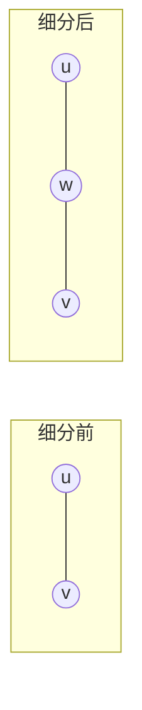

* 一次基本细分使顶点数增加 1、边数增加 1
* 只是在原来的边上多标了一个点，不会改变平面性
* 在平面表示中进行细分，不会改变区域数，也不会改变 $`v-e+r`$

反过来，如果一个度数为 2 的顶点只是某条路径的中间点，可以把它平滑掉，将两段边接成一条边

> 平滑一个度数为 2 的点，是保留原有路径的连接关系，不是直接把这个点和两条边删掉后什么都不接

### 同胚与同构的区别

**同胚（Homeomorphic）**：两个图可以由同一个图经过若干次基本细分得到

通俗地说，允许在边中间插入或平滑度数为 2 的点后，它们的结构相同

| 关系 | 顶点数、边数是否必须相同 | 允许的变化 |
| --- | --- | --- |
| 同构 | 必须相同 | 顶点重新命名、移动位置，保持邻接关系 |
| 同胚 | 不一定相同 | 还允许在边上插入或平滑度数为 2 的点 |

例如三角形 $`C_3`$ 和四边形 $`C_4`$ 顶点数不同，不同构，但在三角形的一条边中间插入一个点就得到四边形，所以它们同胚

**同胚保持平面性**，所以 $`K_5`$、$`K_{3,3}`$ 的任何细分仍然是非平面图

### 库拉托夫斯基定理

对有限图，有

```math
\boxed{
G\text{ 非平面}
\iff
G\text{ 含有与 }K_5\text{ 或 }K_{3,3}\text{ 同胚的子图}
}
```

也就是说，只要能在图中找出一个“把 $`K_5`$ 或 $`K_{3,3}`$ 的部分边拉长成路径”的结构，就能证明整个图非平面

**注意定理说的是子图**，不要求原图整体就与 $`K_5`$ 或 $`K_{3,3}`$ 同胚

* 可以先删除无关顶点和边，保留需要的结构
* 再在保留的子图中，识别哪些度数为 2 的顶点只是边上的中间点
* 原图中有额外边不影响这个证明，因为额外边可以不选入子图

### 怎样写清楚一个细分结构

如果寻找 $`K_5`$ 的细分，需要选出 **5 个分支顶点**，它们两两之间分别由路径连接，共 10 条路径

如果寻找 $`K_{3,3}`$ 的细分，需要选出两组、每组 3 个分支顶点，跨组的每一对都分别由路径连接，共 9 条路径

**这些路径的内部顶点必须两两不重叠，并且不能把其他分支顶点当作中间点**

> 不能只说“随便收缩几条边后像 $`K_5`$”，在使用同胚判据时，要明确对应的分支顶点和内部互不相交的路径

## 六、区域数与度数计算题

### 例 1：15 个顶点，每个顶点度数为 4

已知图是连通平面图，由握手定理

```math
2e=15\times4=60\quad\Rightarrow\quad e=30
```

再用欧拉公式

```math
r=e-v+2=30-15+2=\boxed{17}
```

### 例 2：12 个顶点，每个顶点度数为 3

先得到

```math
2e=12\times3=36\quad\Rightarrow\quad e=18
```

**如果图连通**，则

```math
r=18-12+2=\boxed{8}
```

如果题目只给出“平面图”，却没有连通性条件，完整答案应写成

```math
r=18-12+1+c=7+c
```

不能仅凭每个顶点度数为 3，就认定图一定连通

### 例 3：8 个顶点，6 个区域，求度数之和

已知图连通，先从欧拉公式反求边数

```math
e=v+r-2=8+6-2=12
```

再使用握手定理

```math
\sum_{x\in V}\deg(x)=2e=\boxed{24}
```

**常见套路：握手定理求边数，欧拉公式求区域数，或者反过来用**

## 七、图形判断与重画题

### 例 1：四个常见图中有几个平面图

依次考虑 $`Q_3`$、$`K_{3,3}`$、$`K_4`$、$`K_5`$

| 图 | 是否平面 | 理由 |
| --- | --- | --- |
| $`Q_3`$ | 是 | 可以画成内外两个正方形 |
| $`K_{3,3}`$ | 否 | 违反无三角形平面简单图的边数上界 |
| $`K_4`$ | 是 | 可以把一条对角线绕到外面 |
| $`K_5`$ | 否 | $`10>3\times5-6`$ |

所以一共有 **2 个平面图**

### 例 2：把两张交叉图重画成平面表示

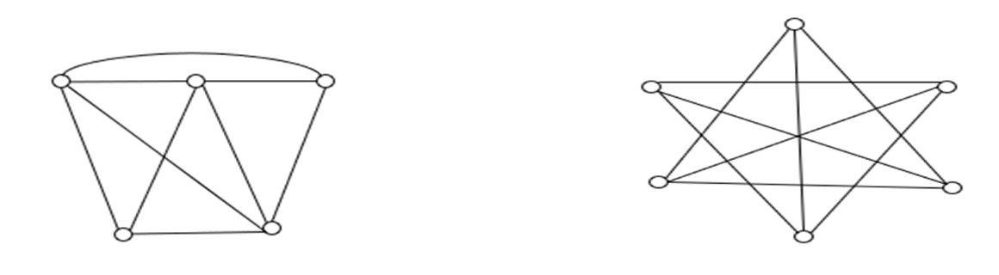

为方便核对，给原图的顶点命名：

* 左图上排从左到右为 $`A,B,C`$，下排从左到右为 $`D,E`$
* 右图最上方为 $`A`$，最下方为 $`B`$，左上、右上为 $`C,D`$，左下、右下为 $`E,F`$

下面的重画保留了各自全部顶点和边，并且没有边交叉

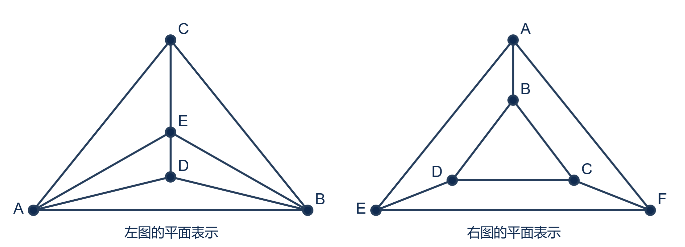

**左图的构造方法**：先画三角形 $`ABC`$，在里面放 $`E`$，连接 $`EA,EB,EC`$，再在小三角形 $`ABE`$ 内放 $`D`$，连接 $`DA,DB,DE`$

**右图的构造方法**：外面画三角形 $`AEF`$，里面画三角形 $`BDC`$，再连接 $`AB,ED,FC`$，它就是三棱柱图的一种平面表示

### 例 3：六顶点图是否平面

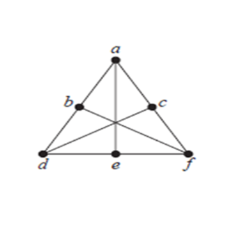

把顶点分成两组

```math
X=\{a,d,f\},\qquad Y=\{b,c,e\}
```

$`a,d,f`$ 都分别与 $`b,c,e`$ 相连，而且图中正好是这 9 条跨组边，所以这个图就是 $`K_{3,3}`$ 的一种画法

因此它是**非平面图**，三条线在中间穿过彼此的位置没有标成顶点，不能把那里当作一个新顶点

### 例 4：寻找 K5 的细分子图

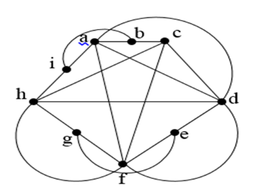

选取 5 个分支顶点

```math
\{a,c,d,f,h\}
```

在原图中保留下列 10 条连接路径，其他边不选入这个子图

| 分支顶点对 | 对应路径 |
| --- | --- |
| $`a,c`$ | $`a,b,c`$ |
| $`a,d`$ | $`a,d`$ 的直边 |
| $`a,f`$ | $`a,f`$ |
| $`a,h`$ | $`a,i,h`$ |
| $`c,d`$ | $`c,d`$ |
| $`c,f`$ | $`c,f`$ |
| $`c,h`$ | $`c,h`$ |
| $`d,f`$ | $`d,e,f`$ |
| $`d,h`$ | $`d,h`$ |
| $`f,h`$ | $`f,g,h`$ |

中间点 $`b,i,e,g`$ 互不重复，平滑掉它们后就是 $`K_5`$，因此原图**非平面**

> 先选子图，再在子图中看度数，$`b,i,e,g`$ 在原图中可能还有额外连边，不需要原图中的度数本来就是 2

### 例 5：两张非平面图的证明

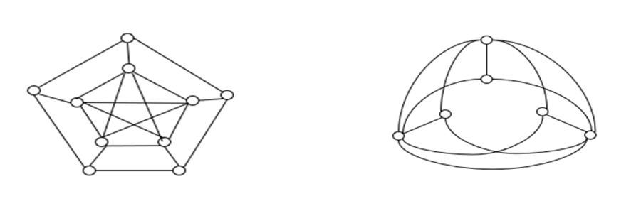

**左图是彼得森图**，可以通过删除一个外圈顶点及其关联边，找到 $`K_{3,3}`$ 的细分，具体对应方法见下一节

**右图**把最上方与左下、右下的三个顶点分为一组，把中间的三个顶点分为另一组

删除第一组内部三条连接边后，两组之间的 9 条连接边构成 $`K_{3,3}`$，因此右图也非平面

## 八、用细分结构证明非平面

### 例 1：彼得森图

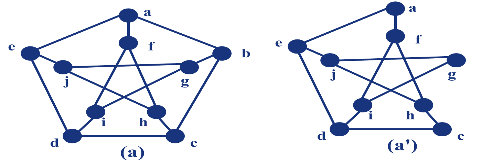

删除顶点 $`b`$ 以及以它为端点的三条边，剩余子图中选取两组分支顶点

```math
X=\{f,d,j\},\qquad Y=\{e,i,h\}
```

跨组连接可以整理成下表

| 顶点 | 到 $`e`$ 的路径 | 到 $`i`$ 的路径 | 到 $`h`$ 的路径 |
| --- | --- | --- | --- |
| $`f`$ | $`f,a,e`$ | $`f,i`$ | $`f,h`$ |
| $`d`$ | $`d,e`$ | $`d,i`$ | $`d,c,h`$ |
| $`j`$ | $`j,e`$ | $`j,g,i`$ | $`j,h`$ |

这 9 条路径的内部顶点只有 $`a,c,g`$，彼此不重叠，平滑掉这三个点就得到 $`K_{3,3}`$

所以彼得森图是**非平面图**

### 例 2：七顶点图中的 K5 细分

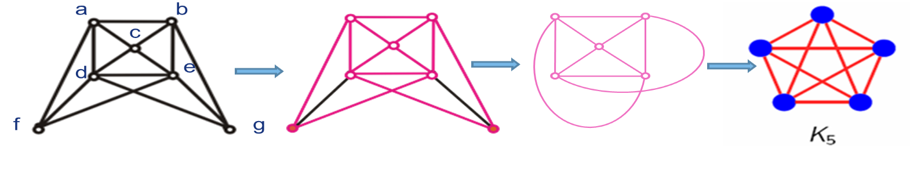

选择 $`a,b,c,d,e`$ 作为分支顶点，保留其中已有的 8 条直接连接，再用

```math
a,f,e\qquad\text{和}\qquad b,g,d
```

分别代替缺少的 $`ae`$ 和 $`bd`$ 两条边

也就是删除不需要的边 $`fd,ge`$，此时 $`f,g`$ 成为所选子图中的度数为 2 的点，再平滑它们，就得到 $`K_5`$

因此原图**非平面**

> 不能直接把 $`f,g`$ 和所有关联边删掉，那样会把需要的连接路径也删掉，这里保留的是 $`a-f-e`$ 与 $`b-g-d`$ 两条路径

### 例 3：八顶点图中的 K3,3 细分

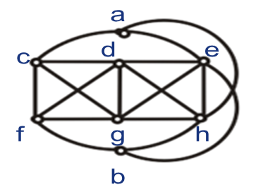

选择两组分支顶点

```math
X=\{c,g,e\},\qquad Y=\{f,d,h\}
```

保留以下跨组路径

| 顶点 | 到 $`f`$ 的路径 | 到 $`d`$ 的路径 | 到 $`h`$ 的路径 |
| --- | --- | --- | --- |
| $`c`$ | $`c,f`$ | $`c,d`$ | $`c,a,h`$ |
| $`g`$ | $`g,f`$ | $`g,d`$ | $`g,h`$ |
| $`e`$ | $`e,b,f`$ | $`e,d`$ | $`e,h`$ |

可删除的多余边为 $`cg,fd,dh,ge,ae,bh`$，然后平滑中间点 $`a,b`$，就得到 $`K_{3,3}`$

因此原图**非平面**

## 九、证明平面与证明非平面的思路

### 要证明是平面图

最直接的方法是**给出一种无交叉的平面表示**

可以先找一个圈作为外边界，再把其他顶点安排在里面或外面，把暂时造成交叉的边绕到合适的区域中

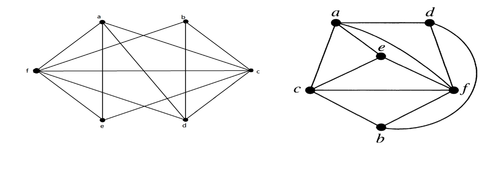

重画完要核对：

* 顶点有没有漏掉
* 每一条原有边是否都还在
* 有没有凭空多出一条边
* 边是否只在公共端点相交

### 要证明不是平面图

| 方法 | 怎么使用 |
| --- | --- |
| 一般边数上界 | 若 $`e>3v-6`$，直接矛盾 |
| 无三角形的边数上界 | 先说明无三角形，再用 $`e>2v-4`$ 得出矛盾 |
| 度数条件 | 若每个顶点度数都至少为 6，可用平均度数矛盾 |
| 库拉托夫斯基定理 | 找出 $`K_5`$ 或 $`K_{3,3}`$ 的细分子图 |

**数值条件能排除就先用数值条件，排除不了再寻找具体结构**

满足边数上界、存在低度数顶点，都只能说明尚未排除平面性，不能当成平面的充分证明

### 应用：电路连接

可以把电路元件当作顶点，元件之间的导线当作边

在单层平面布线且导线不能交叉的理想模型中，图的平面性决定是否有机会完成无交叉连接

非平面连接结构需要改变设计约束，例如使用跨线、桥接或多层连接，单靠在同一层移动元件和弯曲导线无法消除所有交叉
